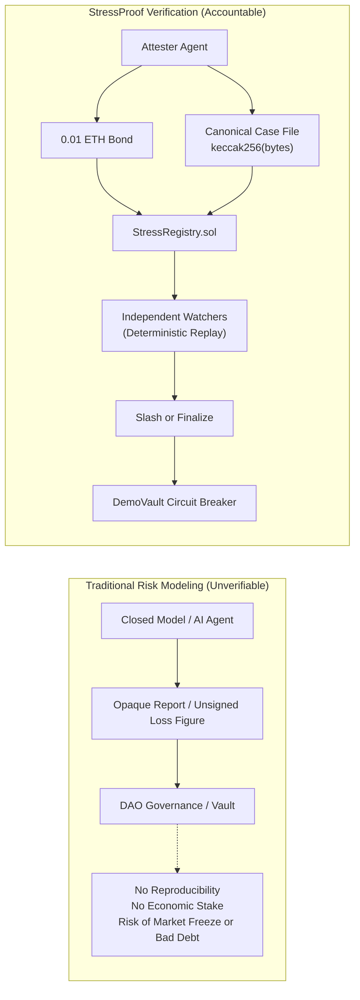
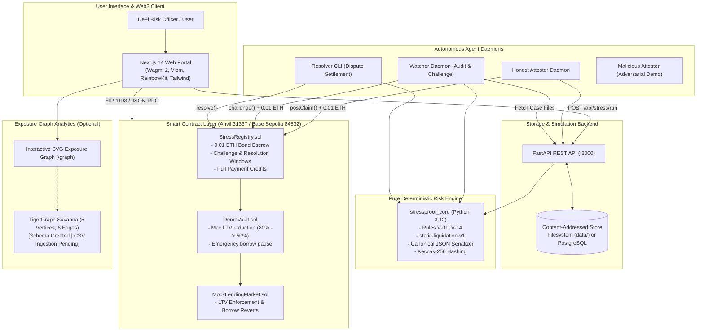
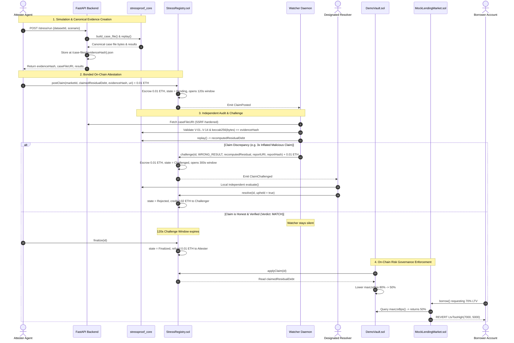
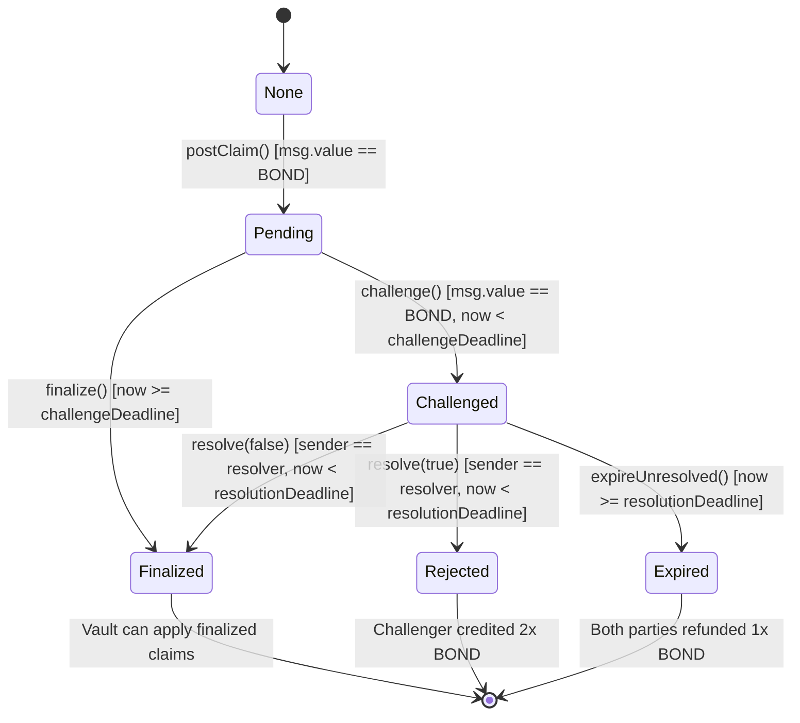
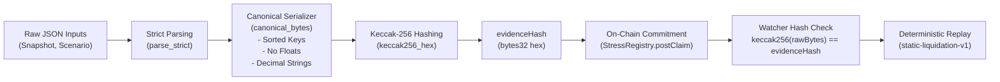
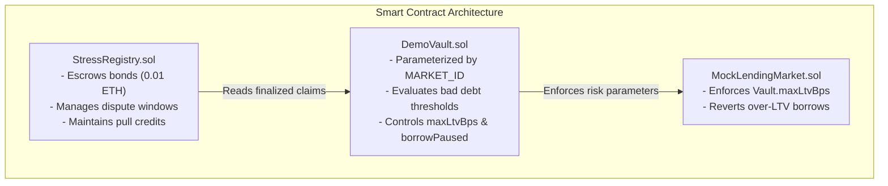
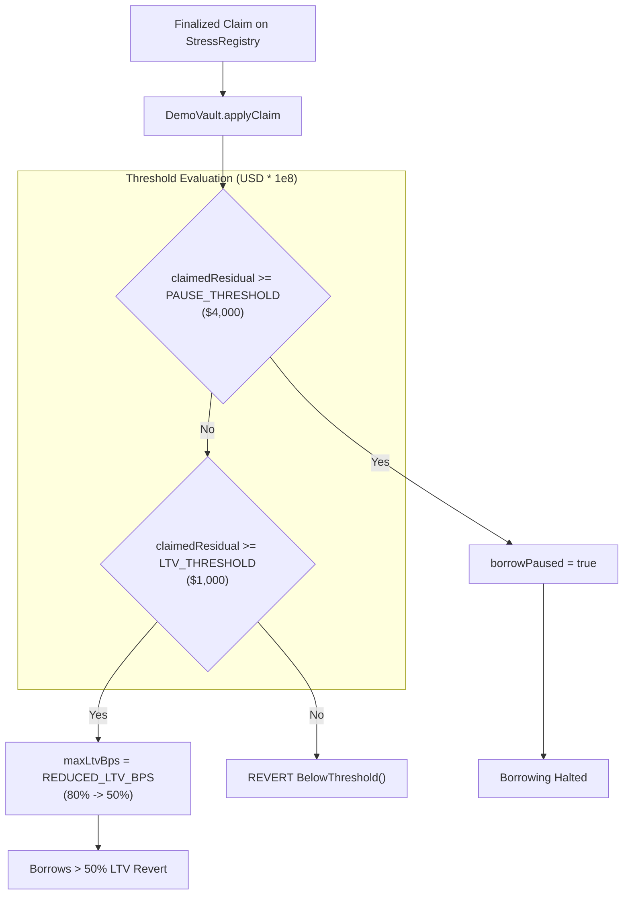
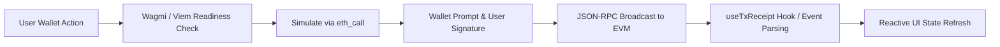
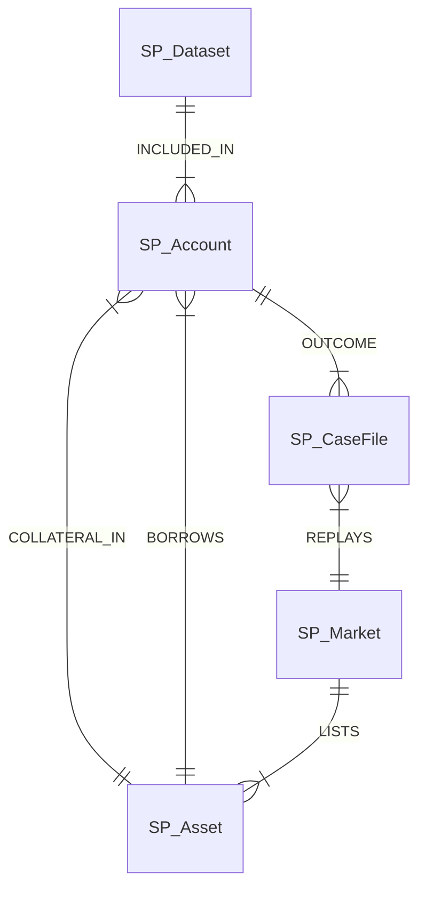

# StressProof

**Stress. Challenge. Defend.**

*An open, challengeable, evidence-backed verification protocol for AI-generated lending-market risk claims.*

[](contracts/)
[](contracts/test/)
[](core/)
[](backend/)
[](frontend/)
[](frontend/)
[](frontend/tests/)
[](LICENSE)

**Team:** Gravity
**Web Application:** [https://stress-proof.vercel.app/](https://stress-proof.vercel.app/)
**Source Repository:** [https://github.com/madhavansingh/StressProof](https://github.com/madhavansingh/StressProof)

---

> **Operational Status (October 2026):**
> The complete protocol stack is **implemented and locally verified** on Anvil (chain `31337`). All test suites pass: **Foundry 95/95**, **Pytest 770/770** (73 skipped for PostgreSQL), **Vitest 230/230**, **TypeScript strict clean**, and **GATE-24 local end-to-end 101/101**.
> **Base Sepolia deployment (chain `84532`) and testnet acceptance are PENDING** (wallets require testnet funding; contract addresses in `deployments/84532.json` are placeholders). All demonstration data uses the committed **SYNTHETIC** fixture dataset (`weth-stable-fixture-v1`, 6 synthetic borrower accounts). The TigerGraph schema is created in Savanna; CSV data ingestion is pending. See [docs/SUBMISSION.md](docs/SUBMISSION.md) and [docs/DEMO_GUIDE.md](docs/DEMO_GUIDE.md).

---

## Table of Contents

- [1. Executive Overview](#1-executive-overview)
- [2. The Problem: The Trust Gap in DeFi Risk Intelligence](#2-the-problem-the-trust-gap-in-defi-risk-intelligence)
- [3. Protocol Design Principles](#3-protocol-design-principles)
- [4. High-Level System Architecture](#4-high-level-system-architecture)
- [5. Protocol Claim Lifecycle](#5-protocol-claim-lifecycle)
- [6. Claim State Machine](#6-claim-state-machine)
- [7. Cryptographic Evidence Pipeline](#7-cryptographic-evidence-pipeline)
- [8. Smart Contract Architecture](#8-smart-contract-architecture)
- [9. Autonomous Off-Chain Agent Suite](#9-autonomous-off-chain-agent-suite)
- [10. Lending & Vault Risk Enforcement](#10-lending--vault-risk-enforcement)
- [11. Backend API Architecture](#11-backend-api-architecture)
- [12. Frontend Portal Architecture](#12-frontend-portal-architecture)
- [13. Exposure Graph & TigerGraph Analytics](#13-exposure-graph--tigergraph-analytics)
- [14. Security Architecture & Threat Analysis](#14-security-architecture--threat-analysis)
- [15. Repository Structure](#15-repository-structure)
- [16. Verified Technology Stack](#16-verified-technology-stack)
- [17. Local Development & Setup](#17-local-development--setup)
- [18. Testing & Verification Suites](#18-testing--verification-suites)
- [19. End-to-End Demo Walkthrough](#19-end-to-end-demo-walkthrough)
- [20. Protocol Limitations & Engineering Roadmap](#20-protocol-limitations--engineering-roadmap)
- [21. Governance, Contributing & License](#21-governance-contributing--license)
- [22. Documentation Reference Map](#22-documentation-reference-map)

---

## 1. Executive Overview

**StressProof** is a bonded verification and dispute resolution protocol designed to make AI-generated lending-market risk claims reproducible, challengeable, and economically accountable.

In decentralized lending protocols (such as Aave, Compound, and Morpho), governance parameters—including Maximum Loan-to-Value (Max LTV) ratios, liquidation thresholds, and emergency borrow pauses—are routinely adjusted based on off-chain stress simulations. As autonomous AI agents increasingly take over financial modeling, lending DAOs face a critical dilemma: **how can a smart contract or governance council trust an off-chain risk projection when evaluating the simulation is too computationally expensive for the EVM?**

StressProof solves this dilemma through **optimistic bonded assertions backed by deterministic cryptographic evidence**:
1. **Bonded Commitment:** An attester (an AI risk agent or analyst) stakes an economic bond ($0.01\text{ ETH}$) to assert a market risk claim on-chain (e.g., *"a $-30\%$ WETH price collapse creates $\$2,000$ of residual bad debt in this market"*), committing to the Keccak-256 hash of a complete, canonical case file.
2. **Pure Deterministic Replay:** The case file contains the exact borrower snapshot, market parameters, and price shock. Anyone can fetch the file, verify its byte hash, and execute a pure integer liquidation calculation (`static-liquidation-v1`). The replay operates with zero network lookups, zero clock dependency, and zero floating-point math: **identical inputs always yield identical bytes and identical output**.
3. **Independent Watcher Challenges:** Independent watcher daemons audit all pending claims during a $120\text{ s}$ challenge window. If the replayed bad debt differs from the claimed amount (`WRONG_RESULT`) or the evidence is malformed (`EVIDENCE_INVALID`), the watcher posts a matching $0.01\text{ ETH}$ bond to challenge.
4. **Economic Settlement:** A dispute resolver evaluates the mathematical replay. The winner receives both bonds ($0.02\text{ ETH}$). If unaddressed, claims safely expire with full refunds via pull payments.
5. **Direct On-Chain Risk Governance:** An unchallenged or upheld claim finalizes and can be consumed by connected lending vaults (`DemoVault`), which dynamically tighten risk parameters (reducing max LTV from $80\%$ to $50\%$) or activate emergency circuit breakers (pausing borrowing) on the underlying market (`MockLendingMarket`).

---

## 2. The Problem: The Trust Gap in DeFi Risk Intelligence



### The Anatomy of Lending Market Insolvency
When collateral assets suffer sharp market sell-offs:
- Health factors collapse below $1.0$, making accounts eligible for liquidation.
- If collateral value minus liquidation bonuses cannot cover debt, the protocol accumulates **residual bad debt**.
- If risk parameters are set too loose, cascading liquidations cause protocol insolvency.
- If risk parameters are set too tight based on erroneous models, borrowing freezes and liquidity flees.

### The Problem of Trusting the Computation
Evaluating complex lending-market simulations directly on-chain is cost-prohibitive. Off-chain risk analysis is therefore mandatory, but unbonded off-chain reports introduce severe vulnerabilities:
- **No Verification:** Stakeholders cannot verify whether an analyst dropped delinquent accounts or altered liquidation thresholds.
- **Zero Cost for Hallucination:** Autonomous AI agents publishing erroneous projections suffer no financial penalties.
- **Asymmetric Downside:** Lending vaults absorb millions in bad debt while the risk reporter walks away unscathed.

StressProof creates an economic game where publishing a false claim is strictly negative-EV, while running an independent watcher to challenge dishonesty is reliably profitable.

---

## 3. Protocol Design Principles

- **Deterministic Evaluation:** The calculation model (`static-liquidation-v1`) uses strict integer floor division. Floating-point numbers are prohibited in serialization and computation.
- **Canonical Evidence:** Evidence bytes follow strict canonical JSON ordering (lexicographically sorted keys, no trailing whitespace, decimal strings for amounts). Byte arrays are hashed directly without re-serialization.
- **Cryptographic Commitments:** Claims commit to raw byte Keccak-256 hashes (`evidenceHash`). The smart contract never parses JSON; it validates hash equality.
- **Bonded Economic Accountability:** Every claim and challenge requires an escrowed capital bond ($0.01\text{ ETH}$). Dishonest attesters are slashed; diligent challengers are rewarded $2\times\text{BOND}$.
- **Independent Verification:** Any party can fetch the content-addressed case file and independently audit the claim.
- **Optimistic Dispute Settlement:** Claims finalize automatically if unchallenged after the challenge window ($120\text{ s}$).
- **On-Chain Risk Enforcement:** Finalized risk metrics directly parameterize connected smart contracts, modifying LTV caps and borrow pauses without human governance delays.
- **Explicit Trust Boundaries:** Untrusted inputs (LLM outputs, client URIs) are strictly isolated from deterministic validation and settlement logic.
- **Transparent Failure States:** If an evidence URI is unreachable or unparseable, it is treated as `EVIDENCE_INVALID` and slashed. If a resolver goes offline, funds expire safely with full refunds.

---

## 4. High-Level System Architecture



---

## 5. Protocol Claim Lifecycle



---

## 6. Claim State Machine

The smart contract `StressRegistry.sol` strictly enforces the following finite state transitions:



### State Definitions & Caller Permissions

| State | Enum ID | Condition / Active Window | Permitted Transition Callers |
|---|---|---|---|
| `None` | `0` | Default uninitialized state for non-existent IDs. | Anyone via `postClaim()` with exact $0.01\text{ ETH}$ bond. |
| `Pending` | `1` | Claim posted; active challenge window ($120\text{ s}$). | Anyone except attester via `challenge()`; anyone via `finalize()` after window expires. |
| `Challenged` | `2` | Claim disputed; active resolution window ($300\text{ s}$). | Designated `resolver` via `resolve()`; anyone via `expireUnresolved()` after deadline. |
| `Finalized` | `3` | Claim verified honest (unchallenged or challenge rejected). | Terminal state. Can be applied to `DemoVault`. Attester refunded/rewarded. |
| `Rejected` | `4` | Challenge upheld (claim dishonest or malformed). | Terminal state. Challenger credited $2\times\text{BOND}$. Claim cannot affect vaults. |
| `Expired` | `5` | Resolver inactive during resolution window. | Terminal state. Both parties refunded their $0.01\text{ ETH}$ bond. |

---

## 7. Cryptographic Evidence Pipeline



### 7.1. Canonical JSON Specification
To prevent hash malleability across heterogeneous environments:
- **Encoding:** Strict UTF-8.
- **Key Sorting:** All JSON object keys are sorted lexicographically by Unicode codepoints.
- **Whitespace:** Strict delimiters `","` and `":"` with zero spaces.
- **Float Prohibition:** Floating-point numbers are prohibited. All monetary and balance quantities are represented as positive integer strings (e.g., `"2000000000000"` for $20,000\text{ USD}$ scaled to $10^8$).

### 7.2. Keccak-256 vs. NIST SHA-3
StressProof uses Ethereum's native **Keccak-256** (padding `0x01`), **NOT** NIST FIPS 202 SHA-3 (padding `0x06`). This allows zero-cost verification inside EVM smart contracts:
$$\text{keccak256}(\text{b""}) = \text{0xc5d2460186f7233c927e7db2dcc703c0e500b653ca82273b7bfad8045d85a470}$$

### 7.3. The Deterministic Replay Model (`static-liquidation-v1`)
Liquidation math is implemented strictly in integer floor division:
1. **Shocked Collateral Price:**
   $$P_{\text{shocked}} = \left\lfloor \frac{P_{\text{initial}} \times (10,000 + \text{shockBps})}{10,000} \right\rfloor$$
2. **Collateral Valuation:**
   $$C_{\text{usd8}} = \left\lfloor \frac{\text{collateralAmount} \times P_{\text{shocked}}}{10^{\text{decimals}}} \right\rfloor$$
3. **Liquidation Threshold Invariant (Health Factor < 1.0):**
   $$\left\lfloor \frac{C_{\text{usd8}} \times \text{ltBps}}{10,000} \right\rfloor < \text{debtUsd8}$$
4. **Repaid Debt & Residual Bad Debt:**
   $$\text{repaidUsd8} = \min\left(\text{debtUsd8}, \left\lfloor \frac{C_{\text{usd8}} \times 10,000}{\text{bonusBps}} \right\rfloor\right)$$
   $$\text{residualBadDebtUsd8} = \text{debtUsd8} - \text{repaidUsd8}$$

---

## 8. Smart Contract Architecture



### Contract Interfaces & Capabilities

#### 1. `StressRegistry.sol` (Implements `IStressRegistry`)
- `postClaim(bytes32 marketId, uint256 claimedResidualBadDebt, bytes32 evidenceHash, string calldata uri) payable returns (uint256)`: Staking $0.01\text{ ETH}$, opens $120\text{ s}$ challenge window.
- `challenge(uint256 id, Reason reason, uint256 counterResidualBadDebt, string calldata reportURI, bytes32 reportHash) payable`: Staking $0.01\text{ ETH}$, disputes a pending claim.
- `finalize(uint256 id)`: Transitions unchallenged claim to `Finalized` and refunds attester bond.
- `resolve(uint256 id, bool upheld)`: Callable only by `resolver`. Awards $2\times\text{BOND}$ to winner.
- `expireUnresolved(uint256 id)`: Refunds both parties if resolver fails to act within $300\text{ s}$.
- `withdraw()`: Pull-payment withdrawal. Zeroes `credits[msg.sender]` before executing ether transfer.

#### 2. `DemoVault.sol`
- `applyClaim(uint256 claimId)`: Evaluates a finalized claim. If residual bad debt $\ge \$4,000$ (`PAUSE_THRESHOLD`), sets `borrowPaused = true`. If residual bad debt $\ge \$1,000$ (`LTV_THRESHOLD`), lowers `maxLtvBps` from $80\%$ down to $50\%$. Reverts if claim was already applied.
- `resetControls()`: Owner-only escape hatch to restore borrowing after market recovery.

#### 3. `MockLendingMarket.sol`
- `borrow(uint256 collateralUsd8, uint256 amountUsd8)`: Enforces ceiling LTV math:
  $$\text{requestedLtv} = \left\lfloor \frac{\text{amountUsd8} \times 10,000 + \text{collateralUsd8} - 1}{\text{collateralUsd8}} \right\rfloor$$
  Reverts with `LtvTooHigh` if requested LTV exceeds `vault.maxLtvBps()`.

---

## 9. Autonomous Off-Chain Agent Suite

The `agents/` workspace provides autonomous Python daemons implementing protocol roles:

| Agent Daemon | Entry Point / Command | Core Functionality | Failure Handling |
|---|---|---|---|
| **Honest Attester** | `python -m stressproof_agents.attester.main run --auto-finalize` | Solicits simulation from backend, validates case file via `stressproof_core`, simulates `postClaim`, broadcasts with bond, and finalizes. | Aborts before signing if self-check does not yield `MATCH`. |
| **Watcher Daemon** | `python -m stressproof_agents.watcher.main` | Continuously polls registry for `Pending` claims, fetches evidence via SSRF-safe client, replays calculation, and submits `challenge()`. | Retries fetching until $30\text{ s}$ before deadline; challenges `EVIDENCE_INVALID` on fetch failure. |
| **Resolver CLI** | `python -m stressproof_agents.resolver.cli resolve <id> --send` | Operator CLI to assess disputed claims, independently fetch evidence, execute replayer, and broadcast resolution. | Requires interactive typing `UPHOLD <id>` or `REJECT <id>` unless `--yes` is passed. |
| **Malicious Attester** | `python -m stressproof_agents.malicious.main` | Demo agent that publishes an intentionally inflated claim ($3\times R$) to verify watcher slashing capabilities. | Signs and submits adversarial claims for live testing. |

---

## 10. Lending & Vault Risk Enforcement



### Risk Parameter Configurations (Local Deployment)

| Parameter | Value | Scaled Representation | Description |
|---|---|---|---|
| `LTV_THRESHOLD` | $\$1,000.00$ | `100000000000` | Bad debt required to trigger LTV reduction. |
| `PAUSE_THRESHOLD` | $\$4,000.00$ | `400000000002` | Bad debt required to activate emergency borrow pause. |
| `DEFAULT_MAX_LTV_BPS` | $80.00\%$ | `8000` | Standard borrowing capacity. |
| `REDUCED_LTV_BPS` | $50.00\%$ | `5000` | Defended borrowing capacity after finalized risk claim. |
| Honest Residual $R$ | $\$2,000.00$ | `200000000001` | Residual bad debt from $-30\%$ WETH shock on fixture dataset. |

---

## 11. Backend API Architecture

The FastAPI service (`backend/`) acts as the content-addressed evidence store and simulation coordinator:

| Method | Endpoint | Description | Auth / Security | Status |
|---|---|---|---|---|
| `GET` | `/health` | Service health, version, registered datasets, storage backend. | Public | Operational |
| `GET` | `/datasets` | Lists registered snapshot datasets. | Public | Operational |
| `GET` | `/datasets/{id}/manifest` | Returns raw dataset manifest JSON bytes. | Public | Operational |
| `POST` | `/stress/run` | Builds case file, executes core replayer, stores raw bytes. | `Bearer $API_WRITE_TOKEN` | Operational |
| `GET` | `/case-files/{hash}` | Returns exact immutable raw case file JSON bytes. | Public (`X-Content-Keccak256`) | Operational |
| `POST` | `/case-files` | Ingests pre-built case file, validates V-01..V-13, stores by hash. | `Bearer $API_WRITE_TOKEN` | Operational |
| `GET` | `/replay-outputs/{hash}` | Returns per-account outcome JSONL derived records. | Public (`X-Evidence-Hash`) | Operational |
| `GET` | `/replay-reports/{hash}` | Returns watcher dispute report JSON bytes. | Public (`X-Content-Keccak256`) | Operational |
| `GET` | `/feed` | Returns recent protocol telemetry events (feed.jsonl). | Public | Operational |
| `GET` | `/graph/exposure` | Queries TigerGraph Savanna for exposure analytics. | Public (Answers 503 while TG unconfigured) | Built / Offline |
| `GET` | `/graph/tigergraph/health` | Read-only connection check for TigerGraph Savanna. | Public | Built / Offline |

---

## 12. Frontend Portal Architecture

The frontend (`frontend/`) is built on **Next.js 14 App Router**, **Tailwind CSS**, and **Wagmi 2 / Viem**:



### Verified Application Routes

| Route | View Name | Key Capabilities |
|---|---|---|
| `/` | Landing Page | Protocol value proposition, architecture overview, direct portal entry. |
| `/dashboard` | Protocol Dashboard | Live on-chain vault parameters, total claims count, recent attestations. |
| `/stress` | Stress Simulator | Configurable shock slider, execution trigger, one-click bonded publication. |
| `/claims` | Claims Registry | Filterable claims table, active challenge countdown timers, challenge modals. |
| `/claims/[id]` | Claim Dossier | In-browser Keccak-256 evidence verifier, case file inspection, vault application trigger. |
| `/vault` | Circuit Breaker | Live LTV monitor, interactive borrow simulator proving `LtvTooHigh` reverts. |
| `/feed` | Protocol Telemetry | Real-time event log tracking simulations, claims, challenges, and resolutions. |
| `/graph` | Exposure Graph | Interactive SVG canvas rendering accounts, assets, markets, and case files. |

---

## 13. Exposure Graph & TigerGraph Analytics

StressProof features an interactive visual graph representation of lending market risk:



### 1. In-Browser Interactive Replay Graph (`/graph`, WP-6)
- **Status:** **Operational**.
- **Data Source:** Constructed client-side by combining hash-verified case files (`GET /case-files/{hash}`) and per-account output records (`GET /replay-outputs/{hash}`).
- **Integrity Audit:** Recomputes total liquidatable accounts, debt at risk, liquidation volume, and residual bad debt directly from the accounts array and compares against committed totals.
- **Visual Distinction:** Distinctly marked with an amber badge: **SYNTHETIC FIXTURE DATA (Local Replay, not TigerGraph)**.

### 2. TigerGraph Savanna Analytics Integration (WP-2..5)
- **Status:** **Schema Created in Savanna; CSV Data Loading Pending**.
- **Schema (`tigergraph/schema.gsql`):** 5 vertex types (`SP_Dataset`, `SP_Market`, `SP_Asset`, `SP_Account`, `SP_CaseFile`) and 6 edge types.
- **Analytics Query (`tigergraph/queries/sp_exposure.gsql`):** Performs graph traversals to identify asset concentration risks and cascading borrower insolvencies.
- **UI State:** When TigerGraph is not connected, `/graph` displays a transparent notice: **TIGERGRAPH UNAVAILABLE**. TigerGraph query results never affect on-chain dispute verdicts.

---

## 14. Security Architecture & Threat Analysis

StressProof implements comprehensive defensive mitigations against modeled threats:

| Threat Category | Specific Attack Vector | Enforced Mitigation |
|---|---|---|
| **Reentrancy** | Reentrancy during bond withdrawal (S-01) | Checks-effects-interactions; pull payments only; credits balance zeroed before external call. |
| **Bond Tampering** | Incorrect ether sent on post/challenge (S-02) | Strict equality check: `msg.value == BOND`. Over/underpayments revert with `WrongBond`. |
| **SSRF** | Hostile `caseFileURI` targeting metadata/private IPs (S-06) | IP denylisting (RFC 1918, link-local `169.254.0.0/16`, loopback); redirects blocked; 25 MB cap. |
| **Hash Malleability** | Altering formatting to forge commitments (S-08) | Strict canonical JSON serializer; raw byte hashing; float prohibition; strict key sorting. |
| **Path Traversal** | Directory traversal via evidence hash parameters (S-09) | Regex validation: hash must strictly match `^0x[0-9a-f]{64}$`. |
| **Token Exposure** | Leaking backend write token in client bundle (S-16) | Next.js API route `/api/stress/run` acts as a server-side BFF proxy; write token never sent to browser. |
| **Supply Chain** | Vulnerable dependencies in npm / Python (S-13) | Socket security scans (`scripts/socket_scan.sh`); Vitest upgraded to 4.1.12; Next.js image optimizer disabled. |

---

## 15. Repository Structure

```text
StressProof/
├── agents/             # Autonomous agent daemons (attester, watcher, resolver, malicious)
├── backend/            # FastAPI REST backend and content-addressed storage
├── contracts/          # Foundry Solidity smart contracts (StressRegistry, DemoVault, MockLendingMarket)
├── core/               # stressproof_core: deterministic replay engine & validation rules V-01..V-14
├── data/               # Content-addressed case files, feed logs, and golden synthetic fixtures
├── deployments/        # Active contract addresses (31337.json local, 84532.json testnet)
├── docs/               # Technical specifications, architecture blueprints, threat models, guides
├── frontend/           # Next.js 14 Web3 application (App Router, Wagmi 2, Viem, Tailwind)
├── pipeline/           # Aave v3 archive snapshot extraction and normalization pipeline
├── scripts/            # Deployment scripts, E2E gate harness (GATE-24), Socket supply-chain scanner
├── tigergraph/         # TigerGraph Savanna GSQL schema, analytics queries, synthetic CSVs
├── Makefile            # Project orchestration commands
└── pyproject.toml      # Root Python workspace configuration (uv)
```

See [docs/REPOSITORY_STRUCTURE.md](docs/REPOSITORY_STRUCTURE.md) for the complete annotated module map.

---

## 16. Verified Technology Stack

| Layer | Technology | Verified Version | Purpose |
|---|---|---|---|
| **Smart Contracts** | Solidity | `0.8.24` | Core escrow, registry, and vault circuit breakers. |
| **Smart Contract Tooling** | Foundry (Forge/Anvil) | `forge 1.8.6` | Contract compilation, testing, fuzzing, and local EVM node. |
| **Deterministic Engine** | Python | `3.12.15` | Pure integer liquidation math and canonical hashing. |
| **Package Management (Py)**| Astral `uv` | `0.4.x` | Monorepo Python workspace resolution and locking. |
| **Backend Framework** | FastAPI | `0.115.x` | Content-addressed storage API and feed server. |
| **Frontend Framework** | Next.js (App Router) | `14.2.35` | Web portal and server-side BFF proxy. |
| **Web3 Client Libraries** | Wagmi / Viem | `wagmi 2.14.x`, `viem 2.21.x` | Typesafe contract interaction and wallet management. |
| **Frontend Testing** | Vitest | `4.1.12` | Fast component, hash verification, and unit testing. |
| **Graph Database** | TigerGraph Savanna | GSQL 4.x | Exposure graph analytics (schema created, data pending). |

---

## 17. Local Development & Setup

### Prerequisites
- Node.js LTS (`v20+`) and `pnpm` (`npm install -g pnpm`)
- Python `3.11+` and `uv` (`curl -LsSf https://astral.sh/uv/install.sh | sh`)
- Foundry (`curl -L https://foundry.paradigm.xyz | bash && foundryup`)

### Step-by-Step Local Deployment
```bash
# 1. Bootstrap Python & Frontend Workspaces
uv sync
cd frontend && pnpm install && cd ..

# 2. Configure Environment Files
cp .env.example .env
cp frontend/.env.example frontend/.env

# 3. Launch Local Stack (one terminal each)
make chain          # Terminal 1: Anvil EVM node on 127.0.0.1:8546 (Chain 31337)
make deploy-local   # Terminal 2: Deploys contracts, writes deployments/31337.json
make backend        # Terminal 3: FastAPI backend on 127.0.0.1:8000
make web            # Terminal 4: Next.js frontend on http://localhost:3000
make watcher        # Terminal 5: Autonomous watcher daemon
```

See [docs/DEVELOPMENT.md](docs/DEVELOPMENT.md) for detailed environment configuration and troubleshooting.

---

## 18. Testing & Verification Suites

All test suites have been executed and verified locally:

| Domain | Test Suite Command | Tests Passed | Tests Failed / Skipped | Notes |
|---|---|---|---|---|
| **Smart Contracts** | `cd contracts && forge test` | **95 passed** | 0 failed | 6 suites; includes 25,600 fuzz invariant calls. |
| **Python Workspaces** | `uv run pytest` | **770 passed** | 73 skipped | Core, agents, backend, pipeline; skipped need PostgreSQL. |
| **Frontend Unit** | `cd frontend && npx vitest run` | **230 passed** | 0 failed | 25 test files; hash verifier, graph layout, wallet guards. |
| **Type Integrity** | `cd frontend && npx tsc --noEmit` | **Clean** | 0 errors | Strict TypeScript compilation. |
| **Production Build** | `cd frontend && npx next build` | **Clean** | 0 errors | All 11 static and dynamic routes compiled. |
| **Local E2E Gate** | `make e2e` (`scripts/e2e_local.sh`) | **101/101 passed**| 0 failed | Automated honest claim, dispute, and vault borrow gate. |

---

## 19. End-to-End Demo Walkthrough

A complete demonstration of StressProof takes approximately 5 minutes:

```mermaid
flowchart LR
    Step1["1. Dashboard<br/>Inspect live vault LTV"] --> Step2["2. Stress Simulation<br/>Run -3000 bps WETH shock"]
    Step2 --> Step3["3. Publish Claim<br/>Stake 0.01 ETH on Anvil"]
    Step3 --> Step4["4. Verify Evidence<br/>In-browser keccak256 hash check"]
    Step4 --> Step5["5. Adversarial Challenge<br/>make evil -> Watcher challenges"]
    Step5 --> Step6["6. Dispute Resolution<br/>make resolve ID=<id> upholds dispute"]
    Step6 --> Step7["7. Finalize & Defend<br/>DemoVault reduces LTV to 50%"]
    Step7 --> Step8["8. Borrow Revert<br/>Borrow at 70% LTV reverts LtvTooHigh"]
```



1. **Open Dashboard:** Navigate to `http://localhost:3000/dashboard`. Observe initial vault limits ($80\%$ max LTV, borrow active).
2. **Execute Simulation:** Navigate to `/stress` and click **Run Stress Simulation**. The core engine identifies 4 liquidatable accounts and $\$2,000.00$ residual bad debt.
3. **Publish Claim:** Connect MetaMask on Anvil Local (`31337`) and click **Publish Bonded Claim**. Sign the transaction staking $0.01\text{ ETH}$.
4. **Audit Evidence:** Open the published claim at `/claims/[id]`. The browser automatically fetches raw bytes and computes Keccak-256: **KECCAK256 INTEGRITY VERIFIED**.
5. **Adversarial Challenge Demo:** In a terminal, run `make evil`. A malicious attester posts an inflated claim ($3\times R$). The running watcher daemon audits the claim, detects the discrepancy, uploads a replay report, and broadcasts an on-chain challenge.
6. **Settle Dispute:** In a terminal, run `uv run -m stressproof_agents.resolver.cli resolve <id> --send`. The resolver independently replays the evidence and upholds the challenge, slashing the dishonest attester.
7. **Apply Vault Defense:** After an honest claim's $120\text{ s}$ challenge window expires, finalize it and click **Apply Claim to Vault**. Max LTV is lowered from $80\%$ to $50\%$.
8. **Simulate Borrow Revert:** Navigate to `/vault` and click **Execute Borrow Simulation** (requesting a $70\%$ LTV loan). The smart contract reverts with `LtvTooHigh(7000, 5000)`.

See [docs/DEMO_GUIDE.md](docs/DEMO_GUIDE.md) for the detailed step-by-step presentation script.

---

## 20. Protocol Limitations & Engineering Roadmap

### Disclosed MVP Limitations
1. **Pending Testnet Deployment:** The contracts are verified locally on Anvil (chain `31337`). Deployment to Base Sepolia (chain `84532`) is pending wallet funding.
2. **Synthetic Demonstration Fixture:** All demonstration scenarios use a committed 6-account synthetic fixture (`weth-stable-fixture-v1`).
3. **Pending TigerGraph Data Ingestion:** The TigerGraph Savanna schema is created, but live CSV data loading is pending. The frontend displays local deterministic replay graphs.
4. **Designated Resolver in MVP:** Disputes are arbitrated by a designated resolver address running the replayer.
5. **Simplified Liquidation Model:** `static-liquidation-v1` assumes single-pass liquidations without order-book slippage.

### Post-Submission Engineering Roadmap
- [ ] **Phase 2.1 (Immediate):** Fund Base Sepolia deployer and execute `make deploy-testnet` to complete GATE-24.
- [ ] **Phase 2.2:** Ingest synthetic CSV data into TigerGraph Savanna and enable live `/graph/exposure` analytics.
- [ ] **Phase 2.3:** Implement autonomous LLM scenario proposer (WP-7) with strict JSON schema validation.
- [ ] **Phase 3.1:** Upgrade frontend to Next.js 15.5.28+ to eliminate residual App Router security advisories.
- [ ] **Phase 3.2:** Replace designated resolver with interactive zk-fraud-proof verifiers (RISC Zero / Cartesi).
- [ ] **Phase 3.3:** Transition from fixed bonds to dynamic market-scaled capital bonding.

---

## 21. Governance, Contributing & License

StressProof is a single-owner open-source protocol project maintained by **Team Gravity**. See [CONTRIBUTING.md](CONTRIBUTING.md) for pull request guidelines, commit standards, and branch policies.

### License
This project is licensed under the **MIT License** — see [LICENSE](LICENSE) for details.

---

## 22. Documentation Reference Map

| Document | Description |
|---|---|
| [docs/ARCHITECTURE.md](docs/ARCHITECTURE.md) | Complete system architecture, C4 diagrams, container topology, and failure modes. |
| [docs/PROTOCOL_DESIGN.md](docs/PROTOCOL_DESIGN.md) | Protocol design, game-theoretic bonding models, state machines, and mathematical invariants. |
| [docs/CRYPTOGRAPHIC_EVIDENCE.md](docs/CRYPTOGRAPHIC_EVIDENCE.md) | Canonical serialization, Keccak-256 hashing, replay algorithm, and validation catalogue. |
| [docs/SECURITY_MODEL.md](docs/SECURITY_MODEL.md) | Comprehensive threat model (S-01..S-16), SSRF defenses, and supply-chain audits. |
| [docs/DEVELOPMENT.md](docs/DEVELOPMENT.md) | Developer onboarding, local stack setup, environment variables, and troubleshooting. |
| [docs/REPOSITORY_STRUCTURE.md](docs/REPOSITORY_STRUCTURE.md) | Annotated directory tree, package boundaries, entry points, and module responsibilities. |
| [docs/DATA_FLOW.md](docs/DATA_FLOW.md) | End-to-end data flow specifications and detailed Mermaid sequence diagrams. |
| [docs/DEMO_GUIDE.md](docs/DEMO_GUIDE.md) | Step-by-step evaluator presentation guide and demo execution walkthrough. |
| [docs/SUBMISSION.md](docs/SUBMISSION.md) | Hackathon evaluator summary, verified deliverable status, and verification evidence. |
