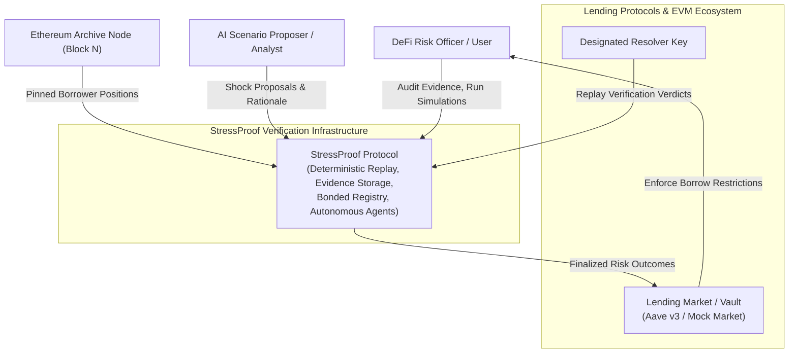
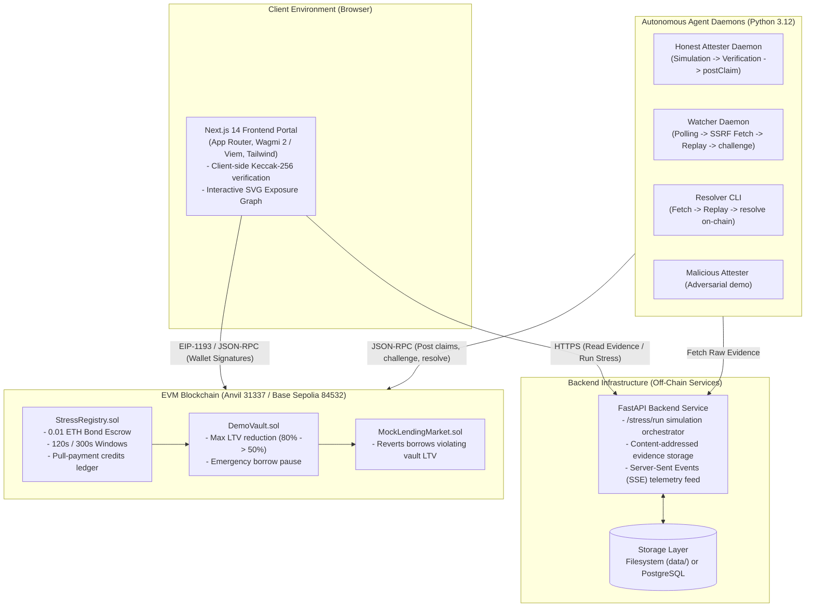
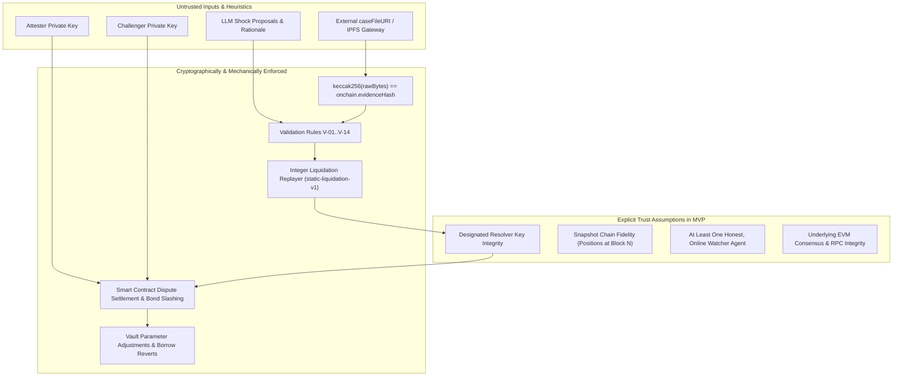

# StressProof: System Architecture & Technical Specification

This document provides the definitive architectural specification for **StressProof**, detailing the system context, container topology, subsystem component designs, runtime network boundaries, trust models, and failure modes.

---

## 1. System Context (C4 Level 1)

StressProof bridges off-chain decentralized risk intelligence and on-chain capital protection in lending markets:



---

## 2. Container Architecture (C4 Level 2)

The system consists of five distinct deployable containers across off-chain, client-side, and on-chain environments:



---

## 3. Component Deep Dive (C4 Level 3)

### 3.1. Deterministic Core Engine (`core/src/stressproof_core/`)
The foundational pure computation library. It has zero external network calls, zero file I/O, and zero floating-point math:
- `canonical_json.py`: Implements `canonical_bytes()` and `parse_strict()`. Enforces lexicographical key sorting, strict token parsing, and strips non-canonical whitespaces.
- `hashing.py`: Computes EVM-native `keccak256_hex()` and derives canonical `market_id()`.
- `models.py`: Frozen dataclasses (`ReplayResult`, `AccountOutcome`, `Violation`, `Evaluation`).
- `validation.py`: Implements normative validation rules **V-01 through V-14**. Never throws on hostile byte arrays; yields structural violation codes.
- `replay.py`: The `static-liquidation-v1` liquidation waterfall engine. Strictly evaluates integer floor division formulas for collateral valuation, liquidation thresholds, bonus penalties, and residual bad debt.
- `verdict.py`: Implements `evaluate()`. Compares case file bytes against on-chain claim data, outputting `MATCH`, `WRONG_RESULT`, or `EVIDENCE_INVALID`.

### 3.2. Smart Contract Layer (`contracts/src/`)
Written in Solidity `0.8.24` and compiled via Foundry:
- `StressRegistry.sol`:
  - Escrows exact `0.01 ETH` bonds per claim and challenge.
  - Maintains `Claim` structs indexed by `claimId`.
  - Enforces temporal challenge deadlines (`now < challengeDeadline`) and resolution deadlines (`now < resolutionDeadline`).
  - Implements pull-payment accounting (`credits[recipient] += amount`) and zero-balance reentrancy protection.
- `DemoVault.sol`:
  - Parameterized risk controller linked to an immutable `MARKET_ID`.
  - Implements `applyClaim(claimId)`. Inspects finalized claims and tightens `maxLtvBps` (80% $\to$ 50% if residual bad debt $\ge \$1,000$) or sets `borrowPaused = true` (if residual bad debt $\ge \$4,000$).
  - Prevents replay attacks via `applied[claimId] = true`.
- `MockLendingMarket.sol`:
  - Simulates an overcollateralized lending pool.
  - Reverts with `BorrowPaused()` or `LtvTooHigh(requestedBps, maxBps)`.

### 3.3. Backend API Service (`backend/src/stressproof_backend/`)
FastAPI application providing content-addressed evidence storage and proxy endpoints:
- `api/routes/stress.py`: Endpoint `POST /stress/run`. Orchestrates snapshot loading, builds canonical case files, executes replayer, stores derived outputs, and logs feed events.
- `api/routes/files.py`: Content-addressed byte retrieval (`GET /case-files/{hash}`, `GET /replay-outputs/{hash}`, `GET /replay-reports/{hash}`). Emits strict cache headers (`public, max-age=31536000, immutable`) and `X-Content-Keccak256`.
- `storage/store.py` & `storage/postgres.py`: Dual-mode storage adapter (local filesystem directory `data/` or PostgreSQL database).
- `storage/feed.py`: Durable event log backed by `feed.jsonl` or PostgreSQL table.

### 3.4. Autonomous Agent Suite (`agents/src/stressproof_agents/`)
Daemon processes executing off-chain risk monitoring and verification:
- `common/fetch.py`: SSRF-hardened HTTP client (`EvidenceFetcher`). Enforces IP denylists (RFC 1918 private nets, link-local `169.254.169.254`, IPv6 loopback), disables HTTP redirects, caps response sizes at 25 MB, and sets 10s timeouts.
- `common/state.py`: SQLite-backed state machine tracking processed claims, retry intervals, and challenge receipts.
- `attester/`: Automated workflow that runs stress tests, verifies generated case files, simulates `postClaim`, broadcasts on-chain transactions, and finalizes claims after window expiration.
- `watcher/`: Continuous daemon polling `StressRegistry`. Fetches case files, checks byte hashes, re-executes `stressproof_core.evaluate()`, builds replay reports, and broadcasts `challenge()` transactions when discrepancies occur.
- `resolver/`: Interactive operator CLI providing `show`, `check`, `resolve`, and `expire` subcommands for manual or automated arbitration.

### 3.5. Frontend Portal (`frontend/src/`)
Next.js 14 App Router application:
- `lib/validation/verify.ts`: Executes in-browser Keccak-256 byte hashing on raw evidence Uint8Arrays.
- `lib/graph/buildGraph.ts`: Assembles graph structures from case files and per-account output records (`replay_outputs.jsonl`).
- `lib/web3/`: Defensive wallet connection guards, simulation before signing, network switching, and custom error decoding.

---

## 4. Trust Boundaries & Verification Guarantees



### Classification of Guarantees:
| Concern | Mechanism | Guarantee Level |
|---|---|---|
| **Case File Immutability** | Keccak-256 hash stored in contract storage | **Cryptographic** (256-bit collision resistance) |
| **Mathematical Replay** | Pure integer arithmetic in `stressproof_core` | **Absolute** (deterministic across all CPU architectures) |
| **Bounty Settlement** | Automated smart contract pull credits | **Trustless On-Chain Enforcement** |
| **Dispute Arbitration** | Designated resolver key executing replayer | **Trusted Role in MVP** (disclosed design) |
| **Snapshot Authenticity** | Pinned block number in dataset manifest | **Operational** (verifiable against archive node) |

---

## 5. Runtime & Infrastructure Topology

```
+-----------------------------------------------------------------------------------+
| LOCAL DEVELOPMENT TOPOLOGY (Chain ID: 31337)                                     |
|                                                                                   |
|  [Anvil Node] (127.0.0.1:8546)                                                   |
|    - StressRegistry (0x5FbDB2315678afecb367f032d93F642f64180aa3)                  |
|    - DemoVault      (0xe7f1725E7734CE288F8367e1Bb143E90bb3F0512)                  |
|    - MockLending    (0x9fE46736679d2D9a65F0992F2272dE9f3c7fa6e0)                  |
|                                                                                   |
|  [FastAPI Backend] (127.0.0.1:8000)                                               |
|    - Serves /case-files, /replay-outputs, /stress/run                             |
|    - Backed by local disk (data/)                                                 |
|                                                                                   |
|  [Next.js Frontend] (127.0.0.1:3000)                                              |
|    - Reads Anvil contracts & FastAPI backend                                      |
|    - Injected MetaMask wallet on chain 31337                                      |
|                                                                                   |
|  [Watcher Daemon]                                                                 |
|    - Polls Anvil 8546; fetches from backend 8000                                  |
+-----------------------------------------------------------------------------------+
```

---

## 6. Failure Modes & Graceful Degradation

| Failure Mode | Direct Impact | System Mitigation |
|---|---|---|
| **Watcher Agent Offline** | Erroneous claim could finalize unchallenged | 120s challenge window allows any third-party watcher or script to challenge; attester bond is slashed if any watcher is online. |
| **Resolver Offline** | Disputed claim remains in `Challenged` state | After the 300s resolution window elapses, `expireUnresolved()` is callable by anyone, refunding both bonds. No funds are locked permanently. |
| **Evidence Store Unreachable (HTTP 500 / 404)** | Watcher cannot retrieve case file | Watcher retries until 30s before deadline; if still unreachable, issues `EVIDENCE_INVALID` challenge, slashing the unretrievable claim. |
| **Attester Submits Inflated Claim** | Intended to pause borrowing maliciously | Watcher detects mismatch, challenges with `WRONG_RESULT`, supplies replayed counter-value, and slashes attester bond. |
| **Borrower Exceeds Tightened LTV** | Borrower attempts to borrow under old limits | `MockLendingMarket` queries `DemoVault.maxLtvBps()` atomically on every borrow; transaction reverts with `LtvTooHigh`. |
| **Wrong Wallet Network Connected** | User could sign transactions on unintended chain | Frontend enforces strict chain verification (`chainId == ACTIVE_CHAIN_ID`); write buttons disable and prompt network switch. |
