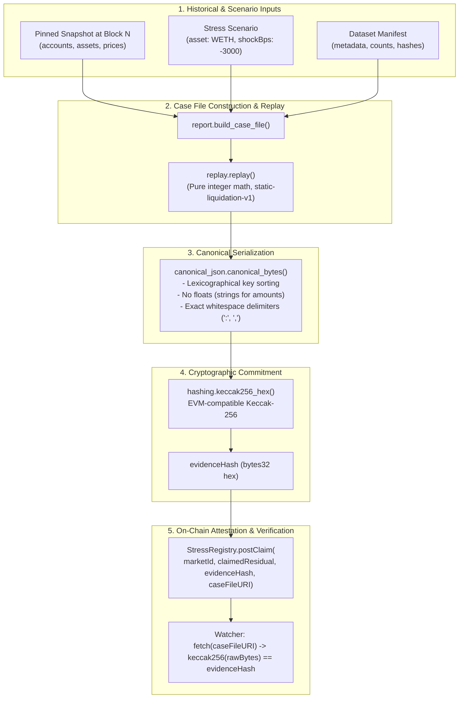
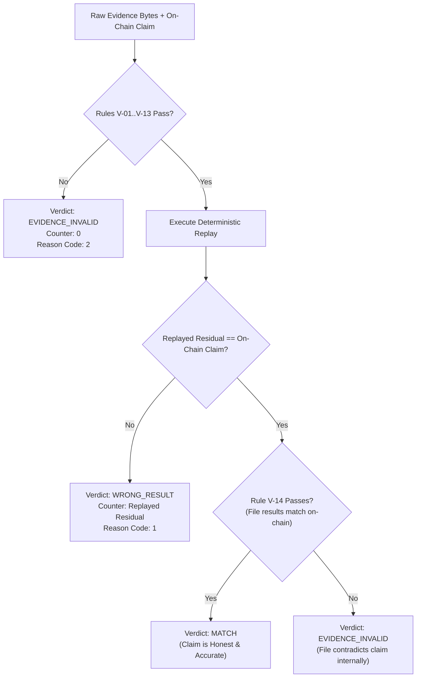

# StressProof: Cryptographic Evidence Pipeline & Deterministic Replay Engine

This document specifies the technical mechanics of StressProof's evidence generation, canonical serialization, cryptographic hashing, and deterministic liquidation replay engine (`static-liquidation-v1`).

---

## 1. The Evidence Pipeline Architecture

The core tenet of StressProof is that **evidence must be self-contained, canonical, immutable, and deterministically verifiable without network access or external state**.



---

## 2. Canonical Case File Specification

A case file is the atomic, content-addressed unit of proof in StressProof. It encapsulates the borrower snapshot, the stress scenario, the execution model, and the resulting bad debt calculations.

### 2.1. Top-Level Schema (Schema Version 1)

```json
{
  "schemaVersion": 1,
  "marketId": "aave-v3-eth-weth-stable",
  "dataClass": "SYNTHETIC",
  "dataset": { ... },
  "snapshot": { ... },
  "scenario": {
    "asset": "WETH",
    "shockBps": -3000
  },
  "model": {
    "id": "static-liquidation-v1",
    "replayerCommit": "43ceec73e7e05372de2af9d9c360810e11f379b5"
  },
  "agentRationale": "Phase 1 fixed scenario: -3000 bps WETH shock.",
  "results": {
    "liquidatableAccounts": 4,
    "debtAtRiskUsd8": "3374300000002",
    "liquidationVolumeUsd8": "3174300000001",
    "residualBadDebtUsd8": "200000000001"
  }
}
```

### 2.2. Sub-Schemas
1. **`snapshot.assets` Map:**
   ```json
   "WETH": {
     "decimals": 18,
     "priceUsd8": "300000000000",
     "ltBps": 8300,
     "bonusBps": 10500
   }
   ```
   - `priceUsd8`: Initial asset price in USD scaled by $10^8$ ($3,000.00$).
   - `ltBps`: Liquidation threshold in basis points ($83.00\%$).
   - `bonusBps`: Liquidation bonus in basis points ($105.00\%$, indicating a 5% liquidation penalty).
2. **`snapshot.accounts` Array:**
   Sorted strictly ascending by `id`:
   ```json
   {
     "id": "synth-0001",
     "origin": "synthetic",
     "collateralAmount": "10000000000000000000",
     "debtUsd8": "2000000000000"
   }
   ```
   - `collateralAmount`: Raw collateral token units ($10 \times 10^{18}\text{ wei}$).
   - `debtUsd8`: Total outstanding stablecoin debt in USD scaled by $10^8$ ($\$20,000.00$).

---

## 3. Strict Canonical JSON Serialization

To ensure identical Keccak-256 hashes across different programming languages and runtimes (Python, TypeScript, Go, Rust), StressProof implements a strict canonical serializer:

### Rules of Canonical Serialization:
1. **UTF-8 Encoding:** All content is serialized strictly as UTF-8 bytes.
2. **Key Sorting:** All dictionary keys at every level are sorted lexicographically by unicode codepoints.
3. **No Whitespace:** Delimiters are strictly `","` and `":"` with zero leading or trailing spaces.
4. **Prohibition of Floating-Point Numbers:** JSON floats (e.g. `123.45` or `1e8`) are strictly prohibited in financial amounts. All token amounts and currency values MUST be serialized as non-negative decimal strings (e.g., `"2000000000000"`).
5. **No Trailing Commas or Newlines:** The output byte array has no trailing newline or whitespace.

### Strict Parsing (`parse_strict`):
The parser rejects input if:
- Trailing bytes exist after the root JSON object.
- Floating-point tokens are encountered in schema-controlled numeric fields.
- Non-standard escape sequences or UTF-16 surrogate pairs are present.

---

## 4. Cryptographic Hashing & Commitment

### 4.1. Keccak-256 vs. NIST SHA-3
StressProof strictly employs **Keccak-256** (padding `0x01`, EVM opcode `SHA3` / `0x20`), **NOT** standard NIST FIPS 202 SHA3-256 (padding `0x06`).
- Standard test vector:
  $$\text{keccak256}(\text{b""}) = \text{0xc5d2460186f7233c927e7db2dcc703c0e500b653ca82273b7bfad8045d85a470}$$
- All hashes are represented as lowercase 66-character hex strings prefixed with `0x`.

### 4.2. Market Identifier Derivation
The on-chain `marketId` is derived deterministically by hashing the canonical UTF-8 market string:
$$\text{marketId} = \text{keccak256}(\text{"aave-v3-eth-weth-stable"}) = \text{0x2701f07d2eb0de529ccb283ac9cd1ebb8ed772916b7db0822335d9bcdabbc026}$$

---

## 5. Deterministic Liquidation Replay (`static-liquidation-v1`)

The replayer is a pure mathematical function:
$$\text{ReplayResult} = \mathcal{R}(\text{CaseFile})$$
It operates under the following guarantees:
- **No Floating-Point Math:** Integer floor division (`//` in Python, `/` in Solidity) is used throughout.
- **No Network I/O:** Executes in memory without external lookups.
- **Zero Clock Dependence:** System time cannot affect execution.

### Replay Mathematical Equations

```
Algorithm: static-liquidation-v1
Inputs:
  P_init     : asset.priceUsd8
  dec        : asset.decimals
  LT         : asset.ltBps
  bonus      : asset.bonusBps
  shock      : scenario.shockBps
  accounts   : snapshot.accounts

1. Calculate Shocked Price:
   P_shock = floor(P_init * (10000 + shock) / 10000)

2. For each account in accounts:
   c_amt = account.collateralAmount
   d_usd8 = account.debtUsd8

   // Collateral valuation at shocked price
   c_val = floor(c_amt * P_shock / 10^dec)

   // Liquidation threshold check (Health Factor < 1.0)
   is_liquidatable = floor(c_val * LT / 10000) < d_usd8

   if is_liquidatable:
       // Maximum repayable debt covered by collateral with liquidation penalty
       repaid = min(d_usd8, floor(c_val * 10000 / bonus))
       residual = d_usd8 - repaid

       total_debt_at_risk += d_usd8
       total_liquidation_volume += repaid
       total_residual_bad_debt += residual
       liquidatable_accounts += 1
```

---

## 6. Normative Validation Rules Catalogue (V-01 to V-14)

Before replaying evidence, `stressproof_core.validation.validate()` subjects raw bytes to 14 strict rules:

| Code | Rule Name | Condition Checked | Action on Failure |
|---|---|---|---|
| **V-01** | Non-Empty Payload | Input is non-empty `bytes` or `bytearray`. | Reject immediately. Do not parse. |
| **V-02** | Hash Integrity | $\text{keccak256}(\text{rawBytes}) == \text{onchain.evidenceHash}$. | Reject immediately. Never replay untrusted bytes. |
| **V-03** | Canonical JSON | Strict parser succeeds without non-canonical artifacts. | Reject with parser syntax error. |
| **V-04** | Schema Conformance | Exact key matches; `schemaVersion == 1`; `agentRationale` clean. | Reject with missing/unknown key errors. |
| **V-05** | Market ID Match | $\text{keccak256}(\text{caseFile.marketId}) == \text{onchain.marketId}$. | Flag market identifier mismatch. |
| **V-06** | Model Identifier | `caseFile.model.id == "static-liquidation-v1"`. | Reject unsupported calculation models. |
| **V-07** | Scenario Asset | `caseFile.scenario.asset` exists in `snapshot.assets`. | Reject undefined asset scenario. |
| **V-08** | Domain Constraints | $\text{shockBps} \in [-9000, -1]$, $\text{LT} \in [5000, 9500]$, $\text{LT} \times \text{bonus} \le 10^8$. | Reject out-of-bounds parameters. |
| **V-09** | Decimal Amounts | All currency/token values are non-negative decimal strings. | Reject numbers or scientific notation. |
| **V-10** | Account ID Sorting | Account IDs are strictly unique, sorted ascending, and match origin format. | Reject unsorted or duplicate accounts. |
| **V-11** | Manifest Counts | Account counts in manifest equal snapshot array length. | Flag count discrepancy. |
| **V-12** | Data Class Integrity | `dataClass` (`REAL`, `SYNTHETIC`, `MIXED`) matches account origin flags. | Flag origin mislabeling. |
| **V-13** | Snapshot Hash | $\text{keccak256}(\text{canonical}(\text{snapshot})) == \text{dataset.snapshotHash}$. | Flag internal snapshot tampering. |
| **V-14** | On-Chain Claim Equality | `results.residualBadDebtUsd8 == str(onchain.claimedResidualBadDebt)`. | Flag claimed residual discrepancy. |

---

## 7. The Claim Verdict Engine

The verdict engine evaluates evidence bytes against an on-chain claim tuple:



### Edge-Case Handling:
If an attester submits a case file where the replay equals the on-chain claim, but the case file's internal `results.residualBadDebtUsd8` text field was tampered to show a different number (violating V-14), challenging with `WRONG_RESULT` would revert on-chain because $\text{counter} == \text{claim}$. The verdict engine detects this condition and correctly classifies the claim as `EVIDENCE_INVALID`.

---

## 8. Guarantees and Boundaries

### What Cryptographic Evidence Guarantees:
- **Exact Byte Integrity:** No intermediary can alter a single character of the case file without invalidating the on-chain commitment.
- **Computational Reproducibility:** Anyone executing the replayer on the committed bytes will arrive at the exact same bad debt number down to 1 wei / 1 cent.
- **Internal Consistency:** The committed snapshot hash matches the account balances, and the manifest counts match reality.

### What Cryptographic Evidence Does NOT Guarantee:
- **External Reality Fidelity:** The pipeline does not prove on-chain that the snapshot accounts truly represented Ethereum mainnet at block $N$ without a zero-knowledge storage proof.
- **Market Liquidity & Slippage:** `static-liquidation-v1` assumes single-pass full liquidations with zero price slippage. It is a conservative risk boundary, not a real-time order-book execution forecast.
