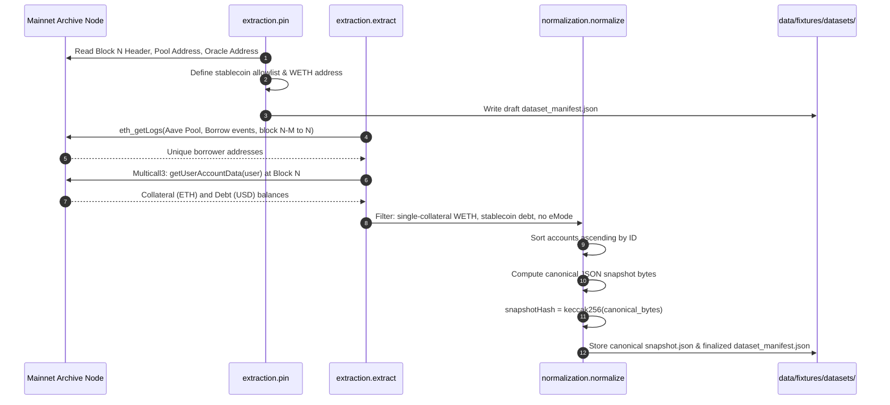
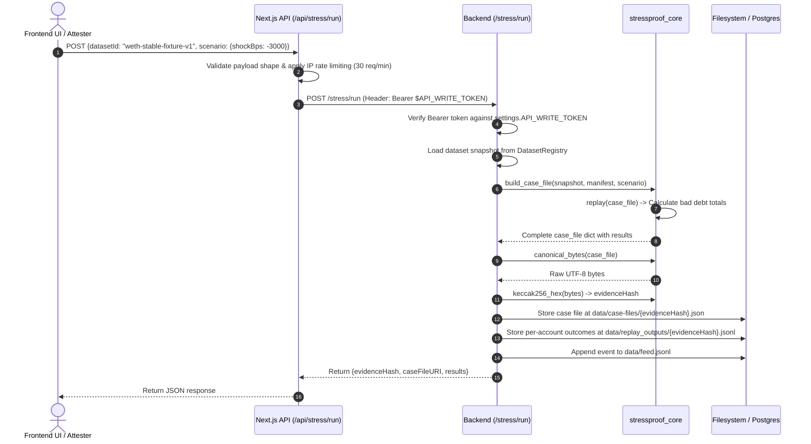
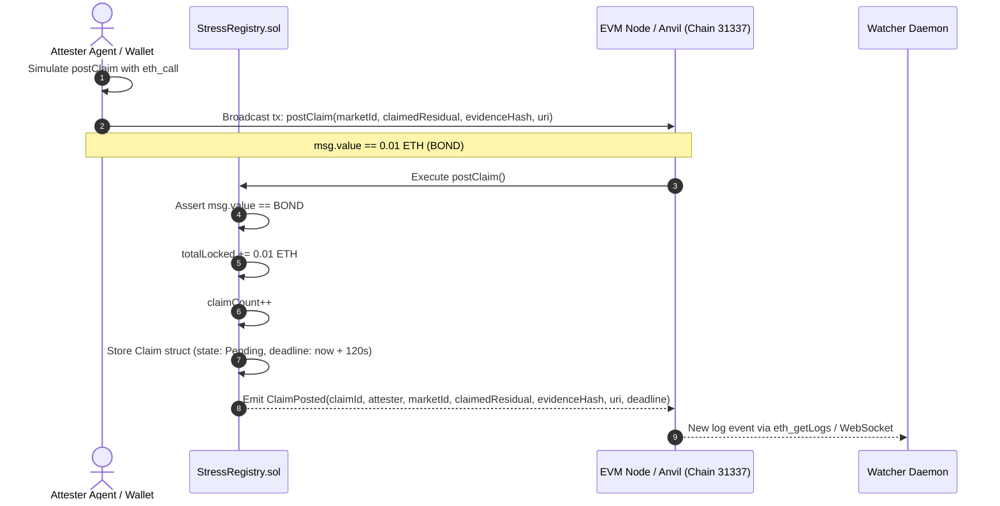
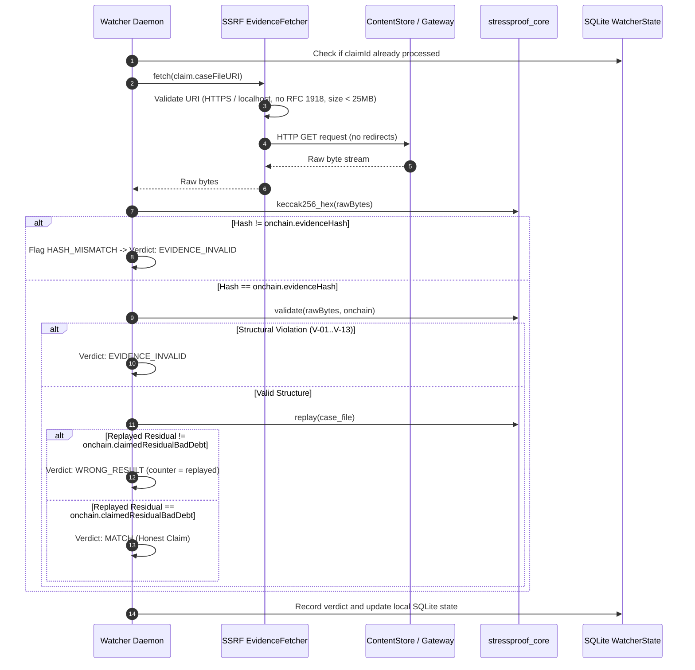
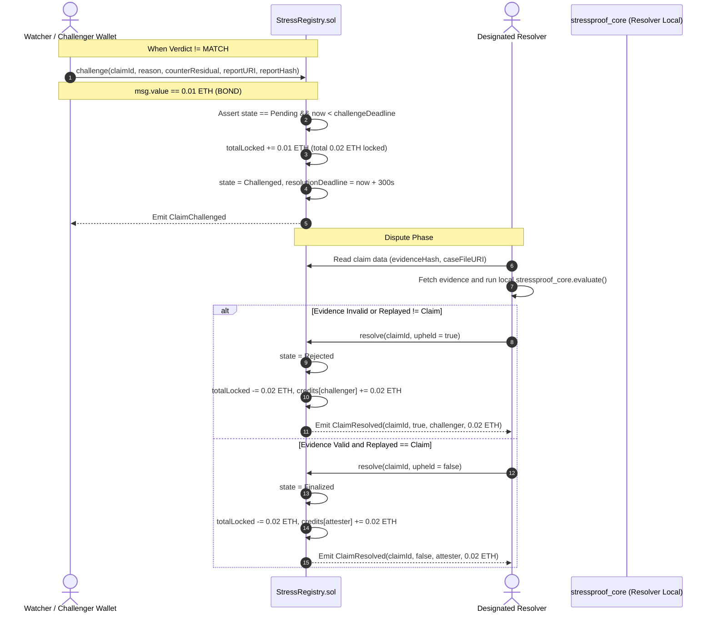
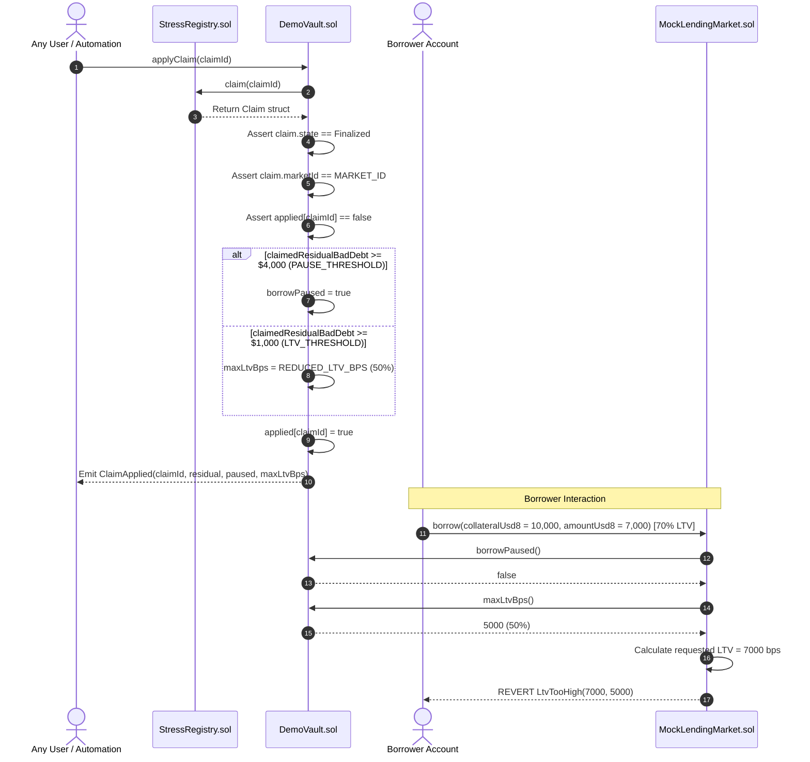
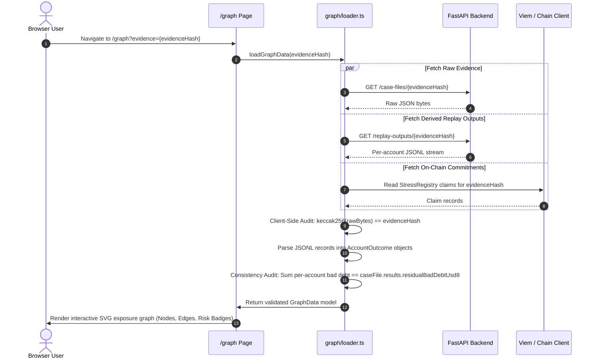

# StressProof: End-to-End System Data Flow

This document details the precise data transformations, byte-level flows, network boundaries, and state transitions across the StressProof architecture.

---

## 1. High-Level Data Journey

```mermaid
flowchart TD
    subgraph Phase1["1. Scenario & Generation"]
        AaveFork["Aave v3 Archive Snapshot (Block N)"] --> RawData["Raw Borrower Data"]
        RawData --> Normalizer["Pipeline Normalizer (synth.py / normalize.py)"]
        Normalizer --> Snapshot["snapshot.json + manifest.json"]
        ScenarioInput["Scenario Input (WETH, -3000 bps)"] --> Backend["FastAPI POST /stress/run"]
        Snapshot --> Backend
    end

    subgraph Phase2["2. Replay & Content Commitment"]
        Backend --> CoreReplay["Pure Core Replayer (static-liquidation-v1)"]
        CoreReplay --> CaseFile["Case File JSON (Schema v1)"]
        CaseFile --> Canonicalizer["Canonical JSON Serializer"]
        Canonicalizer --> RawBytes["Canonical UTF-8 Bytes"]
        RawBytes --> Keccak["Keccak-256 Hashing"]
        Keccak --> EvidenceHash["evidenceHash (bytes32 hex)"]
        RawBytes --> Store["ContentStore: data/case-files/{hash}.json"]
    end

    subgraph Phase3["3. On-Chain Bonded Attestation"]
        EvidenceHash --> AttesterAgent["Attester Agent"]
        AttesterAgent --> PostTx["StressRegistry.postClaim() + 0.01 ETH"]
        PostTx --> Registry["StressRegistry (State: Pending)"]
        Registry --> Event["Emit ClaimPosted(id, evidenceHash, ...)"]
    end

    subgraph Phase4["4. Independent Audit & Challenge"]
        Event --> Watcher["Watcher Daemon"]
        Watcher --> Fetch["GET /case-files/{evidenceHash}"]
        Fetch --> VerifyHash{"keccak256(bytes) == evidenceHash?"}
        VerifyHash -- Yes --> CoreReplay2["Run Core Replay"]
        VerifyHash -- No --> InvalidFlow["Challenge EVIDENCE_INVALID"]
        CoreReplay2 --> CheckMatch{"Replayed Residual == Claimed Residual?"}
        CheckMatch -- Disagree --> ChallengeFlow["Challenge WRONG_RESULT"]
        CheckMatch -- Agree --> HonestFlow["Stay Silent (Verdict: MATCH)"]
    end

    subgraph Phase5["5. Resolution & Settlement"]
        ChallengeFlow --> ChallengeTx["StressRegistry.challenge() + 0.01 ETH"]
        ChallengeTx --> ChallengedState["State: Challenged"]
        ChallengedState --> Resolver["Resolver CLI (replays evidence)"]
        Resolver --> ResolveTx["StressRegistry.resolve(id, upheld)"]
        ResolveTx --> Settlement["Credits Winner 2x BOND (0.02 ETH)"]
    end

    subgraph Phase6["6. Finalization & Vault Defense"]
        HonestFlow --> WaitWindow["Wait 120s Challenge Window"]
        WaitWindow --> FinalizeTx["StressRegistry.finalize(id)"]
        FinalizeTx --> FinalState["State: Finalized"]
        FinalState --> ApplyTx["DemoVault.applyClaim(id)"]
        ApplyTx --> LtvUpdate["DemoVault: maxLtvBps 80% -> 50%"]
        LtvUpdate --> Market["MockLendingMarket: Reverts Borrows > 50% LTV"]
    end
```

---

## 2. Data Flow 1: Offline Snapshot Generation & Normalization

---

## 3. Data Flow 2: Simulation Execution & Content-Addressed Storage

---

## 4. Data Flow 3: Bonded Attestation & On-Chain Event Propagation

---

## 5. Data Flow 4: Watcher Verification & Replay Engine

---

## 6. Data Flow 5: Challenge Submission & Dispute Settlement

---

## 7. Data Flow 6: Vault Defense & Borrow Execution

---

## 8. Data Flow 7: Client-Side Replay Graph Rendering & Audit

