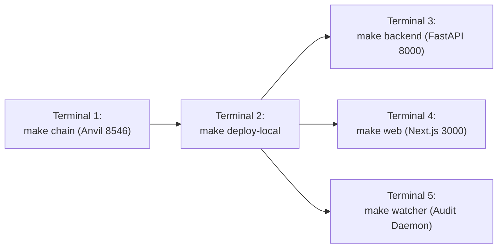

# StressProof: Development, Build & Operations Guide

This document provides the standard operating procedures, local development setup, environment configurations, and testing commands for engineers contributing to **StressProof**.

---

## 1. Prerequisites & Tooling

Ensure the following tools are installed before setting up the workspace:

| Tool | Minimum Version | Installation / Verification |
|---|---|---|
| **Node.js** | `v20.0.0+` (LTS) | `node --version` |
| **npm / pnpm** | `npm v10+`, `pnpm v9+` | `npm install -g pnpm` |
| **Python** | `3.11+` (tested on `3.12.15`) | `python3 --version` |
| **uv** | `v0.4.0+` (Astral Python manager) | `curl -LsSf https://astral.sh/uv/install.sh \| sh` |
| **Foundry** | `forge 1.8.6+` | `curl -L https://foundry.paradigm.xyz \| bash && foundryup` |
| **Git** | `2.40+` | `git --version` |

---

## 2. Workspace Bootstrapping

Clone the repository and install dependencies across all package boundaries:

```bash
# 1. Clone repository
git clone https://github.com/madhavansingh/StressProof.git
cd StressProof

# 2. Bootstrap Python workspace (installs core, pipeline, backend, agents)
uv sync

# 3. Bootstrap Frontend workspace
cd frontend && pnpm install && cd ..

# 4. Initialize environment configuration
cp .env.example .env
cp frontend/.env.example frontend/.env
```

---

## 3. Environment Variable Configuration

StressProof enforces strict separation between local Anvil development, backend services, and testnet deployment. **Never commit `.env` or `.env.testnet` files containing private keys.**

### Root `.env` (Backend, Agents, Local Anvil)

| Variable | Default (Local) | Purpose |
|---|---|---|
| `LOCAL_RPC_URL` | `http://127.0.0.1:8546` | Standalone Anvil node RPC URL |
| `DEPLOYMENTS_FILE` | `deployments/31337.json` | Path to active network contract address registry |
| `API_WRITE_TOKEN` | `dev-write-token-change-in-production` | Secret bearer token guarding backend `POST` routes |
| `MARKET_ID_STRING` | `aave-v3-eth-weth-stable` | Canonical market identifier string |
| `DATA_DIR` | `data` | Directory for content-addressed case files and feed logs |
| `FETCH_ALLOW_LOCALHOST` | `true` | Allows agent HTTP fetcher to access `127.0.0.1` during local tests |
| `DEPLOYER_PK` | Anvil Account #0 | `0xac0974bec39a17e36ba4a6b4d238ff944bacb478cbed5efcae784d7bf4f2ff80` |
| `RESOLVER_PK` | Anvil Account #1 | `0x59c6995e998f97a5a0044966f0945389dc9e86dae88c7a8412f4603b6b78690d` |
| `ATTESTER_PK` | Anvil Account #2 | `0x5de4111afa1a4b94908f83103eb2f954b10e04a5b3220316ced2e41c82eeb0f2` |
| `WATCHER_PK` | Anvil Account #3 | `0x7c852118294e51e653712a81e05800f419141751be58f605c371e15141b007a6` |
| `MALICIOUS_PK` | Anvil Account #4 | `0x47e1797c2dd344305b827999982e499fdd4e8a6300a87001e49b8812320043aa` |

### `frontend/.env` (Next.js Application)

| Variable | Default (Local) | Purpose |
|---|---|---|
| `NEXT_PUBLIC_CHAIN_ID` | `31337` | Network ID for wallet connections (`31337` local, `84532` testnet) |
| `NEXT_PUBLIC_BACKEND_URL` | `http://127.0.0.1:8000` | Backend API base URL |
| `API_WRITE_TOKEN` | Same as backend | Server-side token used by Next.js route `/api/stress/run` |

---

## 4. Running the Complete Local Stack

To run the complete protocol locally, launch the following processes in separate terminal sessions:



### Terminal 1: Standalone Anvil Node
Runs a fresh local blockchain with chain ID `31337` on port `8546`:
```bash
make chain
```

### Terminal 2: Smart Contract Deployment
Deploys `StressRegistry`, `DemoVault`, and `MockLendingMarket` to Anvil and writes confirmed addresses to `deployments/31337.json`:
```bash
make deploy-local
```

### Terminal 3: FastAPI Backend
Starts the backend service on `http://127.0.0.1:8000`:
```bash
make backend
```

### Terminal 4: Next.js Frontend Portal
Starts the Web3 frontend on `http://localhost:3000`:
```bash
make web
```

### Terminal 5 (Optional): Autonomous Watcher Daemon
Monitors the local registry for newly published claims, verifies hashes, replays liquidations, and submits challenges:
```bash
make watcher
```

---

## 5. Verification & Test Execution

Run the comprehensive test suites across contracts, Python modules, and the frontend:

### 1. Smart Contract Tests (Foundry)
Executes unit tests, dispute resolution tests, fuzz suites, and 25,600-call invariant handler tests:
```bash
cd contracts && forge test
```
*Expected: 95 passed, 0 failed.*

### 2. Python Workspace Tests (Pytest)
Executes core deterministic math tests, validation rules V-01..V-14, agent workflows, backend routes, and script tests:
```bash
uv run pytest
```
*Expected: 770 passed, 73 skipped (PostgreSQL-specific tests are skipped when `DATABASE_URL` is unset).*

### 3. Frontend Unit & Integration Tests (Vitest)
Executes client-side Keccak-256 verification tests, graph rendering tests, wallet policy guards, and UI formatting:
```bash
cd frontend && npx vitest run
```
*Expected: 230 passed across 25 files.*

### 4. TypeScript Strict Compilation
```bash
cd frontend && npx tsc --noEmit --incremental false
```
*Expected: Clean output with 0 errors.*

### 5. Production Build Verification
```bash
cd frontend && npx next build
```
*Expected: 11 static/dynamic routes compiled successfully.*

### 6. Automated Local End-to-End Gate (GATE-24)
Executes the full automated protocol lifecycle (honest claim $\to$ finalize $\to$ vault reduce LTV $\to$ borrow revert $\to$ malicious claim $\to$ watcher challenge $\to$ resolver dispute $\to$ refund expiry):
```bash
make e2e
```
*Expected: 101/101 checks passed.*

---

## 6. Local State Management & Anvil Snapshots

StressProof provides pre-recorded Anvil state dumps in `data/` to instantly restore local chain states without redeploying:

### Restoring Pre-Recorded Demo State
If Anvil is running on port `8546`, you can restore a verified state containing published and challenged claims:
```bash
# Set chain state from committed hex dump
curl -s -X POST http://127.0.0.1:8546 \
  -H "Content-Type: application/json" \
  -d "{\"jsonrpc\":\"2.0\",\"method\":\"anvil_loadState\",\"params\":[\"$(cat data/anvil-demo-state-2026-10-30.hex)\"],\"id\":1}"
```

### Saving Active Chain State
```bash
curl -s -X POST http://127.0.0.1:8546 \
  -H "Content-Type: application/json" \
  -d '{"jsonrpc":"2.0","method":"anvil_dumpState","params":[],"id":1}' \
  | jq -r .result > data/my-anvil-state.hex
```

---

## 7. Troubleshooting & Common Pitfalls

| Issue | Root Cause | Solution |
|---|---|---|
| `WrongBond(received, expected)` revert | Transaction sent with incorrect ether value | Ensure wallet sends exactly `0.01 ETH` with `postClaim()` or `challenge()`. |
| Backend returns `401 Unauthorized` | Missing or mismatched `API_WRITE_TOKEN` | Confirm `API_WRITE_TOKEN` in `frontend/.env` matches `API_WRITE_TOKEN` in root `.env`. |
| Frontend shows `WRONG_NETWORK` banner | Wallet is connected to mainnet or Sepolia | Switch wallet network to Anvil Local (RPC `http://127.0.0.1:8546`, Chain ID `31337`). |
| Anvil transaction nonce desync | Anvil was restarted while browser kept old nonce | In MetaMask: Settings $\to$ Advanced $\to$ Clear activity tab data. |
| Revert `LtvTooHigh(7000, 5000)` | Expected behavior when testing vault circuit breaker | The finalized claim lowered max LTV to 50%; borrowing at 70% is rejected by design. |
| Port `8546` or `8000` already in use | Stale background process holding the port | Run `lsof -ti :8546 \| xargs kill -9` and `lsof -ti :8000 \| xargs kill -9`. |
