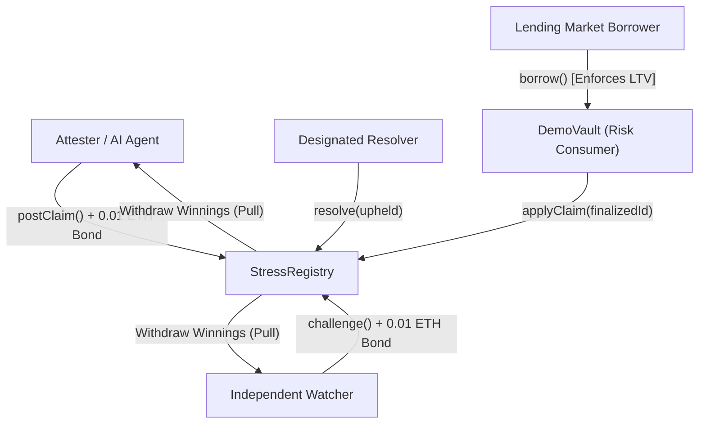
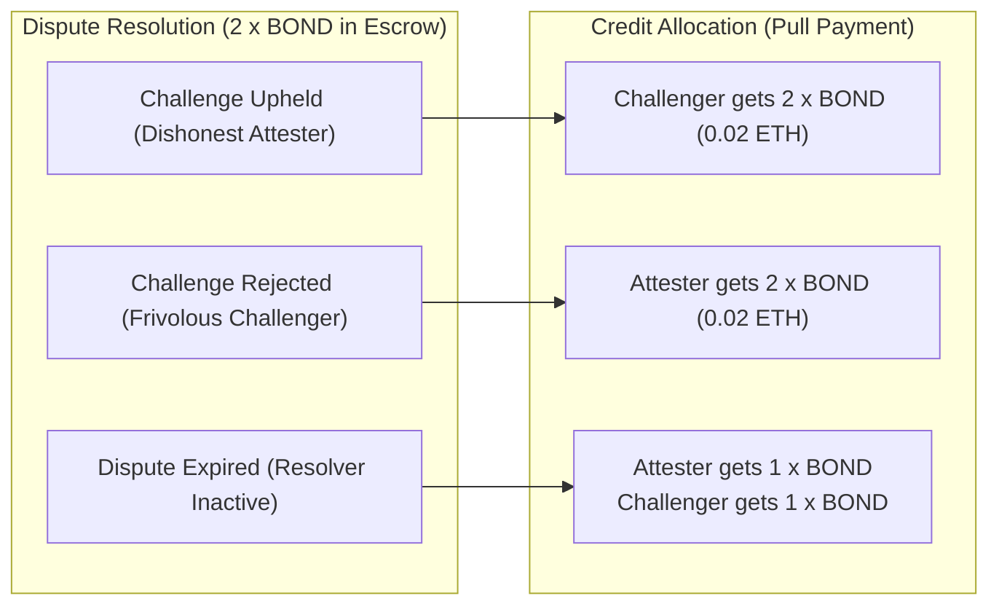
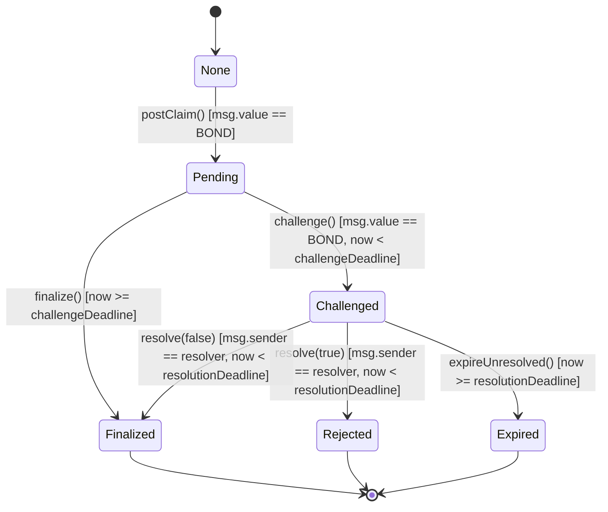
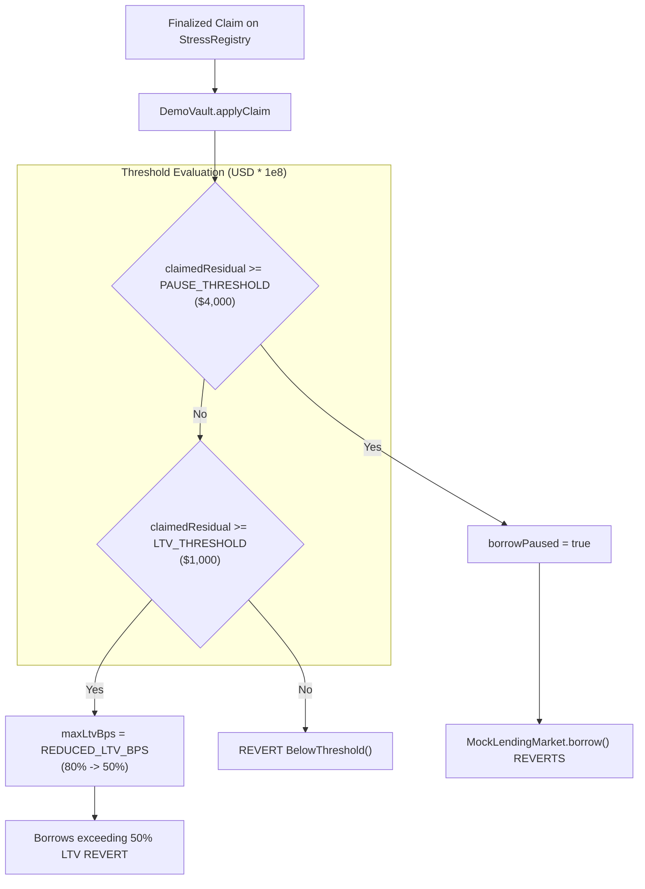

# StressProof: Protocol Design & Game-Theoretic Verification

This document specifies the mechanism design, economic models, state machine transitions, and verification invariants of the **StressProof** protocol.

---

## 1. Design Objectives & Problem Statement

DeFi lending protocols (such as Aave, Compound, and Morpho) govern billions of dollars in collateralized loans. Protocol health depends on parameterized risk controls:
- **Maximum Loan-to-Value (Max LTV):** The maximum borrowing power assigned to an asset.
- **Liquidation Threshold (LT):** The health factor boundary below which collateral can be liquidated.
- **Emergency Borrow Pause:** Halting borrowing to prevent insolvencies during market crashes.

Protocols typically rely on external risk modeling firms or autonomous AI agents to simulate liquidation cascades and recommend parameter adjustments. However, traditional risk reporting suffers from three systemic vulnerabilities:
1. **Unverifiable Off-Chain Models:** Risk simulations are conducted in proprietary off-chain systems. Observers cannot verify whether the output mathematically follows from the historical borrower state or if cherry-picked inputs were used.
2. **Zero Economic Accountability:** An AI agent or rogue analyst can publish an overstated bad-debt projection (causing unnecessary market freezing) or an understated projection (leaving vaults insolvent) with zero capital risk.
3. **Dispute Incomputability:** When two parties disagree on market risk, on-chain governance cannot run expensive, multi-block Monte Carlo simulations to settle the dispute.

StressProof solves this by transforming risk claims into **bonded, optimistic commitments backed by canonical evidence and pure deterministic replay**.

---

## 2. Actor Model & Protocol Roles

The protocol defines five distinct operational roles:



| Role | Operational Scope | Economic Stake | Responsibilities |
|---|---|---|---|
| **Attester** | Off-Chain + On-Chain | Stakes $0.01\text{ ETH}$ (`BOND`) per claim | Simulates market shocks, publishes canonical case files, submits on-chain claims committing to $\text{evidenceHash}$, and finalizes unchallenged claims. |
| **Watcher (Challenger)** | Off-Chain + On-Chain | Stakes $0.01\text{ ETH}$ (`BOND`) per challenge | Continuously monitors `ClaimPosted` events, fetches case files, verifies Keccak-256 hashes, executes deterministic replays, and challenges erroneous or malformed claims. |
| **Resolver** | Off-Chain + On-Chain | None (Arbitrator) | Designated address authorized to settle disputed claims during the resolution window by replaying the committed evidence. |
| **Vault Controller (`DemoVault`)** | On-Chain Smart Contract | None (Consumer) | Inspects finalized claims and automatically tightens borrowing limits or pauses borrowing if claimed residual bad debt crosses preset thresholds. |
| **Market Participant (Borrower)** | On-Chain Smart Contract | Capital at Risk | Borrows assets from `MockLendingMarket`, subject to dynamic limits enforced by `DemoVault`. |

---

## 3. Economic Bonding & Incentive Structure

### 3.1. Fixed Capital Bond
In the MVP implementation, every claim and challenge requires a fixed bond:
$$\text{BOND} = 0.01\text{ ETH} = 10^{16}\text{ wei}$$

The bond serves two functions:
1. **Spam & Sybil Resistance:** Discourages flooding the registry with frivolous, invalid, or hallucinated claims.
2. **Bounty for Independent Watchers:** Compensates honest watchers for the compute and gas required to audit evidence and challenge invalid claims.

### 3.2. Settlement & Payout Mechanics
The protocol enforces three settlement outcomes:



1. **Unchallenged Claim (Happy Path):**
   - The claim remains pending for the entire `CHALLENGE_WINDOW` ($120\text{ s}$).
   - `finalize(claimId)` transitions the state to `Finalized`.
   - The Attester is refunded their $1.0\times\text{BOND}$ ($0.01\text{ ETH}$). Net cost: transaction gas.
2. **Upheld Challenge (Dishonest or Malformed Claim):**
   - The Watcher challenges with `WRONG_RESULT` or `EVIDENCE_INVALID`.
   - The Resolver verifies the replay failure and calls `resolve(claimId, true)`.
   - The claim transitions to `Rejected`.
   - The Challenger is credited $2.0\times\text{BOND}$ ($0.02\text{ ETH}$), winning the Attester's bond.
3. **Rejected Challenge (Frivolous Challenge):**
   - A Challenger disputes an honest claim.
   - The Resolver verifies that the replay matches the claim and calls `resolve(claimId, false)`.
   - The claim transitions to `Finalized`.
   - The Attester is credited $2.0\times\text{BOND}$ ($0.02\text{ ETH}$), winning the Challenger's bond.
4. **Unresolved Expiration (Resolver Inactivity):**
   - If the Resolver fails to act within the `RESOLUTION_WINDOW` ($300\text{ s}$), anyone can call `expireUnresolved(claimId)`.
   - The claim transitions to `Expired`.
   - Both parties are refunded their original $1.0\times\text{BOND}$ ($0.01\text{ ETH}$). No funds are permanently locked.

### 3.3. Pull-Payment Accounting
To eliminate reentrancy vulnerabilities and denial-of-service via reverting external calls, the contract maintains an internal ledger:
```solidity
mapping(address => uint256) public credits;
```
When a claim settles, funds are moved from `totalLocked` to `totalCredited` and credited to the winner. Users extract funds at their leisure by calling `withdraw()`.

---

## 4. State Machine Specification

`StressRegistry.sol` implements a deterministic finite state machine with strict temporal and caller transitions:



### State Transition Invariants

| From State | To State | Trigger Function | Access Control | Time Precondition | Balance Movement |
|---|---|---|---|---|---|
| `None` | `Pending` | `postClaim()` | Permissionless | None | Escrow $+\text{BOND}$ into `totalLocked` |
| `Pending` | `Challenged` | `challenge()` | Anyone except Attester | `block.timestamp < challengeDeadline` | Escrow $+\text{BOND}$ into `totalLocked` |
| `Pending` | `Finalized` | `finalize()` | Permissionless | `block.timestamp >= challengeDeadline` | Credit $1\times\text{BOND}$ to Attester |
| `Challenged` | `Rejected` | `resolve(true)` | `msg.sender == resolver` | `block.timestamp < resolutionDeadline` | Credit $2\times\text{BOND}$ to Challenger |
| `Challenged` | `Finalized` | `resolve(false)` | `msg.sender == resolver` | `block.timestamp < resolutionDeadline` | Credit $2\times\text{BOND}$ to Attester |
| `Challenged` | `Expired` | `expireUnresolved()` | Permissionless | `block.timestamp >= resolutionDeadline` | Credit $1\times\text{BOND}$ to both |

### Invariant Equations Enforced by Smart Contract:
1. **Solvency Invariant:**
   $$\text{address}(\text{this}).\text{balance} \ge \text{totalLocked} + \text{totalCredited}$$
2. **Escrow Invariant:**
   $$\text{totalLocked} = N_{\text{Pending}} \times \text{BOND} + N_{\text{Challenged}} \times (2 \times \text{BOND})$$
3. **Terminal State Immutability:** Once a claim enters `Finalized`, `Rejected`, or `Expired`, its state can never be modified.

---

## 5. Dispute Resolution Mechanics

Disputes are classified into two normative reasons defined in `IStressRegistry.Reason`:

```solidity
enum Reason { NONE, WRONG_RESULT, EVIDENCE_INVALID }
```

### 5.1. `WRONG_RESULT` (Reason 1)
- **Condition:** The evidence file is structurally valid, canonical, and matches `evidenceHash`, but the replayed residual bad debt differs from the on-chain `claimedResidualBadDebt`.
- **Challenger Requirement:** The challenger MUST supply `counterResidualBadDebt`.
- **Constraint:** `counterResidualBadDebt != claimedResidualBadDebt` (otherwise `challenge()` reverts with `CounterEqualsClaim()`).
- **Verdict Rule:** The Resolver checks whether the deterministic replay matches the claim or the counter.

### 5.2. `EVIDENCE_INVALID` (Reason 2)
- **Condition:** The evidence file cannot be parsed, violates schema rules V-01 through V-13, fails hash verification, or cannot be retrieved from `caseFileURI` before the deadline.
- **Contract Handling:** `counterResidualBadDebt` is automatically zeroed out by the registry.
- **Verdict Rule:** The Resolver verifies structural invalidity. The challenge is upheld regardless of numerical values.

---

## 6. On-Chain Risk Governance Enforcement

Finalized claims are consumed by `DemoVault.sol` to enforce circuit-breaker controls on lending markets:



### Vault Defense Rules:
1. **Single Application:** A claim ID can only be applied once (`applied[claimId] == false`), preventing replay attacks.
2. **Market Matching:** The claim's `marketId` must match the vault's immutable `MARKET_ID`.
3. **Monotonic Tightening:** Risk controls can only tighten (LTV reduces from 80% to 50%; borrow pauses). They never automatically loosen.
4. **Manual Governance Reset:** Only the authorized vault `owner` can call `resetControls()` after the market stabilizes.

---

## 7. Protocol Limitations & Design Trade-offs

1. **Fixed Bond Economics:** A fixed $0.01\text{ ETH}$ bond does not scale with the TVL of the protected market. Future versions should use dynamic bonds proportional to market size or claimed risk magnitude.
2. **Designated Resolver in MVP:** The current implementation uses a single designated resolver key (`resolver`). In production, this can be transitioned to an interactive fraud-proof verifier (e.g., RISC Zero / Cartesi zk-VM) or an optimistic council (e.g., UMA Oracle).
3. **Front-Running of Challenges:** A dishonest attester could attempt to monitor the mempool and front-run honest challengers with a sock-puppet challenge. A commit-reveal challenge pattern is designed for future iterations.
