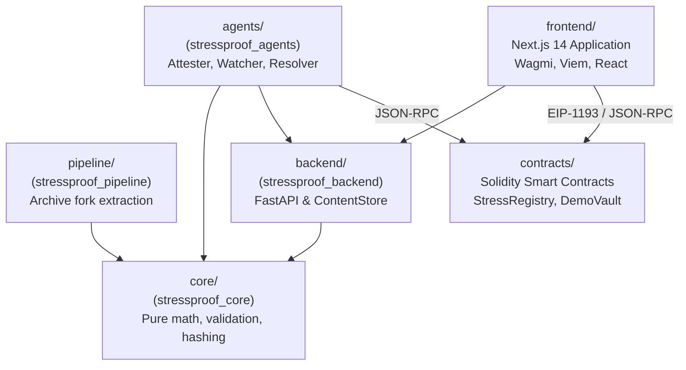

# StressProof: Repository Structure & Module Map

This document provides a comprehensive structural guide to the **StressProof** monorepo, detailing package boundaries, subsystem responsibilities, entry points, dependency directions, and testing layouts.

---

## 1. Monorepo Organization Philosophy

StressProof employs a modular architecture with strict dependency boundaries:
- **`core/` has zero external network, I/O, or web dependencies.** It is a pure algorithmic calculation package.
- **`backend/` depends on `core/`** for building and validating case files, but never imports agent or contract code.
- **`agents/` depends on `core/` and `backend/`** (for HTTP client types), interacting with smart contracts via JSON-RPC.
- **`contracts/` is a standalone Foundry project** with no Python or Node dependencies.
- **`frontend/` is an isolated Next.js application** that communicates with the backend via HTTP and the blockchain via JSON-RPC/EIP-1193.
- **`tigergraph/` maintains declarative GSQL schemas and queries**, decoupled from the verdict path.

---

## 2. Annotated Directory Tree

```text
StressProof/
├── .editorconfig                          # Cross-editor formatting specifications
├── .env.example                           # Root environment template (placeholders only)
├── .env.testnet                           # Base Sepolia environment template (unfunded)
├── .gitignore                             # Repository-wide ignore patterns
├── .gitmodules                            # Git submodule registry (contracts/lib/forge-std)
├── CONTRIBUTING.md                        # Single-owner governance, PR & code guidelines
├── Makefile                               # Developer orchestration targets
├── README.md                              # Definitive protocol overview & quickstart
├── pnpm-workspace.yaml                    # Node / pnpm workspace definition
├── pyproject.toml                         # Root uv workspace configuration
├── socket.yml                             # Socket supply-chain security configuration (v2)
├── uv.lock                                # Pinned Python dependency lockfile
│
├── agents/                                # Autonomous protocol agents (Python 3.12)
│   ├── pyproject.toml                     # Package definition: stressproof-agents
│   ├── README.md                          # Agent daemon overview & CLI documentation
│   ├── src/stressproof_agents/            # Package source
│   │   ├── abi/                           # Copied contract ABIs (StressRegistry, DemoVault, etc.)
│   │   ├── attester/                      # Honest attester workflow & main runner
│   │   │   ├── backend.py                 # Backend API client for simulation requests
│   │   │   ├── context.py                 # Agent environment & settings loader
│   │   │   ├── finalize.py                # Finalization runner for expired challenge windows
│   │   │   ├── main.py                    # CLI entry point: python -m stressproof_agents.attester.main
│   │   │   └── workflow.py                # PostClaim simulation, verification & broadcasting
│   │   ├── common/                        # Shared agent utilities
│   │   │   ├── abi.py                     # ABI loader and selector utilities
│   │   │   ├── chain.py                   # Web3 ChainClient with nonce & error handling
│   │   │   ├── config.py                  # Typed configuration models
│   │   │   ├── deployments.py             # Deployment JSON reader & contract address validation
│   │   │   ├── feed.py                    # Feed event emitter client
│   │   │   ├── fetch.py                   # SSRF-hardened EvidenceFetcher
│   │   │   ├── nonce.py                   # Thread-safe nonce tracking
│   │   │   ├── revert.py                  # Solidity custom error data decoder
│   │   │   └── state.py                   # SQLite WatcherState persistence model
│   │   ├── malicious/                     # Adversarial demonstration agent
│   │   │   ├── inflate.py                 # Residual bad debt inflation logic (3x R)
│   │   │   └── main.py                    # Malicious attester runner: make evil
│   │   ├── resolver/                      # Dispute resolution tools
│   │   │   ├── actions.py                 # Resolve and expire on-chain dispatchers
│   │   │   ├── assess.py                  # Local replay assessment for disputed claims
│   │   │   ├── claim_view.py              # On-chain claim struct unpacker
│   │   │   └── cli.py                     # Resolver CLI: python -m stressproof_agents.resolver.cli
│   │   └── watcher/                       # Continuous audit daemon
│   │       ├── dry_run.py                 # Dry-run evaluation simulator
│   │       ├── main.py                    # Watcher polling loop runner: make watcher
│   │       ├── outcomes.py                # Terminal outcome event listeners
│   │       ├── poller.py                  # New claim poller & block lag manager
│   │       └── processor.py               # Single-claim audit, replay & challenge pipeline
│   └── tests/                             # Agent integration tests (33 test files)
│
├── backend/                               # FastAPI evidence storage & coordination service
│   ├── pyproject.toml                     # Package definition: stressproof-backend
│   ├── README.md                          # API routes and configuration docs
│   ├── scripts/test_postgres.sh           # Test harness for PostgreSQL storage adapter
│   ├── src/stressproof_backend/           # Package source
│   │   ├── config.py                      # Pydantic Settings & environment validation
│   │   ├── dependencies.py                # FastAPI dependency injection providers
│   │   ├── main.py                        # FastAPI application factory, CORS & lifespan
│   │   ├── registry.py                    # DatasetRegistry: loads snapshot & manifest files
│   │   ├── api/routes/                    # HTTP REST routers
│   │   │   ├── datasets.py                # GET /datasets, GET /datasets/{id}/manifest
│   │   │   ├── feed.py                    # GET /feed, GET /feed/events (SSE)
│   │   │   ├── files.py                   # GET /case-files, GET /replay-outputs, POST /case-files
│   │   │   ├── graph.py                   # GET /graph/exposure, GET /graph/tigergraph/health
│   │   │   └── stress.py                  # POST /stress/run simulation orchestrator
│   │   ├── storage/                       # Content-addressed persistence adapters
│   │   │   ├── feed.py                    # Filesystem feed store (feed.jsonl)
│   │   │   ├── postgres.py                # Async PostgreSQL database & feed adapter
│   │   │   └── store.py                   # Filesystem ContentStore (raw bytes by hash)
│   │   └── tigergraph/                    # TigerGraph integration modules
│   │       ├── cli.py                     # TigerGraph CLI management tool
│   │       ├── client.py                  # Async REST++ TigerGraph client
│   │       ├── exposure.py                # Exposure query orchestrator & reconciler
│   │       ├── graph_data.py              # Schema row generators (vertices and edges)
│   │       └── loader.py                  # Idempotent CSV data loader
│   └── tests/                             # API tests (test_api.py, test_tigergraph.py, etc.)
│
├── contracts/                             # Foundry Solidity project (v0.8.24)
│   ├── foundry.toml                       # Foundry compiler configuration & profile settings
│   ├── foundry.lock                       # Pinned submodule dependencies
│   ├── README.md                          # Smart contracts architecture documentation
│   ├── broadcast/                         # Foundry deployment run records
│   ├── lib/                               # Submodule dependencies
│   │   └── forge-std/                     # Foundry standard library
│   ├── script/                            # Foundry deployment scripts
│   │   └── Deploy.s.sol                   # Deterministic deployment & wiring script
│   ├── src/                               # Production contracts
│   │   ├── DemoVault.sol                  # Risk-governed vault circuit breaker
│   │   ├── IStressRegistry.sol            # Core registry interface, structs & events
│   │   ├── MockLendingMarket.sol          # Lending market enforcing DemoVault LTV limits
│   │   └── StressRegistry.sol             # Bonded claims registry, dispute state machine
│   └── test/                              # Foundry test suites (6 suites, 95 tests)
│       ├── Deploy.t.sol                   # Deployment script validations
│       ├── DemoVault.t.sol                # Vault threshold & LTV reduction tests
│       ├── Invariant.t.sol                # 25,600-call stateful invariant tests
│       ├── MockLendingMarket.t.sol        # Borrow rejection & ceiling division tests
│       ├── StressRegistry.t.sol           # Core registry unit tests & bond checks
│       ├── StressRegistryResolution.t.sol # Dispute settlement & pull-payment tests
│       ├── handlers/RegistryHandler.sol   # Fuzz handler for invariant test campaigns
│       └── helpers/                       # Test fixtures and reentrant actor contracts
│
├── core/                                  # Pure deterministic risk engine (Python 3.12)
│   ├── pyproject.toml                     # Package definition: stressproof-core
│   ├── README.md                          # Mathematical model & validation specification
│   ├── src/stressproof_core/              # Package source
│   │   ├── canonical_json.py              # Canonical JSON byte serialization & strict parsing
│   │   ├── constants.py                   # Protocol bounds, model IDs, basis points
│   │   ├── hashing.py                     # EVM-native Keccak-256 & marketId hashing
│   │   ├── models.py                      # Strongly-typed dataclasses
│   │   ├── replay.py                      # Pure static-liquidation-v1 integer replay engine
│   │   ├── report.py                      # Case file and watcher replay report builders
│   │   ├── validation.py                  # Normative validation rules V-01 through V-14
│   │   └── verdict.py                     # Claim evaluate() verdict engine
│   └── tests/                             # Core tests (validation catalogue, property tests)
│
├── data/                                  # Operational data storage (gitignored except fixtures)
│   ├── anvil-demo-state-2026-10-30.hex    # Committed Anvil state dump for reproducible demo
│   ├── case-files/                        # Content-addressed case file JSON files
│   ├── replay-reports/                    # Content-addressed watcher replay reports
│   ├── replay_outputs/                    # Per-account replay outcome JSONL files
│   ├── feed.jsonl                         # Protocol telemetry event log
│   └── fixtures/                          # Golden committed test fixtures
│       ├── casefile_v1.json               # Golden canonical case file
│       ├── casefile_v1.keccak             # Pinned Keccak-256 hash of golden case file
│       ├── snapshot_v1.json               # Golden snapshot
│       ├── dataset_manifest_v1.json       # Golden dataset manifest
│       └── datasets/                      # Registered datasets directory
│           └── weth-stable-fixture-v1/    # Committed 6-account synthetic dataset
│               ├── dataset_manifest.json
│               └── snapshot.json
│
├── deployments/                           # Active contract address registries
│   ├── 31337.json                         # Local Anvil verified deployment (chain 31337)
│   └── 84532.json                         # Base Sepolia placeholder registry (chain 84532)
│
├── docs/                                  # Definitive engineering documentation
│   ├── ARCHITECTURE.md                    # System architecture, C4 diagrams & trust models
│   ├── PROTOCOL_DESIGN.md                 # Protocol design, game theory & bonding mechanics
│   ├── CRYPTOGRAPHIC_EVIDENCE.md          # Canonical JSON, Keccak-256 & replayer specification
│   ├── SECURITY_MODEL.md                  # Threat matrix (S-01..S-16) & security analysis
│   ├── REPOSITORY_STRUCTURE.md            # This structural guide
│   ├── DEVELOPMENT.md                     # Local setup, environment config & troubleshooting
│   ├── DATA_FLOW.md                       # Comprehensive system data-flow diagrams
│   ├── DEMO_GUIDE.md                      # Step-by-step presentation & demo walkthrough
│   ├── SUBMISSION.md                      # Evaluator overview & delivery checklist
│   └── schemas/                           # Normative JSON schema documentation
│
├── frontend/                              # Web portal (Next.js 14 App Router, TypeScript)
│   ├── next.config.mjs                    # Next.js configuration (images.unoptimized: true)
│   ├── package.json                       # Next.js, Wagmi 2, Viem, RainbowKit, Tailwind
│   ├── tailwind.config.ts                 # Tailwind design system configuration
│   ├── tsconfig.json                      # Strict TypeScript compiler options
│   ├── vitest.config.ts                   # Vitest unit testing configuration
│   ├── src/                               # Application source
│   │   ├── app/                           # App Router routes
│   │   │   ├── page.tsx                   # Landing page
│   │   │   ├── dashboard/page.tsx         # Market overview & protocol stats
│   │   │   ├── stress/page.tsx            # Stress simulation & claim publication
│   │   │   ├── claims/page.tsx            # Claims table with challenge/finalize actions
│   │   │   ├── claims/[id]/page.tsx       # Claim dossier with client-side verification
│   │   │   ├── vault/page.tsx             # DemoVault defense & borrow simulation
│   │   │   ├── feed/page.tsx              # Protocol telemetry stream
│   │   │   ├── graph/page.tsx             # WP-6 interactive exposure graph
│   │   │   └── api/stress/run/route.ts    # Secure server-side BFF proxy
│   │   ├── components/                    # UI component library
│   │   │   ├── graph/                     # SVG exposure graph components & canvas
│   │   │   ├── landing/                   # Brutalist landing page sections
│   │   │   └── portal/                    # Portal sidebar, topnav & widgets
│   │   ├── lib/                           # Core client-side libraries
│   │   │   ├── claims.ts                  # Claim struct parser & countdown helpers
│   │   │   ├── contracts.ts               # Deployment address loader & Wagmi config
│   │   │   ├── format.ts                  # USD8, BPS, and address formatters
│   │   │   ├── graph/                     # Graph builder, loader & layout algorithms
│   │   │   ├── validation/verify.ts       # Client-side raw byte Keccak-256 verifier
│   │   │   └── web3/                      # Defensive transaction hooks & error decoders
│   │   └── types/                         # TypeScript interfaces
│   └── tests/                             # Vitest frontend tests (25 files, 230 tests)
│
├── pipeline/                              # Aave v3 archive snapshot extraction pipeline
│   ├── pyproject.toml                     # Package definition: stressproof-pipeline
│   ├── README.md                          # Pipeline architecture & execution guide
│   ├── src/stressproof_pipeline/          # Package source
│   │   ├── datafiles.py                   # Snapshot file path managers
│   │   ├── extraction/pin.py              # Block pinning & oracle/pool resolver
│   │   ├── extraction/extract.py          # Log discovery & Multicall3 classification
│   │   ├── normalization/synth.py         # Synthetic account generator
│   │   ├── normalization/normalize.py     # Canonical snapshot merger & hasher
│   │   └── normalization/sweep.py         # Shock sweep across basis point spectrum
│   └── tests/                             # Pipeline tests
│
├── scripts/                               # Deployment, testnet preflight & CI scripts
│   ├── deploy.sh                          # Dual-mode deployer (local Anvil / Base Sepolia)
│   ├── e2e_local.sh                       # Local end-to-end gate runner (GATE-24)
│   ├── export_abis.sh                     # Syncs Foundry ABIs to frontend and agents
│   ├── gate24.py                          # 101-check local integration test harness
│   ├── socket_scan.sh                     # Socket supply-chain security scanner
│   ├── testnet_preflight.py               # Read-only Base Sepolia readiness verifier
│   ├── write_deployment.py                # Receipts-to-deployments.json writer
│   └── tests/                             # Python unit tests for shell & deploy scripts
│
├── tigergraph/                            # TigerGraph Savanna schema & queries (WP-2..5)
│   ├── schema.gsql                        # 5-vertex, 6-edge GSQL schema definition
│   ├── README.md                          # Savanna setup & REST++ API query docs
│   ├── queries/sp_exposure.gsql           # Read-only exposure query
│   └── data/                              # Synthetic CSV rows for TigerGraph loading
│
└── video/                                 # Demo recording scripts & presentation assets
    └── assets/
        ├── narration.json                 # Timed presentation voiceover transcript
        ├── problem.html                   # Visual title cards
        └── rec.py                         # Headless Chrome screencast recorder (1080p 30fps)
```

---

## 3. Subsystem Package Boundaries & Dependencies



### Dependency Invariants:
1. `core` MUST NOT import `backend`, `agents`, `contracts`, `web3`, or network modules.
2. `contracts` MUST NOT depend on off-chain components.
3. `agents` MUST NOT alter core validation rules; all verdicts MUST originate from `stressproof_core.evaluate()`.
4. `frontend` MUST NOT store secret write tokens; write requests MUST route through `/api/stress/run`.
