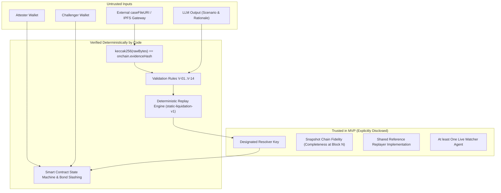

# StressProof — Architecture

This document describes the high-level architecture, subsystem boundaries, trust assumptions, and data flow of StressProof.

---

## 1. Subsystem Architecture

StressProof is divided into four distinct operational subsystems:

1. **Analysis & Extraction Pipeline (`pipeline/`):**
   * Connects to an Ethereum Mainnet archive node via an Anvil fork at pinned block $N$.
   * Filters Aave v3 borrowers to single-collateral (WETH) and stablecoin-debt positions outside eMode and isolation mode.
   * Generates a canonical dataset manifest and `snapshot.json`.
2. **Deterministic Risk Engine (`core/`):**
   * Pure Python calculation engine implementing `static-liquidation-v1`.
   * Operates strictly with non-negative integer arithmetic (USD 8 decimals, 18-decimal token amounts, basis points).
   * Validates case files against strict rules (V-01 through V-14).
3. **Storage & Coordination (`backend/`, `agents/`):**
   * Content-addressed raw byte storage (`data/case-files/{evidenceHash}.json`).
   * Agent daemons for attesting, watching, resolving disputes, and simulating attacks.
4. **On-Chain Enforcement (`contracts/`):**
   * `StressRegistry`: Permissionless registry tracking bonded claims, challenge/resolution windows, dispute statuses, and pull payments.
   * `DemoVault`: Consumes finalized claims to dynamically adjust borrow caps (`maxLtvBps`) or activate emergency pauses (`borrowPaused`).
   * `MockLendingMarket`: Mock protocol demonstrating execution failures when borrowers exceed revised vault parameters.

---

## 2. Trust Boundaries

---

## 3. Separation of Concerns: Model vs. Deterministic Verdict

| Operation | Component | Classification | Reasoning |
|---|---|---|---|
| Proposing market shock size and rationale | LLM / TigerGraph | **Model-Driven (Heuristic)** | Scenario selection requires macroeconomic/concentration intuition. |
| Extracting borrower snapshot at block $N$ | `pipeline` | **Deterministic** | Pinned block number and immutable historical contract state. |
| Simulating liquidations and residual bad debt | `core` | **Deterministic** | Integer math on committed positions using `static-liquidation-v1`. |
| Verifying case file integrity | `agents`, `frontend` | **Cryptographic** | Raw byte Keccak-256 hash comparison. |
| Slashing bonds and transferring rewards | `contracts` | **Deterministic On-Chain** | Smart contract rules in `StressRegistry`. |
| Vault parameter adjustment | `contracts` | **Deterministic On-Chain** | Preset threshold evaluation in `DemoVault`. |

---

## 4. State Transitions

The on-chain claim state machine follows these transitions:

* `None` $\xrightarrow{\text{postClaim() with BOND}}$ `Pending`
* `Pending` $\xrightarrow{\text{challenge() with BOND before challengeDeadline}}$ `Challenged`
* `Pending` $\xrightarrow{\text{finalize() after challengeDeadline}}$ `Finalized`
* `Challenged` $\xrightarrow{\text{resolve(false) by resolver before resolutionDeadline}}$ `Finalized` (Challenge rejected; Attester wins $2\times\text{BOND}$)
* `Challenged` $\xrightarrow{\text{resolve(true) by resolver before resolutionDeadline}}$ `Rejected` (Challenge upheld; Challenger wins $2\times\text{BOND}$)
* `Challenged` $\xrightarrow{\text{expireUnresolved() after resolutionDeadline}}$ `Expired` (Both parties refunded $1\times\text{BOND}$)
