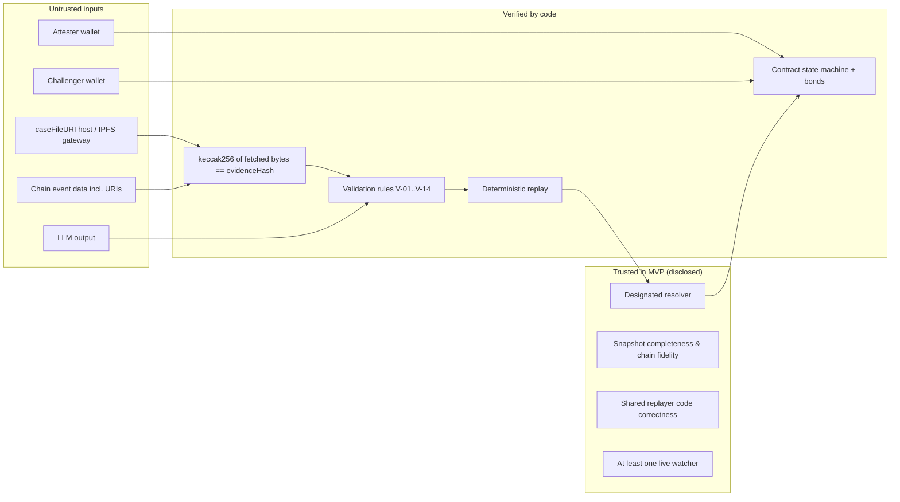
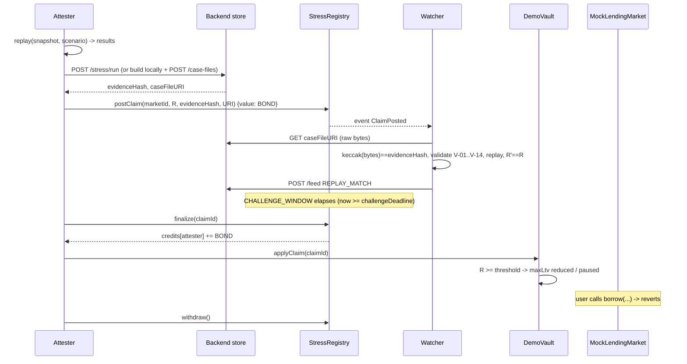
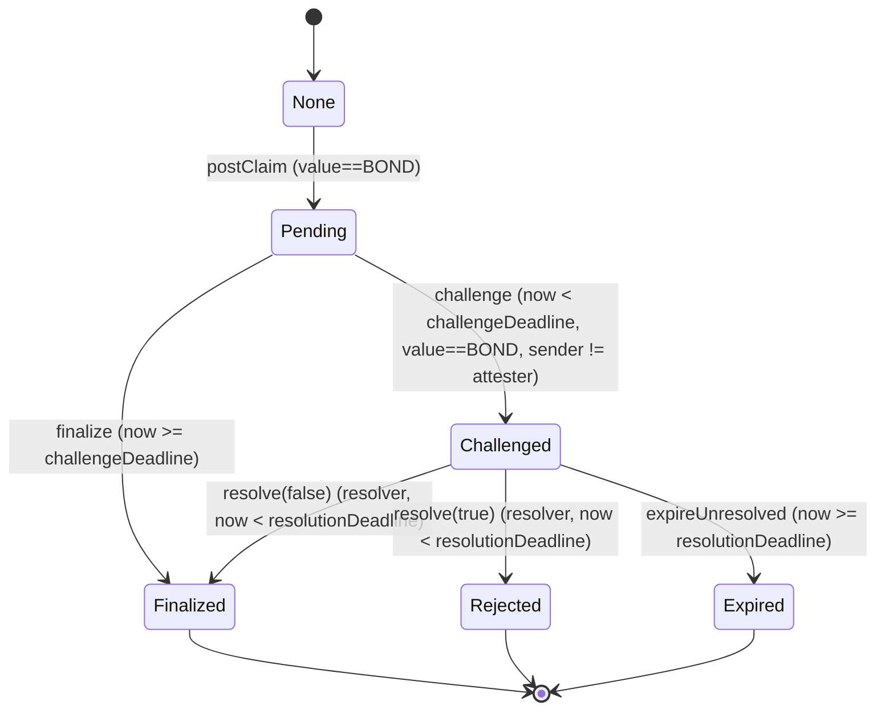

# StressProof — Implementation Plan

**Source of truth:** `StressProof_Final.md` (spec v2). This plan turns that spec into executable work. Where the plan corrects or tightens the spec, the change is logged in Section 2 with reasoning. Nothing here expands the MVP scope.

**Audience:** Person A (contracts), Person B (backend, agents, replay, data), Person C (frontend).

**How to read the labels used throughout:**

| Label | Meaning |
|---|---|
| **[VERIFIED]** | Checked against a source while writing this plan. The source is listed in Appendix F |
| **[UNVERIFIED]** | Plausible but not confirmed. Must be checked before relying on it. Listed again in Section 28 |
| **[DECISION]** | A choice this plan makes where the spec was silent or ambiguous. Change it only as a team |
| **[CORRECTION C-xx]** | Fixes a spec flaw or contradiction. See the register in Section 2 |
| **[GATE]** | An acceptance check that must pass before moving on |

---

## Table of Contents

1. Ground truth and starting state
2. Corrections and contradictions register
3. Architecture
4. Repository structure
5. Toolchain and dependencies
6. Environments, wallets and configuration
7. Encoding, hashing and identifier standards
8. Data schemas
9. Aave v3 snapshot extraction (pipeline steps 1 to 4)
10. Replay model `static-liquidation-v1`
11. Evidence validation rules
12. Smart contracts
13. Bond economics and incentive analysis
14. Backend API
15. Agents: attester, watcher, resolver CLI, malicious attester
16. Case-file storage and transport
17. TigerGraph (pipeline steps 5 and 6, queries)
18. AI layer (Phase 2)
19. Frontend
20. Security and threat model
21. Testing strategy and test catalogue
22. Deployment and demo-day runbook
23. Team responsibilities and handoff contracts
24. 40-hour timeline
25. Phase 2 and Phase 3 features
26. Cut-line procedure
27. Trust assumptions and limitations (disclosure text)
28. Open questions and verification checklist
- Appendix A: Replay test vectors
- Appendix B: Solidity reference skeleton
- Appendix C: GSQL reference
- Appendix D: LLM prompt
- Appendix E: Additional judge Q&A
- Appendix F: Sources consulted

---

## 1. Ground Truth and Starting State

1. **No repository exists yet.** The earlier session inspected its container and found no code, and nothing has been uploaded except the spec. This is a greenfield build. Every path in Section 4 is a proposal to create.
2. **The spec's architecture is fixed.** The plan keeps all of the following:
   - an Aave v3 Ethereum mainnet fork at a pinned block, used to extract the snapshot
   - the price shock applied inside the replay model
   - a mock lending market on a testnet for the on-chain effect
   - a designated, immutable resolver
   - a fixed 0.01 ETH bond on each side
   - the six claim states
   - `static-liquidation-v1`
   - the WETH-collateral, stablecoin-debt snapshot filter
   - TigerGraph kept out of the verdict path
3. **The Phase 1 gate is at hour 24.** Phase 1 is the six-step flow in spec Section 0. No Phase 2 work starts until it passes end to end (Section 24, `GATE-24`).
4. **Context the team should know.** Aave V4 is live on Ethereum mainnet alongside V3. V3 still holds by far the larger share of deposits, and Aave governance has said there is no forced migration. **[VERIFIED]** Sources disagree on V4's exact launch date, so do not put a date on a slide. If a judge asks "why V3?", the answer is that V3 is where the borrowers and the liquidity are today.

---

## 2. Corrections and Contradictions Register

Each item gives the problem, the fix, and where the fix is implemented. None of these adds a user-facing feature.

| ID | Spec location | Problem | Fix | Implemented in |
|---|---|---|---|---|
| **C-01** | 8.1 `postClaim(marketId, …)` and case file `"marketId": "aave-v3-eth-weth-stable"` | Type of `marketId` is unspecified. The watcher steps in 7.6 never check that the on-chain market matches the case file. An attester could post a claim under the vault's market with a case file about something else | On-chain `marketId` is `bytes32 = keccak256(utf8(caseFile.marketId))`. The watcher and resolver check that equality. A mismatch counts as invalid evidence | §7.5, §11 rule V-05, §12 |
| **C-02** | 7.6, 8.1 | "Invalid evidence" is defined only as "unretrievable or hash mismatch". A file that hashes correctly but is malformed (unknown model, shock out of range, unsorted accounts, wrong counts) has no defined outcome | Section 11 defines a closed list of validation rules. Failing any rule is `EVIDENCE_INVALID` | §11 |
| **C-03** | 9 | The watcher "stores a replay report (content-addressed like the case file)", but no endpoint serves reports. The resolver and the UI cannot fetch them | Add `POST /replay-reports` and `GET /replay-reports/{hash}`. Same transport rules as case files | §14 |
| **C-04** | 10 "Agent feed" | Some feed items have no on-chain event. "Watcher replayed and the numbers match" emits nothing, so the UI cannot show it from chain data | Add an append-only agent feed: `POST /feed` (agents) and `GET /feed` (UI). Feed items are labelled "agent-reported". Chain events stay authoritative for state | §14, §19 |
| **C-05** | 6.3 TigerGraph schema | `Account` is keyed by `id` alone. Loading a second dataset with an overlapping address silently overwrites the first, which breaks provenance and reconciliation | Primary IDs become composite: `"<datasetId>:<accountId>"` for `Account` and `"<datasetId>:<symbol>"` for `Asset`. The plain address stays in an attribute | §17 |
| **C-06** | 6.2 step 2 "collect borrower addresses from `Borrow` events" | In Aave v3 the `Borrow` event has both `user` (the caller) and `onBehalfOf` (the account that holds the debt). Using `user` picks the wrong account when credit delegation or contracts are involved | Use the `onBehalfOf` topic. Dedupe | §9.3 |
| **C-07** | 6.2 step 2 | Getting a reserve's bit position from its index in `getReservesList()` is wrong if a reserve was ever dropped, because that list is compacted | Get each reserve's id from `getReserveData(asset).id`, then read bits `2·id` (borrowing) and `2·id+1` (collateral) of `getUserConfiguration(user)` **[UNVERIFIED: confirm bit layout and the `id` field in the deployed ABI at block N]** | §9.4 |
| **C-08** | 5.3 filter "debt=stablecoins" | "Stablecoins" is not a reproducible definition | The manifest records an explicit `stablecoinAllowlist` of reserve addresses and symbols chosen at pin time. The filter string stays for readability | §8.1, §9.2 |
| **C-09** | 6.2 step 4 "compute `snapshotHash`" | It never says which bytes are hashed | `snapshotHash = keccak256(canonical(caseFile.snapshot))`. The `snapshot.json` file on disk is exactly those canonical bytes | §7.4 |
| **C-10** | 7, 9 | The spec says "keccak256" but does not warn that Python's `hashlib.sha3_256` is **NIST SHA-3, a different function**. Using it makes every hash disagree with the chain | Python uses `eth_hash` (or `eth_utils.keccak`) only. A unit test pins `keccak256("")` (§21) | §7.3 |
| **C-11** | 7 "Storage" fallback `GET /case-files/{hash}` | If the server re-serializes JSON (for example FastAPI's `JSONResponse`), the bytes change and the hash check fails | Serve the stored bytes unchanged with `Response(content=bytes, media_type="application/json")`. Clients hash the raw body (`arrayBuffer()` in the browser, `.content` in httpx), never parsed and re-dumped JSON | §14, §16 |
| **C-12** | 7.6, 9 watcher | The watcher fetches an attacker-chosen URI from chain data. That is a server-side request forgery (SSRF) vector, and an oversized or slow response could also run past the 120-second window | Allow only `https://` and `ipfs://` (and `http://localhost` in dev). Block private and link-local IPs, cap size at 25 MB, time out at 10 s, retry at most 3 times | §16.3 |
| **C-13** | 8.7 thresholds | `PAUSE_THRESHOLD`, `LTV_THRESHOLD` and `REDUCED_LTV_BPS` have no values. If the honest residual bad debt at the chosen shock is 0, `applyClaim` reverts with `BelowThreshold` and demo step 4 fails | Run a shock sweep at pin time (§9.8) and pick a documented scenario whose honest result is above zero. Set the thresholds from that result (§12.5). Disclose that the demo thresholds were chosen for the demo | §9.8, §12.5 |
| **C-14** | 5.2 "close factor 100%" | Aave v3's real rule allows 100% liquidation only when HF ≤ 0.95 or the position is below a dust threshold (about $2,000), and 50% otherwise. v3.3 also added deficit accounting **[VERIFIED]** | No change to the model, which is the spec's stated assumption. The assumptions panel must say "full liquidation is a model simplification; Aave allows 50% in some cases" | §10.4, §27 |
| **C-15** | 8.3 `resolve` "resolver is neither attester nor challenger" | If the resolver wallet ever posts or challenges, that claim cannot be resolved and will expire | Keep the spec's literal check. Operational rule: the resolver key is never used for anything else. The deploy script asserts that the resolver differs from the attester, watcher and deployer addresses in `.env` | §12, §22 |
| **C-16** | 8.3 "one challenge only" | A dishonest attester can front-run the honest watcher with a challenge from a sock-puppet wallet. The incorrect claim is still rejected, but the honest watcher earns nothing | MVP: disclose it (§13.3). Post-MVP: commit-reveal challenges or rewards shared among challengers | §13, §27 |
| **C-17** | 8.7 `applyClaim` | A finalized claim can be applied at any time, even when it is old | MVP: disclose it. The demo resets controls between runs. Post-MVP: a maximum claim age | §27 |
| **C-18** | 7.6 step 5 "compares exactly with the claim" | Unclear whether the informational metrics (`liquidatableAccounts`, `debtAtRisk`, `liquidationVolume`) are adjudicated | Only `residualBadDebtUsd8` is adjudicated. The watcher logs mismatches in the other three as `INFO_MISMATCH` but does not challenge on them | §11, §15.2 |
| **C-19** | 8.5 resolver procedure, `EVIDENCE_INVALID` | Whether a file is "unretrievable" depends on who is fetching and when. The spec does not say what happens if the resolver can fetch a matching file that the watcher could not | Rule: if the resolver gets bytes matching `evidenceHash` from **any** source (the URI, the challenger's cached copy, the backend fallback) during the resolution window, the evidence counts as retrievable and the replay rule decides. Disclose that this can cost a watcher its bond when the attester's host was only briefly down | §15.3 |
| **C-20** | 6.2 extraction on "the fork" | Some Python clients forward the `latest` block tag to the upstream RPC when the fork needs state it has not cached, which can return data **after** block N **[VERIFIED for web3.py v7 per eth_defi docs]** | Every read passes an explicit `block_identifier=N`. Never use `latest` or `pending` in extraction | §9 |
| **C-21** | 6.2 step 2 "collect from `Borrow` events up to N" through the fork | It is not confirmed that an Anvil fork serves historical `eth_getLogs` for blocks before the fork point | Fetch logs from the upstream archive RPC with an explicit `toBlock = N`. History before N cannot change, so this does not affect reproducibility. State reads go through the fork, also at an explicit block N **[UNVERIFIED: Anvil's historical log forwarding]** | §9.3 |
| **C-22** | 7.6 watcher | Several cheap integrity checks are missing: the `dataClass` agrees with the account `origin` flags, the counts agree with the manifest, the IDs are unique and sorted | Added as validation rules V-10 to V-14. They are checks on the file's internal consistency, not on whether the snapshot is complete | §11 |
| **C-23** | 8.1 `caseFileURI` | No length limit, so a very long string inflates gas and can break a UI | **[DECISION]** `MAX_URI_LENGTH = 512` bytes. Same cap for `replayReportURI` | §12 |
| **C-24** | 8.6 events | `ClaimFinalized` is listed, but the spec does not say whether `resolve(false)`, which also moves to `Finalized`, emits it | **[DECISION]** Both paths into `Finalized` emit `ClaimFinalized`, so indexers need one rule | §12 |
| **C-25** | Plan v1 §9.2 (self-correction) | The candidate stablecoin list included `USDe` and `sUSDe`, and the next line excluded them | The candidate list is now the complete definition, and those symbols are removed from it | §9.2 |
| **C-26** | Plan v1 §10.2 (self-correction) | The plan said `floor(cval·lt/BPS) < debt` and `cval·lt < debt·BPS` differ at boundaries. That is wrong: for integer debt they are equivalent | The explanation is corrected, and boundary tests are added | §10.2, T-P-36 |
| **C-27** | Plan v1 §10.2, T-P-35 (self-correction) | A text search for `/` does not establish integer-only arithmetic. It gives false positives and misses `float()`, `math.floor`, `Decimal` and similar | Replaced by an exact `Fraction` reference oracle, property tests, tests above 2**53, type checks and code review | §10.2, T-P-35 to T-P-38 |

---

## 3. Architecture

### 3.1 Components and owners

| Component | Owner | Process | In verdict path? |
|---|---|---|---|
| Snapshot pipeline (`pipeline/`) | B | CLI scripts | Produces the inputs. The replay reads the committed result |
| `stressproof_core` (canonical JSON, keccak, schema, validators, replayer) | B | Python library imported by everything | **Yes** |
| Backend (`backend/`, FastAPI) | B | Long-running server | No. It stores and serves bytes, and the hash makes the transport untrusted |
| Attester agent | B | Long-running or one-shot | Proposes |
| Watcher agent | B | Long-running | Checks and challenges |
| Resolver CLI | B builds it, the resolver operates it | One-shot CLI | **Yes (trusted step)** |
| Malicious attester | B | One-shot script | Demo only |
| `StressRegistry`, `DemoVault`, `MockLendingMarket` | A | Testnet contracts | **Yes (state and money)** |
| Frontend (`frontend/`, Next.js) | C | Web app | No |
| TigerGraph loader, reconciler, queries | B (Phase 2) | CLI and backend route | **No, never** |
| LLM scenario proposer | B (Phase 2) | Inside the attester | No. Its output is validated in code |

### 3.2 Trust boundaries



### 3.3 Happy-path sequence (honest claim)



### 3.4 Dispute sequence (dishonest claim)

```mermaid
sequenceDiagram
  participant MA as Malicious attester
  participant REG as StressRegistry
  participant W as Watcher
  participant R as Resolver CLI
  MA->>REG: postClaim(marketId, 3R, h', URI') {BOND}
  REG-->>W: ClaimPosted
  W->>W: fetch, hash OK, validate OK, replay -> R != 3R
  W->>W: build replay report, store -> reportHash, reportURI
  W->>REG: challenge(id, WRONG_RESULT, R, reportURI, reportHash) {BOND}
  REG-->>R: ClaimChallenged
  R->>R: fetch case file + report, repeat checks, print verdict
  R->>REG: resolve(id, true)  (now < resolutionDeadline)
  REG-->>W: credits[watcher] += 2*BOND ; state Rejected
  W->>REG: withdraw()
  Note over REG: DemoVault.applyClaim(id) reverts NotFinalized
```

### 3.5 State machine (on-chain)



---

## 4. Repository Structure

One monorepo. Create exactly this layout. Files marked (P2) are Phase 2 and are not created before `GATE-24`.

```
stressproof/
├── README.md                        # setup, run, disclosure text (§27), Socket scan result (P2)
├── implementationplan.md            # this file
├── StressProof_Final.md             # spec v2, unchanged
├── Makefile                         # all commands in §22.1
├── .env.example                     # every variable in §6.3, no secrets
├── .gitignore                       # .env, data/**, !data/fixtures/**, node_modules, out, cache, .venv
├── deployments/
│   ├── 31337.json                   # local anvil (written by deploy script)
│   └── 84532.json                   # Base Sepolia (written by deploy script) [DECISION testnet, §6.1]
├── contracts/                       # Person A, Foundry project
│   ├── foundry.toml
│   ├── src/
│   │   ├── IStressRegistry.sol
│   │   ├── StressRegistry.sol
│   │   ├── DemoVault.sol
│   │   └── MockLendingMarket.sol
│   ├── script/
│   │   └── Deploy.s.sol
│   └── test/
│       ├── StressRegistry.t.sol     # every row of spec 8.3 and 8.4, plus negatives (§21.2)
│       ├── DemoVault.t.sol
│       ├── MockLendingMarket.t.sol
│       ├── Invariant.t.sol          # balance accounting invariant
│       └── helpers/ReentrantWithdrawer.sol
├── core/                            # Person B, Python package `stressproof_core`
│   ├── pyproject.toml
│   ├── stressproof_core/
│   │   ├── __init__.py
│   │   ├── canonical.py             # canonical_bytes(obj) -> bytes ; parse_strict(bytes) -> obj
│   │   ├── hashing.py               # keccak256(bytes) -> "0x…" ; market_id(str) -> bytes32 hex
│   │   ├── schema.py                # typed dicts / dataclasses for manifest, snapshot, case file, report
│   │   ├── validate.py              # rules V-01..V-14 (§11) -> list[Violation]
│   │   ├── replayer.py              # replay(case_file) -> ReplayReport   (pure, no I/O)
│   │   ├── report.py                # build_replay_report(...)
│   │   └── constants.py             # MODEL_ID, SCHEMA_VERSION, shock bounds
│   └── tests/
│       ├── test_canonical.py
│       ├── test_hashing.py
│       ├── test_replayer_vectors.py # Appendix A
│       ├── test_replayer_props.py   # property tests (§21.3)
│       └── test_validate.py
├── pipeline/                        # Person B, snapshot builder
│   ├── abis/                        # minimal ABIs actually used, copied from verified sources
│   │   ├── PoolAddressesProvider.json
│   │   ├── Pool.json
│   │   ├── ProtocolDataProvider.json
│   │   ├── AaveOracle.json
│   │   └── Multicall3.json
│   ├── pin.py                       # step 1
│   ├── extract.py                   # step 2
│   ├── synth.py                     # step 3 (optional)
│   ├── normalize.py                 # step 4
│   ├── sweep.py                     # shock sweep for C-13
│   ├── tg_load.py                   # step 5 (P2)
│   └── tg_reconcile.py              # step 6 (P2)
├── backend/                         # Person B, FastAPI
│   ├── pyproject.toml
│   └── app/
│       ├── main.py                  # app factory, CORS, routers
│       ├── config.py                # env parsing
│       ├── store.py                 # content-addressed file store
│       ├── ipfs.py                  # optional pinning client
│       ├── routes_stress.py         # POST /stress/run
│       ├── routes_files.py          # case-files and replay-reports
│       ├── routes_datasets.py
│       ├── routes_feed.py
│       └── routes_graph.py          # (P2)
├── agents/                          # Person B
│   ├── common/
│   │   ├── chain.py                 # web3 client, contract handles, tx sender with nonce mgmt
│   │   ├── fetch.py                 # SSRF-safe fetch (§16.3)
│   │   ├── feed.py                  # POST /feed helper
│   │   └── state.py                 # sqlite-backed per-claim watcher state
│   ├── attester.py
│   ├── watcher.py
│   ├── resolver_cli.py
│   ├── malicious_attester.py
│   └── llm_scenario.py              # (P2)
├── tigergraph/                      # (P2)
│   ├── schema.gsql
│   └── queries/
│       ├── top_debt.gsql
│       ├── near_liquidation.gsql
│       └── totals_by_origin.gsql
├── frontend/                        # Person C, Next.js
│   ├── package.json
│   ├── next.config.*
│   ├── src/
│   │   ├── app/
│   │   │   ├── layout.tsx
│   │   │   ├── page.tsx             # Markets
│   │   │   ├── stress/page.tsx
│   │   │   ├── claims/page.tsx
│   │   │   ├── claims/[id]/page.tsx # Verify and Vault for one claim
│   │   │   ├── vault/page.tsx
│   │   │   ├── feed/page.tsx
│   │   │   └── graph/page.tsx       # (P2)
│   │   ├── components/
│   │   ├── lib/
│   │   │   ├── wagmi.ts
│   │   │   ├── contracts.ts         # addresses from deployments/*.json, ABIs from contracts/out
│   │   │   ├── api.ts               # backend client
│   │   │   ├── verify.ts            # fetch raw bytes + keccak
│   │   │   └── format.ts            # usd8 formatting, never floats for logic
│   │   └── abi/                     # generated, do not edit by hand
│   └── tests/
├── scripts/
│   ├── export_abis.sh               # contracts/out -> frontend/src/abi + agents
│   ├── e2e_local.sh                 # full Phase 1 flow on anvil with time warp
│   └── demo_testnet.sh              # scripted demo steps
└── data/                            # gitignored except fixtures
    ├── fixtures/                    # small golden files committed (Appendix A)
    ├── datasets/<datasetId>/        # manifest, real_accounts.jsonl, synthetic_accounts.jsonl, snapshot.json
    ├── case-files/                  # <evidenceHash>.json
    ├── replay-reports/              # <reportHash>.json
    └── feed.jsonl
```

---

## 5. Toolchain and Dependencies

### 5.1 Version policy

This plan **does not name exact package versions.** The current versions could not be checked against registries from here, and guessing would break the rule against inventing facts. Instead:

1. At hour 0, each person installs the **latest stable** release of each tool below and commits the lockfile (`uv.lock` or `requirements.lock` with hashes, `package-lock.json` or `pnpm-lock.yaml`, `foundry.toml` with a pinned `solc`).
2. Record the resolved versions in `README.md` under "Pinned toolchain".
3. Nobody upgrades anything after hour 8 unless a blocking bug forces it.
4. The Socket scan (Phase 2) runs against these lockfiles.

### 5.2 Contracts (Person A)

| Tool | Purpose | Notes |
|---|---|---|
| Foundry (`forge`, `cast`, `anvil`) | Build, test, deploy, local chain, mainnet fork | `anvil --fork-url <archive> --fork-block-number N` **[VERIFIED flag names in Foundry docs]** |
| `solc` 0.8.x | Compiler | **[DECISION]** Pin one 0.8.x release in `foundry.toml`. It needs custom errors (≥ 0.8.4) and built-in overflow checks |
| `forge-std` | Tests | Only test dependency |
| OpenZeppelin | **Not used** | **[DECISION]** The contracts are small enough to write without it: an immutable owner, the checks-effects-interactions pattern, and pull payments. That removes a dependency and shrinks the Socket scan |

### 5.3 Python (Person B)

| Package | Purpose | Notes |
|---|---|---|
| Python ≥ 3.11 | Runtime | Arbitrary-precision `int` is required for the replay math |
| `uv` (or `pip` + `pip-tools`) | Environment and lockfile | Hash-pinned lock |
| `web3` (v7 line) | Chain access | Always pass explicit `block_identifier` (C-20). v7 renamed some middleware compared with v6. Check the docs for the version you install |
| `eth-hash[pycryptodome]` or `eth-utils` | **keccak256** | Never `hashlib.sha3_256` (C-10) |
| `fastapi`, `uvicorn` | Backend | |
| `httpx` | Fetching from agents | Streaming with a size cap (§16.3) |
| `pydantic` v2 | Request and response models in the backend | Not used inside `stressproof_core`, which stays dependency-light so it is easy to audit |
| `pyTigerGraph` (P2) | Graph loading and queries | `TigerGraphConnection`, `upsertVertices`, `upsertEdges`, `getVertexCount` **[VERIFIED in pyTigerGraph docs]**. Check `runInterpretedQuery` against the installed version **[UNVERIFIED]** |
| `pytest`, `hypothesis` | Tests | |
| `python-dotenv` | Config | |
| LLM SDK (P2) | Scenario proposal | The provider is a team choice. Set the model id through `LLM_MODEL`. Never hard-code it |

### 5.4 Frontend (Person C)

| Package | Purpose | Notes |
|---|---|---|
| Node.js LTS | Runtime | |
| Next.js (App Router) | Framework | |
| `wagmi`, `viem`, `@tanstack/react-query` | Chain reads, writes, keccak | `viem.keccak256(Uint8Array)` for in-browser hashing |
| `@rainbow-me/rainbowkit` | Wallet connect | **[UNVERIFIED]** Its `getDefaultConfig` needs a WalletConnect (Reown) `projectId`. Create one at hour 0. Check that the RainbowKit major version matches the installed wagmi major version |
| Tailwind CSS, shadcn/ui | UI | |
| `react-force-graph-2d` (P2) | Graph | **[DECISION]** Chosen over Cytoscape.js. Load it with `next/dynamic` and `ssr: false` because it uses the browser canvas |

### 5.5 External services

| Service | Needed for | Fallback |
|---|---|---|
| Ethereum mainnet **archive** RPC | Extraction at block N | Without archive access, historical reads fail. Fall back to `SYNTHETIC` (spec 6.1) |
| Testnet RPC (Base Sepolia) | Contracts and agents | Local anvil (§22.4) |
| Testnet faucet ETH | Four wallets | Ask organizers or teammates |
| IPFS pinning service (optional) | `ipfs://` URIs | The backend fallback URI (spec 7) |
| TigerGraph Savanna free tier (P2) | Graph | **[VERIFIED]** A free tier exists. Free workspaces auto-stop when idle. A Mumbai (AWS) region is listed. Start the workspace well before the demo |
| LLM API (P2) | Scenario proposal | Fixed scenario (cut item 6) |
| WalletConnect projectId | RainbowKit | Injected wallet only |

---

## 6. Environments, Wallets and Configuration

### 6.1 Chains

| Name | Chain id | Use |
|---|---|---|
| Local anvil | 31337 | Development, CI-style tests, time warp, **demo fallback** |
| Base Sepolia | 84532 **[UNVERIFIED: confirm on the chain registry or Base docs]** | **[DECISION]** Primary demo testnet: cheap, short blocks, public explorer. The spec leaves the testnet open (16) and no partner requires a chain. If a partner bounty names a chain, switch. The contracts are chain-agnostic |
| Ethereum mainnet (read-only, archive) | 1 | Snapshot extraction only. **No transactions are ever sent to mainnet** |

### 6.2 Wallets

Create five keys. Each key has exactly one role.

| Role | Env var | Funded on testnet | Never used for |
|---|---|---|---|
| Deployer / vault owner | `DEPLOYER_PK` | Yes | Posting, challenging, resolving |
| Attester (honest) | `ATTESTER_PK` | Yes (≥ 10 × BOND + gas) | Challenging |
| Malicious attester | `MALICIOUS_PK` | Yes | Anything else |
| Watcher / challenger | `WATCHER_PK` | Yes (≥ 10 × BOND + gas) | Posting |
| Resolver | `RESOLVER_PK` | Yes (gas only) | **Posting or challenging (C-15)** |

The spec's checklist asks for four wallets. This plan adds a separate malicious-attester wallet so the demo shows two clearly different attesters. **[DECISION]**

### 6.3 `.env.example`

```dotenv
# --- chains ---
MAINNET_ARCHIVE_RPC_URL=            # archive node, mainnet, read-only
FORK_RPC_URL=http://127.0.0.1:8545  # anvil fork of mainnet at FORK_BLOCK
FORK_BLOCK=                         # integer, chosen in pipeline step 1
TESTNET_RPC_URL=
TESTNET_CHAIN_ID=84532
LOCAL_RPC_URL=http://127.0.0.1:8546 # separate anvil (non-fork) for local e2e
DEPLOYMENTS_FILE=deployments/84532.json

# --- keys (never commit .env) ---
DEPLOYER_PK=
ATTESTER_PK=
MALICIOUS_PK=
WATCHER_PK=
RESOLVER_PK=

# --- contract constants (deploy-time) ---
BOND_WEI=10000000000000000           # 0.01 ETH
CHALLENGE_WINDOW_SEC=120
RESOLUTION_WINDOW_SEC=300
TOLERANCE_BPS=0
MARKET_ID_STRING=aave-v3-eth-weth-stable
PAUSE_THRESHOLD_USD8=                # from sweep (§9.8, §12.5)
LTV_THRESHOLD_USD8=                  # from sweep
REDUCED_LTV_BPS=5000                 # [DECISION] demo preset
DEFAULT_MAX_LTV_BPS=8000             # [DECISION] demo preset

# --- backend / storage ---
BACKEND_URL=http://127.0.0.1:8000
BACKEND_PUBLIC_URL=                  # URL that other machines and the browser can reach
API_WRITE_TOKEN=                     # shared secret for POST routes
DATA_DIR=./data
CORS_ORIGINS=http://localhost:3000
IPFS_PINNING_ENABLED=false
IPFS_PIN_API_URL=                    # [UNVERIFIED] provider-specific
IPFS_PIN_JWT=
IPFS_GATEWAY_URL=                    # gateway used by watcher/resolver/browser to read ipfs:// URIs

# --- fetch limits (§16.3) ---
FETCH_MAX_BYTES=26214400
FETCH_TIMEOUT_SEC=10
FETCH_RETRIES=3
FETCH_ALLOW_LOCALHOST=true           # dev only; false on demo machines that fetch remote URIs

# --- agents ---
WATCHER_POLL_SEC=2
WATCHER_START_BLOCK=                 # registry deployment block
FIXED_SCENARIO_ASSET=WETH
FIXED_SCENARIO_SHOCK_BPS=            # from sweep
DATASET_ID=

# --- phase 2 ---
TG_HOST=
TG_GRAPH=StressProof
TG_USERNAME=
TG_PASSWORD=
TG_SECRET=
LLM_PROVIDER=
LLM_MODEL=
LLM_API_KEY=

# --- frontend (NEXT_PUBLIC_* are exposed to the browser: never put secrets here) ---
NEXT_PUBLIC_BACKEND_URL=
NEXT_PUBLIC_CHAIN_ID=84532
NEXT_PUBLIC_WC_PROJECT_ID=
```

The manifest **never** contains RPC URLs or keys (spec 6.2). It records only a provider name, through `RPC_PROVIDER_NAME`, which the pipeline reads.

---

## 7. Encoding, Hashing and Identifier Standards

All components must produce identical bytes. This section is normative.

### 7.1 Canonical JSON (`core/stressproof_core/canonical.py`)

```python
import json

def canonical_bytes(obj) -> bytes:
    _assert_canonical_types(obj)     # raises on float, NaN, non-str keys, bytes, tuples, sets
    return json.dumps(
        obj,
        sort_keys=True,
        separators=(",", ":"),
        ensure_ascii=True,           # non-ASCII → \uXXXX escapes; output is pure ASCII ⊂ UTF-8
        allow_nan=False,
    ).encode("utf-8")
```

Rules:

1. Allowed value types are `dict` (string keys), `list`, `str`, `int`, `bool` and `None`. **Floats are rejected.**
2. **Amounts** (`priceUsd8`, `collateralAmount`, `debtUsd8`, all `*Usd8` results) are **decimal strings**: digits only, no sign, no leading zeros, and `"0"` for zero. Regex: `^(0|[1-9][0-9]*)$`.
3. **Small bounded integers** are JSON numbers: `schemaVersion`, `decimals`, `ltBps`, `bonusBps`, `shockBps`, `liquidatableAccounts`, `forkBlock`, `counts.*`. Each must satisfy `|v| < 2**53` so JavaScript can read it safely.
4. Keys are sorted by Unicode code point. All keys are ASCII, so this is the same as byte order.
5. There is no trailing newline.
6. **Verification never re-serializes.** Verifiers hash the bytes exactly as fetched. `parse_strict(bytes)` additionally checks that `canonical_bytes(json.loads(bytes)) == bytes`, and validation rule V-03 rejects a file that is not canonical. That catches producer bugs early.
7. Free text (`agentRationale`) is limited to 4,000 characters after stripping control characters other than `\n`. **[DECISION]**

### 7.2 Number domains

| Quantity | Unit | Max expected | Representation |
|---|---|---|---|
| WETH price | USD × 1e8 | ~1e13 | string |
| Collateral amount | wei (18 decimals) | up to ~1e24 or more | string |
| Debt | USD × 1e8 | up to ~1e17 per account | string |
| Totals | USD × 1e8 | up to ~1e19 or more | string. **May exceed uint64**, so never store totals in a TigerGraph `UINT` without checking (§17) |
| bps | basis points | 10,000 to 20,000 | number |

### 7.3 Hashing (`hashing.py`)

```python
from eth_hash.auto import keccak   # NOT hashlib.sha3_256

def keccak256_hex(b: bytes) -> str:
    return "0x" + keccak(b).hex()       # lowercase, 0x-prefixed, 66 chars

def market_id(s: str) -> str:
    return keccak256_hex(s.encode("utf-8"))   # bytes32 for postClaim (C-01)
```

Test pin: `keccak256(b"") == 0xc5d2460186f7233c927e7db2dcc703c0e500b653ca82273b7bfad8045d85a470`. For contrast, `hashlib.sha3_256(b"")` gives `a7ffc6f8…`, which **must not** match. That test exists to catch C-10.

Equivalent hashes elsewhere:
- **Solidity:** `keccak256(bytes(marketIdString))`. Only used in tests and the deploy script.
- **Browser:** `viem.keccak256(new Uint8Array(await res.arrayBuffer()))`.
- **CLI:** `cast keccak` for strings. For files, use the Python helper, because `cast keccak` treats input that starts with `0x` as hex.

### 7.4 What each hash covers

| Hash | Input bytes | Where it lives |
|---|---|---|
| `snapshotHash` | `canonical_bytes(caseFile["snapshot"])`, which is also the exact content of `snapshot.json` | Manifest (inside the case file) |
| `evidenceHash` | `canonical_bytes(caseFile)`, the whole file | On-chain `postClaim`, file name in the store |
| `replayReportHash` | `canonical_bytes(report)` | On-chain `challenge` |
| `marketId` (bytes32) | UTF-8 bytes of `caseFile["marketId"]` | On-chain `postClaim` (C-01) |

### 7.5 Identifiers

| Thing | Format |
|---|---|
| Real account id | Lowercase hex address `0x` plus 40 characters. **[DECISION]** Lowercase, not checksummed, so sorting is unambiguous |
| Synthetic account id | `synth-0001` … `synth-9999` |
| Account sort order | Plain string comparison of `id`. All real ids start with `0x`, which sorts before `s`, so real accounts come first |
| `datasetId` | `weth-stable-<forkBlock>-v1`, or `-v1-mixed-<seed>` and `-v1-synth-<seed>` for the other data classes |
| `claimId` | `uint256`, starts at **1**. Id 0 always reads as state `None` |
| `marketId` string | `aave-v3-eth-weth-stable` |
| `model.id` | `static-liquidation-v1` |

---

## 8. Data Schemas

All files are canonical JSON (§7.1) unless they end in `.jsonl`.

### 8.1 Dataset manifest (`data/datasets/<datasetId>/dataset_manifest.json`)

Spec 6.2 fields, plus the C-08 additions marked ★.

```json
{
  "datasetId": "weth-stable-<N>-v1",
  "dataClass": "REAL",
  "network": "ethereum-mainnet-fork",
  "forkBlock": 0,
  "forkBlockHash": "0x…",                         // ★ pins the exact block, guards against reorg/ambiguity
  "forkBlockTimestamp": 0,                         // ★
  "poolAddressesProvider": "0x2f39…",             // ★ resolved addresses come from this at block N
  "poolAddress": "0x…",
  "dataProviderAddress": "0x…",
  "oracleAddress": "0x…",
  "wethAddress": "0x…",                            // ★
  "stablecoinAllowlist": [ {"address":"0x…","symbol":"USDC"} ],   // ★ C-08, sorted by address
  "rpcProvider": "<provider name only>",           // ★ name, never URL
  "extractionScriptCommit": "<git sha>",
  "syntheticSeed": null,
  "filter": "collateral=WETH only; debt=stablecoins; eMode=0; isolation=false",
  "counts": { "real": 0, "synthetic": 0 },
  "excludedCounts": { "noDebt": 0, "eMode": 0, "nonWethCollateral": 0, "nonStableDebt": 0, "wethNotCollateral": 0, "other": 0 },  // ★ explains the funnel
  "snapshotHash": "0x…",
  "extractedAt": "ISO-8601"
}
```

(The `//` comments are documentation only. Real files contain no comments.)

### 8.2 Snapshot (`snapshot.json`) and the case-file `snapshot` object

```json
{
  "accounts": [
    { "collateralAmount": "10000000000000000000", "debtUsd8": "2000000000000", "id": "0x…", "origin": "real_aave_v3_fork" }
  ],
  "assets": {
    "WETH": { "bonusBps": 10500, "decimals": 18, "ltBps": 8300, "priceUsd8": "300000000000" }
  }
}
```

This follows the spec 7 schema exactly, with keys shown in sorted order. `ltBps` and `bonusBps` are the WETH reserve's values at block N. `priceUsd8` is `AaveOracle.getAssetPrice(WETH)` at block N. The sample numbers are only illustrative.

### 8.3 Case file

This is the spec 7 schema. `dataset` holds the full manifest from §8.1.

```json
{
  "agentRationale": "…",
  "dataClass": "REAL",
  "dataset": { "…manifest §8.1…": "" },
  "marketId": "aave-v3-eth-weth-stable",
  "model": { "id": "static-liquidation-v1", "replayerCommit": "<git sha>" },
  "results": {
    "debtAtRiskUsd8": "0",
    "liquidatableAccounts": 0,
    "liquidationVolumeUsd8": "0",
    "residualBadDebtUsd8": "0"
  },
  "scenario": { "asset": "WETH", "shockBps": -3000 },
  "schemaVersion": 1,
  "snapshot": { "…§8.2…": "" }
}
```

In Phase 1, `agentRationale` is a fixed string: `"Phase 1 fixed scenario: <shockBps> bps WETH shock."`

### 8.4 Replay report (C-03)

```json
{
  "schemaVersion": 1,
  "chainId": 84532,
  "registry": "0x…",
  "claimId": "7",
  "evidenceHash": "0x…",
  "fetchedFrom": "https://…",
  "hashMatches": true,
  "violations": [],                         // V-xx codes from §11, empty if valid
  "claimedOnChainUsd8": "600000000000",
  "claimedInFileUsd8": "600000000000",
  "recomputed": {
    "debtAtRiskUsd8": "…", "liquidatableAccounts": 0,
    "liquidationVolumeUsd8": "…", "residualBadDebtUsd8": "200000000000"
  },
  "infoMismatches": ["debtAtRiskUsd8"],     // C-18, informational only
  "verdict": "WRONG_RESULT",                // MATCH | WRONG_RESULT | EVIDENCE_INVALID
  "modelId": "static-liquidation-v1",
  "replayerCommit": "<git sha>",
  "watcher": "0x…",
  "caseFileCopyURI": "https://…/case-files/0x…"   // watcher's cached copy, if the hash matched
}
```

`claimId` is a decimal string because it is a uint256.

### 8.5 Per-account outcome (in memory; written to `replay_outputs/<evidenceHash>.jsonl` for the UI and graph only)

```json
{"id":"0x…","liquidatable":true,"repaidUsd8":"1000000000000","residualUsd8":"200000000000","collateralValueUsd8":"1050000000000"}
```

Per-account outcomes are **not** part of the on-chain claim. They are derived data and can always be recomputed.

### 8.6 Agent feed entry (C-04)

```json
{"seq":42,"ts":"ISO-8601","actor":"watcher","kind":"REPLAY_MATCH","claimId":"3","txHash":null,"data":{"recomputedUsd8":"…"}}
```

`kind` takes one of: `CLAIM_BUILT`, `CLAIM_POSTED`, `FILE_FETCHED`, `FETCH_FAILED`, `HASH_OK`, `HASH_MISMATCH`, `VALIDATION_FAILED`, `REPLAY_MATCH`, `REPLAY_MISMATCH`, `INFO_MISMATCH`, `REPORT_STORED`, `CHALLENGE_SENT`, `CHALLENGE_FAILED`, `RESOLVER_VERDICT`, `RESOLVED`, `FINALIZED`, `EXPIRED`, `VAULT_APPLIED`, `WITHDRAWN`, `ERROR`.

### 8.7 Deployments file (`deployments/<chainId>.json`)

```json
{
  "chainId": 84532,
  "registry": "0x…", "vault": "0x…", "market": "0x…",
  "registryDeployBlock": 0,
  "resolver": "0x…",
  "marketId": "0x…", "marketIdString": "aave-v3-eth-weth-stable",
  "bondWei": "10000000000000000",
  "challengeWindowSec": 120, "resolutionWindowSec": 300,
  "pauseThresholdUsd8": "…", "ltvThresholdUsd8": "…",
  "reducedLtvBps": 5000, "defaultMaxLtvBps": 8000,
  "gitCommit": "<sha>"
}
```

Every component reads addresses and constants from this file. **Nobody pastes addresses by hand.**

---

## 9. Aave v3 Snapshot Extraction (Pipeline Steps 1 to 4)

**Owner:** Person B. **Starts:** hour 1, running in the background while B writes the replayer. **Hard fallback:** if `REAL` extraction has not produced a validated snapshot by hour 8, switch to `SYNTHETIC` (spec 6.1 and 17) and keep extracting in the background. A later `REAL` dataset can replace it without code changes.

### 9.1 Addresses

| Contract | Ethereum mainnet address | Status |
|---|---|---|
| PoolAddressesProvider | `0x2f39d218133AFaB8F2B819B1066c7E434Ad94E9e` | **[VERIFIED]** in several third-party libraries that cite `bgd-labs/aave-address-book`. Check once against the address book repo |
| Pool (proxy) | `0x87870Bca3F3fD6335C3F4ce8392D69350B4fA4E2` | **[VERIFIED]** same sources. Also resolve it at block N via `getPool()` and assert equality |
| AaveOracle | `0x54586bE62E3c3580375aE3723C145253060Ca0C2` | Seen in third-party code. **Resolve at block N via `getPriceOracle()`.** Use the resolved value |
| Protocol data provider | **Resolve at N via `getPoolDataProvider()`** | Third-party code lists **different** addresses (several data-provider versions exist), so never hard-code it |
| WETH | `0xC02aaA39b223FE8D0A0e5C4F27eAD9083C756Cc2` | Canonical WETH9. Assert that `getReserveData(WETH)` returns a nonzero aToken at N |
| Multicall3 | `0xcA11bde05977b3631167028862bE2a173976CA11` | **[VERIFIED]** same deterministic address across chains (seen in third-party code). Assert `eth_getCode` is nonempty at N |

Rule: `pin.py` resolves the provider-derived addresses **at block N** and writes the resolved values into the manifest. Hard-coded values are only used for the assertion.

### 9.2 Step 1 — Pin (`pipeline/pin.py`)

Inputs: `--block N` (or `--latest-finalized` to choose one), `--provider-name`.

1. If no N is given, read the archive RPC's `finalized` block, record it, and use it from then on. **[DECISION]** Use a finalized block so there is no reorg ambiguity.
2. Record `forkBlockHash` and `forkBlockTimestamp` from `eth_getBlockByNumber(N)`.
3. At `block_identifier=N`, resolve the Pool, data provider and oracle through PoolAddressesProvider.
4. Build `stablecoinAllowlist` (C-08). Call `getReservesList()` at N and read each reserve's symbol at N. Keep only reserves whose symbol is in this fixed candidate list: `USDC, USDT, DAI, GHO, PYUSD, USDS, LUSD, crvUSD, FRAX, RLUSD`.
   - **[DECISION]** The candidate list is the complete definition. A symbol that is not on it is not a stablecoin for this model.
   - `USDe` and `sUSDe` are deliberately **left off** the list. They are synthetic or yield-bearing dollars and do not hold the USD peg in the way the model's unshocked-debt assumption requires. Accounts with debt in them are excluded as `nonStableDebt`.
   - The final allowlist is the intersection of this list with the reserves listed at N. Record it exactly in the manifest, sorted by address.
   - Match on the reserve **address** after resolving symbols once at N. Never match on symbol strings at runtime, because symbols are not unique identifiers.
   - **[UNVERIFIED]** Which of these symbols are listed on Aave v3 Ethereum at N. The script discovers that. Do not assume.
5. Read the WETH reserve configuration at N with `getReserveConfigurationData(WETH)`: `decimals`, `liquidationThreshold` (bps), `liquidationBonus` (bps, for example `10500` means 5%), `usageAsCollateralEnabled`, `isActive`, `isFrozen`. Also read `getDebtCeiling(WETH)`, which must be 0, meaning WETH is not an isolated asset. Abort if it is not.
6. Read the WETH price at N with `AaveOracle.getAssetPrice(WETH)` (8 decimals, USD base). **[VERIFIED]** Aave v3's base currency on Ethereum is USD with 8 decimals, and `getUserAccountData` reports values in that base. Also call `BASE_CURRENCY_UNIT()` on the oracle and assert it equals `1e8` **[UNVERIFIED: confirm the function name in the oracle ABI]**.
7. Write a draft `dataset_manifest.json` with `counts` and `snapshotHash` left empty.

### 9.3 Step 2a — Borrower discovery (`extract.py discover`)

1. Event: `Borrow(address indexed reserve, address user, address indexed onBehalfOf, uint256 amount, uint8 interestRateMode, uint256 borrowRate, uint16 indexed referralCode)`. **[UNVERIFIED: confirm the exact signature and which arguments are indexed in the Pool ABI. Compute `topic0` from the ABI, never type it by hand.]**
2. Range: from the Pool's deployment block to N. Find the deployment block from the Pool proxy's creation transaction on a block explorer and record it in the manifest. **[UNVERIFIED value: look it up.]**
3. Call `eth_getLogs` **on the upstream archive RPC** (C-21) with `address = Pool`, `topics[0] = Borrow topic0`, and windows of `W` blocks, starting with `W = 10_000`. If the provider returns a "too many results" or range error, halve W and retry. Cache each window to `data/datasets/<id>/logs/<from>-<to>.jsonl` so a crash can resume.
4. Take the borrower as **`onBehalfOf`**, decoded from the indexed topic (C-06). Lowercase it, dedupe it, and sort.
5. Output: `borrowers.txt`. Log the count. Expect tens of thousands of addresses. **[UNVERIFIED magnitude]**

**Optional optimization, explicitly not required:** also scan `Repay` and `LiquidationCall` events. It does not change the candidate set, because every borrower appears in a `Borrow` event.

### 9.4 Step 2b — Classify each borrower at block N (`extract.py classify`)

Use Multicall3 `aggregate3` in batches of 100 to 300 calls, adjusted to the provider's limits, sending every call with `block_identifier=N` **through the anvil fork** at `FORK_RPC_URL`. This keeps the spec's statement that the fork supplies the positions. Start anvil with `anvil --fork-url $MAINNET_ARCHIVE_RPC_URL --fork-block-number $FORK_BLOCK --port 8545`.

For each borrower `u`:

| Call | Purpose |
|---|---|
| `Pool.getUserAccountData(u)` | `totalCollateralBase`, `totalDebtBase` (USD × 1e8), `currentLiquidationThreshold`, `healthFactor` |
| `Pool.getUserEMode(u)` | Must be `0` |
| `Pool.getUserConfiguration(u)` | Bitmap. Reserve id `i`: bit `2i` = borrowing, bit `2i+1` = using as collateral (C-07) **[UNVERIFIED bit layout: confirm in the Aave v3 `UserConfiguration` library at the deployed version]** |

Reserve ids are read once per run with `Pool.getReserveData(asset).id` for every reserve (C-07).

**Filter algorithm, applied in order; the first failing reason is recorded in `excludedCounts`:**

```
if totalDebtBase == 0                       -> noDebt
if eMode != 0                               -> eMode
collateralIds = {i : bit(2i+1)}
if collateralIds != {id(WETH)}              -> nonWethCollateral   (includes "no collateral")
borrowIds = {i : bit(2i)}
if borrowIds is empty                       -> noDebt              (dust/rounding)
if any reserve in borrowIds not in stablecoinAllowlist -> nonStableDebt
isolation: implied false because the only collateral (WETH) has debtCeiling 0 (asserted in pin step)
keep
```

For each **kept** account, make one more call: `ProtocolDataProvider.getUserReserveData(WETH, u)` → `currentATokenBalance` (wei), which becomes `collateralAmount`. Also confirm `usageAsCollateralEnabled == true` (`wethNotCollateral` otherwise; this should already be impossible given the bitmap).

**Per-account cross-checks.** Run them on every kept account. They are warnings, not exclusions, unless the error is large.

1. `collateralValue0 = collateralAmount * priceUsd8 // 10**18`. Check `|collateralValue0 − totalCollateralBase| ≤ 2`, a few base units of rounding. A larger difference means a units bug. **Abort extraction** if more than 1% of accounts fail this check.
2. `currentLiquidationThreshold == ltBps(WETH)` for these accounts, because the only collateral is WETH and eMode is 0. Abort on any mismatch, since it signals a filter bug.
3. Unshocked consistency: compare the model's `liquidatable` at a shock of 0 (a diagnostic only, outside the claim domain) with `healthFactor < 1e18`. Log disagreements. Disagreements should only occur at the boundary, because Aave's percentage math rounds half-up while the model floors. Report the count in the extraction log.

Output `real_accounts.jsonl`, one line per kept account:

```json
{"collateralAmount":"…","debtUsd8":"…","id":"0x…","origin":"real_aave_v3_fork"}
```

`debtUsd8` is set to `totalDebtBase` at N. Debt is valued at the oracle's stablecoin prices at N and is **not** shocked (spec 5.2).

### 9.5 Step 3 — Synthetic accounts (`synth.py`, optional)

1. Deterministic: `random.Random(seed)`. Record the seed in the manifest. Integers only.
2. ids are `synth-0001` onwards. Origin is `synthetic`.
3. Generator: draw `collateralAmount` in whole ETH × 1e18, then draw an LTV between 40% and `ltBps` − 1% and set `debtUsd8 = collateralValue0 * ltv // 10000`. Every synthetic account is therefore healthy at the unshocked price, matching what real Aave positions look like.
4. Use it only to make concentration visible (`MIXED`), or as the full fallback (`SYNTHETIC`). The UI banner is mandatory for both (spec 6.1).

### 9.6 Step 4 — Normalize (`normalize.py`)

1. Merge the real accounts with the optional synthetic ones and reject duplicate ids.
2. Validate every amount with the canonical decimal regex and drop accounts with `collateralAmount == "0"` (log the count).
3. Sort by `id` (§7.5).
4. Build the snapshot object (§8.2), compute `snapshotBytes = canonical_bytes(snapshot)` and write `snapshot.json` with exactly those bytes.
5. Set `snapshotHash = keccak256(snapshotBytes)`.
6. Set `dataClass` from the origins: all real → `REAL`; any synthetic plus at least one real → `MIXED`; all synthetic → `SYNTHETIC`.
7. Finalize the manifest: fill `counts`, `excludedCounts`, `snapshotHash`, `extractedAt` (UTC ISO-8601) and `extractionScriptCommit` (`git rev-parse HEAD`, and **refuse to run if the working tree is dirty**).

**[GATE] PIPE-1:**
- The manifest and snapshot exist.
- `keccak(snapshot.json) == manifest.snapshotHash`.
- Re-running normalize gives byte-identical output.
- `counts.real ≥ 20` for `REAL`. **[DECISION]** Below 20 the result is not meaningful, so add synthetic accounts (`MIXED`).

### 9.7 Failure handling

| Failure | Detection | Action |
|---|---|---|
| RPC is not an archive node | Historical `eth_call` errors such as "missing trie node" | Switch providers. If none works by hour 8, use the `SYNTHETIC` fallback |
| Rate limit or 429 | HTTP status | Exponential backoff with jitter, then smaller batches |
| Log range too large | Provider error | Halve the window (§9.3) |
| Multicall subcall fails | `aggregate3` `success=false` | Retry that account alone. If it still fails, exclude it as `other` and log the address |
| Cross-check 1 fails for > 1% | §9.4 | Stop. Fix the units bug before anything else |
| Too few accounts after the filter | `counts.real < 20` | Use `MIXED` with the banner (spec 17) |
| Anvil fork unstable | Connection errors | Restart anvil. The cached log windows make extraction resumable |

### 9.8 Shock sweep and scenario choice (`sweep.py`, C-13)

1. For `shockBps` in `[-1000, -1500, -2000, …, -9000]`, run `replay` and print a table of all four metrics.
2. **[DECISION]** Choose the Phase 1 fixed scenario: the smallest-magnitude shock in the list where `residualBadDebtUsd8 > 0` **and** at least two accounts are liquidatable. Prefer `-3000` (the spec's example) when it qualifies.
3. Write the chosen value to `FIXED_SCENARIO_SHOCK_BPS` and the honest residual `R` into the threshold calculation in §12.5. Share it with Person A by hour 14.
4. Disclose in the demo that the shock size was chosen so the effect is visible. This is a demo scenario, not a prediction.

---

## 10. Replay Model `static-liquidation-v1`

### 10.1 Contract of the function

```python
def replay(case_file: dict) -> ReplayResult:
    """Pure. No I/O, no clock, no randomness, no env reads, no floats.
    Precondition: validate(case_file) returned no structural violations (V-01..V-14).
    Returns totals + per-account outcomes."""
```

`ReplayResult` holds `liquidatableAccounts: int`, `debtAtRiskUsd8: int`, `liquidationVolumeUsd8: int`, `residualBadDebtUsd8: int` and `accounts: list[AccountOutcome]`. Totals are converted to decimal strings only at serialization.

### 10.2 Exact algorithm (normative; mirrors spec 5.2)

```python
BPS = 10_000

def replay(cf):
    a      = cf["snapshot"]["assets"][cf["scenario"]["asset"]]      # "WETH"
    price  = int(a["priceUsd8"])
    dec    = a["decimals"]                                          # 18
    lt     = a["ltBps"]
    bonus  = a["bonusBps"]
    shock  = cf["scenario"]["shockBps"]                             # in [-9000, -1]

    shocked = price * (BPS + shock) // BPS                          # floor; operands non-negative
    n = dar = vol = bad = 0
    out = []
    for acc in cf["snapshot"]["accounts"]:                          # already sorted by id
        coll = int(acc["collateralAmount"])
        debt = int(acc["debtUsd8"])
        cval = coll * shocked // (10 ** dec)                        # floor
        liq  = (cval * lt // BPS) < debt                            # HF < 1
        if liq:
            repaid   = min(debt, cval * BPS // bonus)               # floor
            residual = debt - repaid
            n += 1; dar += debt; vol += repaid; bad += residual
        else:
            repaid = residual = 0
        out.append(AccountOutcome(acc["id"], liq, repaid, residual, cval))
    return ReplayResult(n, dar, vol, bad, out)
```

Implementation rules:

1. **Integer-only arithmetic, established by tests and review, not by text search.**
   - Use `//` only, and only on non-negative `int` operands.
   - Do not use `float()`, `math.floor`, `math.ceil`, `round`, `Decimal`, or `**` with a negative exponent.
   - A reviewer checks this against the rule (Person A reviews, see §23.1).
   - Tests T-P-35 to T-P-38 (§21.3) are the enforcement. They include an exact `fractions.Fraction` reference implementation and values above 2**53, where any float conversion would visibly lose precision.
2. **The `liquidatable` test.** Write it as `(cval * lt // BPS) < debt`, in the same form as the spec's `collateralValue * ltBps / 10000 < debt`. It is **mathematically equivalent** to `cval * lt < debt * BPS`. For a real x and an integer d, `floor(x) < d` holds exactly when `x < d`: if x < d then floor(x) ≤ x < d, and if floor(x) < d then floor(x) ≤ d − 1, so x < floor(x) + 1 ≤ d.
   - Either form is correct. Keep the spec's form so the code reads like the spec, which makes review easier.
   - The boundary tests T-P-36 check that the two forms agree:
     - debt equal to `cval*lt/BPS` when it divides exactly
     - debt one above and one below that value
     - cases where `cval*lt` is not divisible by `BPS`
   - Unlike the `liquidatable` test, the floors in `shocked`, `cval` and `repaid` **do** change values. Implementations must reproduce them exactly as written.
3. Accounts are processed in file order. Sums do not depend on order, but per-account output must match the file order for diffing.
4. Totals are exact Python integers with no overflow. Any future port to another language must use big integers.

### 10.3 Domain constraints (enforced by validation, §11)

`shockBps ∈ [-9000, -1]`; `decimals == 18`; `0 < ltBps < 10000`; `10000 < bonusBps ≤ 15000`; `ltBps * bonusBps ≤ 10000 * 10000` (Aave's configuration rule that the threshold times the bonus is at most 100% **[UNVERIFIED]**; if it fails, the file is invalid, not a crash); `priceUsd8 > 0`.

### 10.4 Stated assumptions (copy into the UI assumptions panel and README word for word)

1. Each account's only collateral is WETH, the shocked asset. Debt is the account's total debt in USD at block N and is not shocked.
2. There is one liquidation pass, and it liquidates fully (close factor 100%) at the shocked oracle price. **Aave v3 itself allows only 50% per liquidation in some cases (health factor above 0.95 and position above a dust threshold), so this is a simplification** (C-14).
3. The model has no slippage or price impact, no limit on liquidator capacity or gas, no delay, no liquidation protocol fee and no interest accrual after block N.
4. It is not a multi-round cascade. It is a "liquidation simulation".
5. The result is an estimate under these assumptions, not a forecast of real Aave losses. It covers the filtered subset only, not the whole market.
6. "Residual bad debt" here is a model output. It is related to, but not the same thing as, Aave v3.3's on-chain deficit accounting. **[VERIFIED that v3.3 introduced deficit tracking]**

---

## 11. Evidence Validation Rules

`validate(bytes_, onchain) -> list[Violation]` lives in `core/validate.py`. It is used by the watcher, the resolver CLI and the attester as a self-check before posting. **Any violation means the verdict is `EVIDENCE_INVALID`.** Rules run in this order, and the run stops at the first structural failure so that later rules can assume the structure is sound.

| Code | Rule | Notes |
|---|---|---|
| **V-01** | Bytes were retrieved within the limits in §16.3 | Otherwise `FETCH_FAILED` |
| **V-02** | `keccak256(bytes) == onchain.evidenceHash` | Spec step 6.2. On failure, **do not replay** |
| **V-03** | Bytes are canonical: `canonical_bytes(json.loads(bytes)) == bytes`, and they are valid ASCII/UTF-8 JSON | §7.1 |
| **V-04** | `schemaVersion == 1`, and every required key is present with the right type and nothing extra **[DECISION: strict, no unknown keys]** | |
| **V-05** | `keccak256(utf8(marketId)) == onchain.marketId` | C-01 |
| **V-06** | `model.id == "static-liquidation-v1"` | An unknown model cannot be replayed |
| **V-07** | `scenario.asset == "WETH"` and that key exists in `snapshot.assets` | |
| **V-08** | Domain constraints in §10.3 | |
| **V-09** | Every amount matches the canonical decimal regex, and `collateralAmount > 0` | |
| **V-10** | Account ids are unique, strictly ascending and well formed (lowercase 0x+40 hex, or `synth-\d{4}`), and the origin matches the id form | C-22 |
| **V-11** | `dataset.counts.real` and `dataset.counts.synthetic` equal the counts in the snapshot | C-22 |
| **V-12** | `dataClass` agrees with the origins (§9.6 step 6), and `dataClass == dataset.dataClass` | C-22. Checks **consistency only**. Whether the data really is real is not verified (spec 2) |
| **V-13** | `keccak256(canonical_bytes(snapshot)) == dataset.snapshotHash` | Spec 2, table row 4 |
| **V-14** | `results.residualBadDebtUsd8 == str(onchain.claimedResidualBadDebt)` | Spec step 6.3. **[DECISION]** If this fails the verdict is `WRONG_RESULT`, not invalid evidence, with the recomputed value as the counter-value. The file is well formed. The claim simply does not match it |

Then **replay**: if `recomputed.residualBadDebtUsd8 != onchain.claimedResidualBadDebt`, the verdict is `WRONG_RESULT`. With `TOLERANCE_BPS = 0` the comparison is exact equality. Mismatches in the three informational metrics only add to `infoMismatches` (C-18).

**Verdict order:**
1. Any of V-01 to V-13 fails → `EVIDENCE_INVALID`.
2. V-14 fails, or the replay differs → `WRONG_RESULT`, with `counter = recomputed residual`.
3. Otherwise → `MATCH`.

Edge case: a `WRONG_RESULT` challenge requires `counter != claimed` on-chain. By construction the recomputed value differs from the claimed one whenever the verdict is `WRONG_RESULT`, so this always holds. Assert it before sending.

---

## 12. Smart Contracts (Person A)

### 12.1 Design rules

1. No owner or admin powers in `StressRegistry`. All constants are `immutable` and set in the constructor (spec 8.1, 8.5).
2. Pull payments only. State changes happen before the single external call in `withdraw` (checks-effects-interactions). No ETH is pushed anywhere else.
3. Exact `msg.value == BOND`. Overpayment reverts.
4. Custom errors, not revert strings.
5. Time comparisons are exactly as the spec writes them: challenge allowed if `block.timestamp < challengeDeadline`; finalize allowed if `>=`; resolve allowed if `< resolutionDeadline`; expire allowed if `>=`.
6. There is no `receive` or `fallback`. ETH arrives only through `postClaim` and `challenge`.

### 12.2 `IStressRegistry` (normative interface)

```solidity
interface IStressRegistry {
    enum State  { None, Pending, Challenged, Finalized, Rejected, Expired }
    enum Reason { NONE, WRONG_RESULT, EVIDENCE_INVALID }

    struct Claim {
        address attester;              // slot packing: attester + challengeDeadline + state + reason
        uint64  challengeDeadline;
        State   state;
        Reason  reason;
        address challenger;            // challenger + resolutionDeadline
        uint64  resolutionDeadline;
        bytes32 marketId;              // keccak256(utf8(marketId string)) (C-01)
        bytes32 evidenceHash;
        bytes32 replayReportHash;
        uint256 claimedResidualBadDebt;   // USD * 1e8
        uint256 counterResidualBadDebt;   // USD * 1e8, 0 for EVIDENCE_INVALID
        string  caseFileURI;
        string  replayReportURI;
    }

    event ClaimPosted(uint256 indexed claimId, address indexed attester, bytes32 indexed marketId,
                      uint256 claimedResidualBadDebt, bytes32 evidenceHash, string caseFileURI,
                      uint64 challengeDeadline);
    event ClaimChallenged(uint256 indexed claimId, address indexed challenger, Reason reason,
                          uint256 counterResidualBadDebt, string replayReportURI,
                          bytes32 replayReportHash, uint64 resolutionDeadline);
    event ClaimResolved(uint256 indexed claimId, bool challengeUpheld, address indexed winner,
                        uint256 amountCredited);
    event ClaimFinalized(uint256 indexed claimId);
    event ClaimExpired(uint256 indexed claimId);
    event Withdrawn(address indexed account, uint256 amount);

    error WrongBond(uint256 sent, uint256 required);
    error ZeroMarketId();
    error ZeroEvidenceHash();
    error BadURI();                       // empty or > MAX_URI_LENGTH
    error InvalidState(State current);
    error ChallengeWindowClosed();
    error ChallengeWindowOpen();
    error ResolutionWindowClosed();
    error ResolutionWindowOpen();
    error AttesterCannotChallenge();
    error ZeroReportHash();
    error BadReason();
    error CounterEqualsClaim();
    error NotResolver();
    error ResolverIsParty();
    error NothingToWithdraw();
    error TransferFailed();

    function postClaim(bytes32 marketId, uint256 claimedResidualBadDebt, bytes32 evidenceHash,
                       string calldata caseFileURI) external payable returns (uint256 claimId);
    function challenge(uint256 claimId, Reason reason, uint256 counterResidualBadDebt,
                       string calldata replayReportURI, bytes32 replayReportHash) external payable;
    function resolve(uint256 claimId, bool challengeUpheld) external;
    function finalize(uint256 claimId) external;
    function expireUnresolved(uint256 claimId) external;
    function withdraw() external;

    function status(uint256 claimId) external view returns (State);
    function claim(uint256 claimId) external view returns (Claim memory);
    function credits(address account) external view returns (uint256);
    function claimCount() external view returns (uint256);

    function BOND() external view returns (uint256);
    function CHALLENGE_WINDOW() external view returns (uint64);
    function RESOLUTION_WINDOW() external view returns (uint64);
    function TOLERANCE_BPS() external view returns (uint16);
    function resolver() external view returns (address);
}
```

`MAX_URI_LENGTH = 512` is a constant (C-23). Note that `TOLERANCE_BPS` is stored and exposed, but the contract never compares results. Off-chain components read it and must find it is 0. It exists so the published rule is public on-chain.

### 12.3 Function semantics (maps one-to-one to spec 8.3)

| Function | Checks (revert reason) | Effects | Event(s) |
|---|---|---|---|
| `postClaim` | `msg.value == BOND` (`WrongBond`), `marketId != 0` (`ZeroMarketId`), `evidenceHash != 0` (`ZeroEvidenceHash`), `0 < len(uri) ≤ 512` (`BadURI`) | `claimId = ++claimCount`; store; `state = Pending`; `challengeDeadline = now + CHALLENGE_WINDOW`; `totalLocked += BOND` | `ClaimPosted` |
| `challenge` | state is `Pending` (`InvalidState`); `now < challengeDeadline` (`ChallengeWindowClosed`); `msg.sender != attester` (`AttesterCannotChallenge`); `msg.value == BOND`; `reason != NONE` (`BadReason`); `replayReportHash != 0`; `0 < len(reportURI) ≤ 512`; if `WRONG_RESULT`: `counter != claimed` (`CounterEqualsClaim`) | Store challenger, reason, report; if `EVIDENCE_INVALID`: `counter = 0`; `state = Challenged`; `resolutionDeadline = now + RESOLUTION_WINDOW`; `totalLocked += BOND` | `ClaimChallenged` |
| `finalize` | state is `Pending`; `now >= challengeDeadline` (`ChallengeWindowOpen`) | `state = Finalized`; `credits[attester] += BOND`; `totalLocked -= BOND` | `ClaimFinalized` |
| `resolve(id, false)` | `msg.sender == resolver` (`NotResolver`); state is `Challenged`; `now < resolutionDeadline` (`ResolutionWindowClosed`); resolver is not the attester or challenger (`ResolverIsParty`) | `state = Finalized`; `credits[attester] += 2*BOND`; `totalLocked -= 2*BOND` | `ClaimResolved(id,false,attester,2*BOND)`, `ClaimFinalized` (C-24) |
| `resolve(id, true)` | same | `state = Rejected`; `credits[challenger] += 2*BOND`; `totalLocked -= 2*BOND` | `ClaimResolved(id,true,challenger,2*BOND)` |
| `expireUnresolved` | state is `Challenged`; `now >= resolutionDeadline` (`ResolutionWindowOpen`) | `state = Expired`; `credits[attester] += BOND`; `credits[challenger] += BOND`; `totalLocked -= 2*BOND` | `ClaimExpired` |
| `withdraw` | `credits[msg.sender] > 0` (`NothingToWithdraw`) | `amt = credits[sender]; credits[sender] = 0;` then `call{value: amt}("")`, reverting with `TransferFailed` on failure | `Withdrawn` |

**Accounting invariant** (fuzzed in `Invariant.t.sol`):
`address(this).balance == totalLocked + Σ credits`. Track `totalCredited` (incremented on credit, decremented on withdraw) so the invariant can be checked without iterating over all addresses.

`ClaimResolved.winner` is the address credited. `amountCredited` is `2 × BOND`.

### 12.4 `DemoVault` and `MockLendingMarket` (spec 8.7)

```solidity
contract DemoVault {
    IStressRegistry public immutable registry;
    bytes32 public immutable MARKET_ID;
    address public immutable owner;
    uint256 public immutable PAUSE_THRESHOLD;     // USD*1e8
    uint256 public immutable LTV_THRESHOLD;       // USD*1e8, 0 < LTV_THRESHOLD <= PAUSE_THRESHOLD
    uint16  public immutable REDUCED_LTV_BPS;     // < DEFAULT_MAX_LTV_BPS
    uint16  public immutable DEFAULT_MAX_LTV_BPS;

    bool    public borrowPaused;
    uint16  public maxLtvBps;                     // starts at DEFAULT_MAX_LTV_BPS
    uint256 public lastAppliedClaimId;
    mapping(uint256 => bool) public applied;

    event ClaimApplied(uint256 indexed claimId, uint256 residualBadDebt, bool paused, uint16 maxLtvBps);
    event ControlsReset();
    error NotFinalized(); error WrongMarket(); error AlreadyApplied(); error BelowThreshold(); error NotOwner();

    function applyClaim(uint256 claimId) external {
        IStressRegistry.Claim memory c = registry.claim(claimId);
        if (c.state != IStressRegistry.State.Finalized) revert NotFinalized();   // Rejected/Expired/Pending all fail
        if (c.marketId != MARKET_ID) revert WrongMarket();
        if (applied[claimId]) revert AlreadyApplied();
        if (c.claimedResidualBadDebt >= PAUSE_THRESHOLD)      borrowPaused = true;
        else if (c.claimedResidualBadDebt >= LTV_THRESHOLD)   { if (REDUCED_LTV_BPS < maxLtvBps) maxLtvBps = REDUCED_LTV_BPS; }
        else revert BelowThreshold();
        applied[claimId] = true;
        lastAppliedClaimId = claimId;
        emit ClaimApplied(claimId, c.claimedResidualBadDebt, borrowPaused, maxLtvBps);
    }
    function resetControls() external { if (msg.sender != owner) revert NotOwner();
        borrowPaused = false; maxLtvBps = DEFAULT_MAX_LTV_BPS; emit ControlsReset(); }
}
```

The `if (REDUCED_LTV_BPS < maxLtvBps)` guard is **[DECISION]**: applying a claim only ever tightens controls, so the reduced LTV never loosens a stricter setting. `resetControls` does not clear `applied`, so each demo run uses fresh claims.

```solidity
contract MockLendingMarket {
    DemoVault public immutable vault;
    mapping(address => uint256) public debtUsd8;
    event Borrowed(address indexed user, uint256 collateralUsd8, uint256 amountUsd8, uint256 ltvBps);
    error BorrowPaused(); error ZeroCollateral(); error LtvTooHigh(uint256 requestedBps, uint256 maxBps);

    function borrow(uint256 collateralUsd8, uint256 amountUsd8) external {
        if (vault.borrowPaused()) revert BorrowPaused();
        if (collateralUsd8 == 0) revert ZeroCollateral();
        uint256 ltv = (amountUsd8 * 10_000 + collateralUsd8 - 1) / collateralUsd8;   // ceil: strict
        if (ltv > vault.maxLtvBps()) revert LtvTooHigh(ltv, vault.maxLtvBps());
        debtUsd8[msg.sender] += amountUsd8;
        emit Borrowed(msg.sender, collateralUsd8, amountUsd8, ltv);
    }
}
```

This is a mock, so there are no tokens and no real collateral, and the UI labels it "mock". `borrow` is all the spec requires.

### 12.5 Threshold selection (C-13)

Let `R` be the honest residual bad debt at the chosen scenario (§9.8). **[DECISION]**

| Constant | Value | Effect in demo |
|---|---|---|
| `LTV_THRESHOLD` | `R / 2`, rounded down | The honest claim (R) crosses it, so max LTV drops from 80% to 50% |
| `PAUSE_THRESHOLD` | `2 × R` | The honest claim does not pause. The malicious claim (3R) **would** have paused borrowing if it had finalized, which shows the harm the challenge prevented |
| `DEFAULT_MAX_LTV_BPS` | 8000 | |
| `REDUCED_LTV_BPS` | 5000 | |

Demo "Try borrow" values: collateral `$10,000`, borrow `$7,000` (70%). That succeeds before the claim is applied and reverts with `LtvTooHigh(7000, 5000)` afterwards. A $4,000 borrow (40%) still succeeds, which shows the controls are bounded rather than a blanket pause.

If R is too small to be readable (for example under $1,000), say so plainly and keep it. Do not inflate the shock to make it look larger, because the scenario must stay the documented one.

### 12.6 Deploy script (`contracts/script/Deploy.s.sol`)

1. Read env: `BOND_WEI`, the windows, `TOLERANCE_BPS`, the resolver address (derived from `RESOLVER_PK`, or set directly as `RESOLVER_ADDRESS`), `MARKET_ID_STRING`, and the thresholds.
2. **Assert:**
   - the resolver differs from the deployer, the attester, the malicious attester and the watcher (C-15)
   - `TOLERANCE_BPS == 0`
   - `0 < LTV_THRESHOLD ≤ PAUSE_THRESHOLD`
   - `REDUCED_LTV_BPS < DEFAULT_MAX_LTV_BPS ≤ 10000`
3. Deploy `StressRegistry`, then `DemoVault(registry, keccak256(bytes(MARKET_ID_STRING)), …)`, then `MockLendingMarket(vault)`.
4. Write `deployments/<chainId>.json` (§8.7). Use `vm.writeJson`, or have a wrapper script parse the broadcast file.
5. Verify the source on the explorer **[UNVERIFIED: the Base Sepolia verifier flags for `forge verify-contract`. Check the Foundry and Basescan docs]**.

### 12.7 Gas and limits

These are testnet values, so gas cost is not a concern. Strings are stored once. No function loops. The struct storage is about 10 slots plus the strings.

---

## 13. Bond Economics and Incentive Analysis

### 13.1 Payout table (spec 8.4, unchanged)

| Scenario | Final state | Attester net | Challenger net |
|---|---|---|---|
| Honest, unchallenged | Finalized | 0 (bond returned) | — |
| Honest, wrongly challenged | Finalized | **+BOND** | **−BOND** |
| Incorrect, challenged | Rejected | **−BOND** | **+BOND** |
| Challenged, resolver absent | Expired | 0 | 0 |

These figures exclude gas. There is no fee and no treasury.

### 13.2 Why each actor behaves

- **Honest attester:** gets its bond back. It gains if someone challenges it wrongly.
- **Watcher:** replay costs it under a second of compute. It wins `+BOND` for each incorrect claim it catches. It loses `BOND` only if it challenges a correct claim, which a watcher running the same replayer will not do unless there is a bug or an evidence-availability dispute (C-19).
- **Dishonest attester:** loses `BOND` when caught. When not caught (no live watcher), its claim finalizes, which is the spec's stated weakness (8.8).

### 13.3 Known attacks and MVP posture

| Attack | Effect | MVP posture |
|---|---|---|
| Sock-puppet pre-challenge (C-16) | The honest watcher gets no reward. The incorrect claim is still rejected or expires | Disclose. Post-MVP: commit-reveal or multiple challengers |
| Griefing an honest claim with a frivolous challenge | Delays finalization by up to 300 s. The griefer loses `BOND` | Acceptable |
| A cheap bond relative to the vault's impact | Economics alone don't deter it (spec 8.8) | The vault acts only on `Finalized` claims, the controls are bounded presets, and the market is a mock |
| Resolver collusion or error | Wrong outcome | Trusted and disclosed. Production would use UMA or several independent replayers (spec 12) |
| Resolver absent | Funds locked | `Expired` refunds both sides |
| Evidence withheld after posting | The watcher cannot replay | `EVIDENCE_INVALID` challenge. The resolver applies C-19 |
| Stale claim applied later (C-17) | An old result tightens controls | Disclose. The demo uses `resetControls` |
| No watcher running | An incorrect claim finalizes | Disclose. Run the watcher under a supervisor (§22.3) |

---

## 14. Backend API (Person B)

FastAPI, one process, default port 8000.
- `POST` routes need the header `Authorization: Bearer $API_WRITE_TOKEN`. **[DECISION]** This stops strangers on the venue network from writing files. Reads stay public, because the hash check is what makes them trustworthy.
- CORS allows only `CORS_ORIGINS`.

| Method and path | Phase | Request | Response | Errors |
|---|---|---|---|---|
| `GET /health` | 1 | — | `{"ok":true,"gitCommit":"…","datasets":[…]}` | — |
| `GET /datasets` | 1 | — | List of `{datasetId, dataClass, forkBlock, counts, snapshotHash}` | — |
| `GET /datasets/{datasetId}/manifest` | 1 | — | Raw manifest bytes | 404 |
| `POST /stress/run` | 1 | `{"datasetId": str, "scenario": {"asset":"WETH","shockBps":int}, "agentRationale": str?}` | `{"evidenceHash","caseFileURI","caseFileHttpURL","results":{…4 metrics…},"dataClass","sizeBytes"}` | 404 unknown dataset, 422 scenario out of domain |
| `GET /case-files/{evidenceHash}` | 1 | — | **Raw stored bytes** (C-11), `Content-Type: application/json`, `Cache-Control: public, max-age=31536000, immutable`, `X-Content-Keccak256: <hash>` | 400 malformed hash, 404 |
| `POST /case-files` | 1 | Raw canonical bytes as the body | `201 {"evidenceHash","caseFileURI"}`. Idempotent: an existing hash gives 200 | 413 too large, 422 not canonical or fails V-03 to V-13 |
| `POST /replay-reports` | 1 | Raw canonical bytes | `201 {"reportHash","reportURI"}` | 413, 422 |
| `GET /replay-reports/{hash}` | 1 | — | Raw bytes | 400, 404 |
| `POST /feed` | 1 | One feed entry (§8.6) without `seq` | `{"seq": n}` | 422 |
| `GET /feed?since=<seq>&limit=<n>` | 1 | — | `{"entries":[…], "nextSince": n}` | — |
| `GET /graph/exposure?datasetId=&evidenceHash=` | 2 | — | `{"nodes":[…],"links":[…],"label":"estimated exposure"}` | 503 if TigerGraph is unavailable |

**`POST /stress/run` steps:**
1. Load `snapshot.json` and the manifest for `datasetId`.
2. Validate the scenario domain.
3. Build the case file with `results` set to `replay(...)`, the fixed rationale or the supplied one, `model.replayerCommit = git sha`, and `marketId = MARKET_ID_STRING`.
4. Run `canonical_bytes`, then `validate` as a self-check (it must return no violations).
5. Store the file (§16.1).
6. If pinning is enabled, pin the file (§16.2). The URI is `ipfs://<CID>`. Otherwise the URI is `${BACKEND_PUBLIC_URL}/case-files/<hash>`.
7. Write the per-account outputs (§8.5).
8. Append `CLAIM_BUILT` to the feed.

This endpoint **does not post on-chain.** The attester, or the user's wallet in the UI, posts with its own key and bond.

**Hash path parameter validation:** `^0x[0-9a-f]{64}$`. Map it to a file name only after validation, which prevents path traversal.

**Feed storage:** `data/feed.jsonl`, append-only, with `seq` assigned under a process lock. One backend process only. **[DECISION]**

---

## 15. Agents (Person B)

### 15.1 Attester (`agents/attester.py`)

```
attester run --dataset <id> --shock <bps> [--rationale-file f] [--dry-run]
```

1. `POST /stress/run`, which returns `evidenceHash`, `caseFileURI` and `results`.
2. Self-check: fetch `caseFileURI` back through `common/fetch.py`, recompute the hash and confirm it matches. Do not post a claim whose file cannot be fetched.
3. Build the `postClaim` transaction: `marketId = keccak(MARKET_ID_STRING)`, `claimed = int(results.residualBadDebtUsd8)`, `value = BOND`.
4. Read `BOND` from the contract, not from env. Assert it matches the deployments file.
5. Send the transaction and wait for one confirmation. Parse `ClaimPosted` to get the `claimId`. Append `CLAIM_POSTED` with `txHash` to the feed.
6. Background loop (optional flag `--auto-finalize`):
   - When the latest block's timestamp is at or past `challengeDeadline` and the state is still `Pending`, call `finalize`.
   - If the claim is finalized, call `DemoVault.applyClaim(claimId)`. A `BelowThreshold` revert is expected for small results, so log it.
   - Call `withdraw` once `credits > 0`.

Transaction sending (`common/chain.py`):
- Use a local nonce manager per key.
- Estimate gas, add 20%, and use EIP-1559 fees from the node.
- Retry on a "nonce too low" error after refreshing the nonce.
- **Never send from more than one process with the same key.**

### 15.2 Watcher (`agents/watcher.py`)

The watcher runs continuously and keeps its state in `data/watcher.sqlite` so it can resume after a restart.

**Main loop, every `WATCHER_POLL_SEC` (2 s):**

1. `logs = getLogs(registry, ClaimPosted, fromBlock=cursor+1, toBlock=latest)`. **[DECISION]** It polls instead of using websockets, because public testnet websockets are unreliable.
2. For each new claim, insert a row with `SEEN`, then process it immediately. Claims are processed in parallel so one slow fetch does not block another.
3. Also watch `ClaimChallenged`, `ClaimResolved`, `ClaimFinalized` and `ClaimExpired`, to update rows and to trigger `withdraw`.

**Per-claim state machine:**

```
SEEN → FETCHING → (FETCH_FAILED → INVALID) | FETCHED
FETCHED → (hash mismatch → INVALID) | HASH_OK
HASH_OK → validate → (violation → INVALID) | VALID
VALID → replay → MATCH (terminal for this watcher) | MISMATCH
INVALID | MISMATCH → REPORT_BUILT → REPORT_STORED → CHALLENGE_SENDING → CHALLENGED | CHALLENGE_FAILED
CHALLENGED → (resolved upheld → WON → WITHDRAWN) | (resolved not upheld → LOST) | (expired → REFUNDED → WITHDRAWN)
```

Rules:

1. **Deadline guard:** before sending a challenge, read the latest block's timestamp `t`. If `t >= challengeDeadline − 5s`, still send. A late send only reverts, and the attempt is logged. **Always re-read `status(claimId)` first.** If the claim is no longer `Pending`, skip it, because someone else may have challenged already (C-16).
2. **Self-skip:** ignore claims where `attester == watcher`.
3. **Report:** build the report (§8.4), call `canonical_bytes`, `POST /replay-reports`, and get the hash and URI. If the hash matched, also `POST /case-files` with the fetched bytes so a cached copy exists for the resolver (C-19). Record `caseFileCopyURI`.
4. **Challenge arguments:**
   - `WRONG_RESULT`: the counter is the recomputed residual.
   - `EVIDENCE_INVALID`: the counter is 0.
   - The report URI and hash are passed in both cases.
5. **Timing budget:** fetch at most 10 s × 3 retries, then replay (under 1 s for tens of thousands of accounts **[estimate]**), store the report, and send the transaction, all inside the 120 s window. If fetching is still failing at `challengeDeadline − 30s`, stop retrying and challenge with `EVIDENCE_INVALID`. **[DECISION]**
6. Every transition appends a feed entry.
7. If the watcher crashes, resume from `cursor` and re-evaluate unfinished rows. The steps are idempotent because the state is re-read from chain before each action.

### 15.3 Resolver CLI (`agents/resolver_cli.py`)

```
resolver show <claimId>          # print claim, challenge, deadlines, time left
resolver check <claimId>         # fetch + validate + replay, print verdict, no tx
resolver resolve <claimId> [--yes]  # check, then send resolve(id, upheld) after typed confirmation
resolver expire <claimId>        # convenience: expireUnresolved after deadline (anyone can)
```

**Procedure (spec 8.5 with the C-19 rule):**

1. Read the claim. It must be `Challenged`, and `now < resolutionDeadline`.
2. Gather candidate sources: `caseFileURI`, the report's `caseFileCopyURI`, and `${BACKEND_PUBLIC_URL}/case-files/<evidenceHash>`. Fetch each one with the SSRF-safe fetcher.
3. Take the first set of bytes where `keccak == evidenceHash`. If there is none, the verdict is `EVIDENCE_INVALID`, so **uphold**.
4. Run `validate` and then `replay` (the same code as the watcher).
5. Decide `upheld = (verdict != MATCH)`. The resolver's own recomputation decides. **The challenger's counter-value is informational only.**
6. Fetch the challenger's report and verify its hash. Show any differences between the report and the resolver's recomputation, but do not use them in the decision.
7. Print the verdict table, ask for `type 'UPHOLD 7' or 'REJECT 7' to confirm`, then send `resolve`.
8. Append `RESOLVER_VERDICT` and `RESOLVED` to the feed.

### 15.4 Malicious attester (`agents/malicious_attester.py`, spec 11)

1. Take the honest case file, either from `--from-hash <evidenceHash>` or by calling `/stress/run` with the fixed scenario.
2. Parse it and set `results.residualBadDebtUsd8 = str(3 * honest)`. **Keep the snapshot, scenario and every other field unchanged.** The rationale field stays as it was.
3. Run `canonical_bytes`, compute the new hash, and `POST /case-files`. The backend validator accepts the file, because V-03 to V-13 are structural checks and the file is well formed. That is the point of the demo.
4. Call `postClaim(marketId, 3*honest, newHash, uri)` from `MALICIOUS_PK`.
5. Do **not** script omitted borrowers or a stale block (spec 11).
6. If the honest value is 0, tripling it gives 0 and the demo fails. The sweep (§9.8) guarantees R > 0, and the script also asserts that `honest > 0`.

---

## 16. Case-File Storage and Transport

### 16.1 Local content-addressed store (`backend/app/store.py`)

- `put(bytes) -> hash`: compute keccak, write to `DATA_DIR/case-files/<hash>.json.tmp`, fsync, then rename atomically. If the target already exists, compare its bytes (they will be equal, since the content is addressed by hash) and return.
- `get(hash) -> bytes | None`
- The size cap is `FETCH_MAX_BYTES`.
- Files are never mutated or deleted during the event.

### 16.2 IPFS (optional)

- **[UNVERIFIED]** Pinning service APIs differ by provider. Implement `ipfs.pin(bytes) -> cid` against the chosen provider's documentation, behind `IPFS_PINNING_ENABLED`.
- The URI is `ipfs://<CID>`. Readers turn it into `${IPFS_GATEWAY_URL}/ipfs/<CID>`.
- **The CID is not the evidence hash.** The CID is a multihash of the content (normally sha2-256). The watcher still checks keccak against `evidenceHash`, so the transport does not have to be trusted (spec 7).
- Pin before posting the claim (spec 7). Check that a gateway fetch returns identical bytes before posting.
- Also keep the backend copy, which is the fallback for the resolver (C-19).

### 16.3 SSRF-safe fetcher (`agents/common/fetch.py`, also used by the resolver; C-12)

1. Allowed schemes: `https`, `ipfs` (rewritten to the gateway), and `http` only when the host is `localhost` or `127.0.0.1` and `FETCH_ALLOW_LOCALHOST=true`.
2. Resolve DNS first. Reject private (RFC 1918), loopback (unless allowed), link-local (`169.254.0.0/16`, which covers cloud metadata endpoints), multicast and IPv6 ULA/link-local addresses.
3. Do not follow redirects. **[DECISION]** That is simpler and safer.
4. Stream the body and abort once `FETCH_MAX_BYTES` is exceeded.
5. Total timeout is `FETCH_TIMEOUT_SEC`. Retry up to `FETCH_RETRIES` times with backoff, and only on network errors or 5xx responses.
6. Return the raw `bytes` and the final URL. **No decoding.**

---

## 17. TigerGraph (Phase 2; Person B; never in the verdict path)

### 17.1 Corrected schema (C-05) — `tigergraph/schema.gsql`

```
CREATE VERTEX Account (PRIMARY_ID vid STRING, account_id STRING, origin STRING,
                       debt_usd8 STRING, collateral_amount STRING, collateral_usd8 STRING,
                       dataset_id STRING, snapshot_hash STRING, fork_block UINT)
       WITH primary_id_as_attribute="true"
CREATE VERTEX Asset   (PRIMARY_ID vid STRING, symbol STRING, price_usd8 STRING,
                       lt_bps UINT, bonus_bps UINT, dataset_id STRING, snapshot_hash STRING)
       WITH primary_id_as_attribute="true"
CREATE VERTEX Dataset (PRIMARY_ID dataset_id STRING, data_class STRING, snapshot_hash STRING,
                       fork_block UINT) WITH primary_id_as_attribute="true"
CREATE DIRECTED EDGE COLLATERAL_IN (FROM Account, TO Asset, amount STRING)
CREATE DIRECTED EDGE INCLUDED_IN   (FROM Account, TO Dataset)
CREATE GRAPH StressProof (Account, Asset, Dataset, COLLATERAL_IN, INCLUDED_IN)
```

- `Account.vid = "<datasetId>:<accountId>"` and `Asset.vid = "<datasetId>:WETH"`.
- **Amounts are stored as STRING.** The spec's `UINT` is 64-bit, which overflows for wei amounts and possibly for totals (§7.2). Numeric work happens in Python, or in GSQL only after a checked conversion.
- `debt_usd8` per account would fit in UINT64, but it is kept as STRING too for one consistent rule. **[DECISION]**
- The spec marks its schema as illustrative, and this replaces it.
- **[UNVERIFIED]** The exact GSQL DDL syntax on the Savanna version you get (for example `primary_id_as_attribute`, and whether schema changes go through a schema-change job). Check it in GraphStudio or the docs before scripting.

### 17.2 Load (`pipeline/tg_load.py`, pipeline step 5)

1. Read **only** `snapshot.json`, the manifest and the optional per-account replay outputs (§8.5). Never read from the chain.
2. Upsert the `Dataset` vertex, then the `Asset` vertex, then `Account` vertices in batches of 500 with `upsertVertices`, then the edges with `upsertEdges`.
3. The load is idempotent because the composite primary IDs mean re-running overwrites the same vertices.
4. Add `collateral_usd8 = collateralAmount * priceUsd8 // 1e18`, the **unshocked** value computed in Python and labelled as such.

### 17.3 Reconcile (`pipeline/tg_reconcile.py`, pipeline step 6)

1. Get the vertex counts for this dataset's `Account` vertices, split by origin, using `getVertexCount("Account", where='dataset_id="…",origin="…"')` **[UNVERIFIED: the where-clause string syntax]** or the installed query `totals_by_origin`.
2. Pull all `Account` vertices for the dataset and sum `debt_usd8` and `collateral_amount` **in Python with big integers**.
3. Compare the counts and totals with the manifest and `snapshot.json`. **Any mismatch exits non-zero with a diff** (spec: "fail loudly").
4. Write `data/datasets/<id>/reconciliation.json`, which the UI graph page shows as "graph reconciled ✓ with snapshot <hash>".

### 17.4 Queries (P2) — see Appendix C

| Query | Use | Output label |
|---|---|---|
| `top_debt(datasetId, n)` | LLM context, UI | "estimated exposure" |
| `near_liquidation(datasetId, bandBps)` | Accounts whose unshocked "LTV vs threshold" gap is within the band, giving LLM context on how far ETH must fall | "estimated exposure" |
| `totals_by_origin(datasetId)` | Reconciliation | — |

**Rule:** anything computed in or from the graph is labelled "estimated exposure", never "bad debt" (spec 3.1, 5.1).

### 17.5 Operational notes

- **[VERIFIED]** Free-tier Savanna workspaces auto-stop when idle. Wake the workspace at least 30 minutes before judging and keep a query running every 15 minutes during demo hours. **[UNVERIFIED]** The exact idle timeout.
- If TigerGraph is unavailable during the demo, `/graph/exposure` returns 503 and the UI shows the static graph built from replay outputs. This is cut item 5's fallback.

---

## 18. AI Layer (Phase 2; Person B)

### 18.1 Role boundaries

| AI does | AI never does |
|---|---|
| Propose `shockBps` for WETH from graph context | Choose the asset (it is always WETH), touch numbers in the snapshot, or compute results |
| Write `agentRationale` (plain English) | Decide verdicts, sign transactions, or hold keys |
| Summarize a replay report for the feed (triage assist, cut item 4) | Change what the watcher challenges |

### 18.2 Scenario proposer (`agents/llm_scenario.py`)

1. Context: results of `top_debt(n=20)` and `near_liquidation(bandBps=…)`, the WETH price, `ltBps`, `bonusBps`, the dataset class and the account count. It is sent as compact JSON with **no addresses**, only ranks and amounts. **[DECISION]** This keeps prompts small and avoids putting addresses into prompts.
2. The prompt is in Appendix D. It asks for JSON only: `{"shockBps": int, "rationale": str}`.
3. **Code validation:**
   - parse it strictly
   - `shockBps` must be an int in `[-9000, -1]`
   - `rationale` must be a string; trim it to 4,000 characters and strip control characters
   - on any failure, retry once, then fall back to `FIXED_SCENARIO_SHOCK_BPS` with rationale `"LLM output invalid; fixed scenario used."` and log `ERROR`
4. The validated scenario goes to `/stress/run`. The rationale is inside the case file, so `evidenceHash` commits to it.
5. **Prompt injection:** graph context is numeric and produced by the system, and the LLM output is only two validated fields. **The UI renders the rationale as plain text, never HTML or markdown** (XSS).
6. Record `promptHash = keccak(prompt bytes)` and the model id in the feed entry for traceability. They are not on-chain.
7. **No "AI beats baseline" claim.** It was removed in spec v2.

### 18.3 What to say about the AI

"The AI proposes scenarios and explains them. Verdicts are deterministic. The AI is a proposer, not a judge" (spec 12).

---

## 19. Frontend (Person C)

### 19.1 Global

- Chain config comes from `NEXT_PUBLIC_CHAIN_ID`, with addresses from the deployments JSON imported at build time. ABIs are generated by `scripts/export_abis.sh` from `contracts/out`.
- Read state from the chain with `useReadContract` and `getLogs`. Read off-chain steps from `GET /feed` every 2 s.
- **Time:** every countdown uses the **latest block timestamp** plus local elapsed time since that block was fetched. Never use the browser's clock alone, because demo laptops drift.
- **Numbers:** USD8 values are `bigint` and formatted with `formatUnits(v, 8)`. No float maths in any logic.
- A persistent header shows the network badge, a "MOCK MARKET" badge and the `dataClass` banner when it is not `REAL` (spec 6.1). The banner text is "Synthetic accounts included — results do not describe real Aave" for `MIXED`, and "Synthetic dataset — does not describe real Aave" for `SYNTHETIC`.

### 19.2 Screens (spec 10)

| Route | Must show | Actions | Acceptance |
|---|---|---|---|
| `/` Markets | One market row: `aave-v3-eth-weth-stable`, latest claim status, last finalized residual bad debt, vault state (paused, max LTV) | Connect wallet | Loads in < 2 s from chain reads |
| `/stress` | Dataset picker (`GET /datasets`), shock input, **four metrics with their exact spec names**, assumptions panel (§10.4 text word for word), data-class banner, case-file hash and URI | **Run** (`POST /stress/run`), **Publish claim** (wallet sends `postClaim` with `value = BOND`) | Publish shows the `ClaimPosted` tx and claimId |
| `/claims` | Table: ID, attester, claimed residual bad debt, bond, status chip, challenge and resolution deadlines with live countdown, `caseFileURI` | **Challenge** (form: reason, counter-value, report URI and hash — mainly for manual demos), **Finalize**, **Expire**, **Verify** → `/claims/[id]` | Chips update within 4 s of events |
| `/claims/[id]` Verify and Vault | In-browser verification: fetch the URI as raw bytes, `keccak256`, compare with `evidenceHash` (green or red), show the result number, link to the challenger's report and show its hash check. Vault panel: max LTV, paused, `lastAppliedClaimId` | **Apply to vault** (`applyClaim`), **Try borrow** (collateral $10,000, borrow $7,000, plus custom values) showing the decoded revert reason (`LtvTooHigh(7000,5000)` or `BorrowPaused`), **Withdraw** for the connected wallet | A rejected claim's Apply button shows the `NotFinalized` revert |
| `/feed` | A timeline merging chain events (authoritative, labelled "on-chain") and backend feed items (labelled "agent-reported") | — | Shows "watcher replayed: MATCH" for the honest claim |
| `/graph` (P2) | Force graph: Dataset → Accounts → Asset, accounts coloured by replay outcome (liquidatable or residual > 0), filter real or synthetic, "estimated exposure" label, reconciliation badge | — | Renders 1,000 nodes smoothly. Above that, show the top N by debt |

### 19.3 In-browser verification (`lib/verify.ts`)

```ts
export async function verifyCaseFile(uri: string, expected: `0x${string}`) {
  const url = uri.startsWith("ipfs://") ? `${GATEWAY}/ipfs/${uri.slice(7)}` : uri;
  const res = await fetch(url, { cache: "no-store" });
  if (!res.ok) return { ok: false, reason: `HTTP ${res.status}` };
  const bytes = new Uint8Array(await res.arrayBuffer());   // raw bytes, never res.json()
  const actual = keccak256(bytes);
  return { ok: actual === expected.toLowerCase(), actual, bytes };
}
```

- CORS: the backend allows the frontend origin. **[UNVERIFIED]** Whether the chosen IPFS gateway sends CORS headers. If it does not, fall back to the backend copy (§16.2).
- Spec cut item 7: if in-browser hashing breaks, show the CLI output instead.

### 19.4 Error handling

Decode custom errors with viem and the ABI. Map each one to a sentence:

| Error | Message |
|---|---|
| `ChallengeWindowClosed` | "The 2-minute challenge window has ended" |
| `WrongBond` | "Bond must be exactly 0.01 ETH" |
| `NotFinalized` | "Only finalized claims can change the vault" |

Handle a wallet on the wrong chain with a switch-chain prompt.

---

## 20. Security and Threat Model

| # | Threat | Where | Mitigation | Test |
|---|---|---|---|---|
| S-01 | Reentrancy during payout | `withdraw` | Zero the credit before the external call. Pull payments. No other ETH transfers | T-C-30 (reentrant attacker) |
| S-02 | Wrong ETH amount | `postClaim`, `challenge` | Exact `msg.value == BOND` | T-C-02, T-C-11 |
| S-03 | Late or early transitions | All | Strict `<` and `>=` boundaries | T-C-12, T-C-13, T-C-20, T-C-21, T-C-24, T-C-25 |
| S-04 | Resolver abuse | `resolve` | Only `Challenged`, only before the deadline, only a boolean outcome, no other powers. Disclosed as trusted | T-C-22, T-C-23 |
| S-05 | Funds stuck | Registry | `Expired` path. Invariant test | T-C-26, T-INV-1 |
| S-06 | SSRF via `caseFileURI` | Watcher, resolver | §16.3 | T-P-40 to T-P-44 |
| S-07 | Oversized or slow evidence | Watcher | Size and time caps, fallback to `EVIDENCE_INVALID` before the deadline | T-P-45 |
| S-08 | Hash bypass via re-serialization | Backend, browser | Raw bytes only (C-11) | T-P-20, T-F-03 |
| S-09 | Path traversal | Backend file routes | Hash regex before touching the filesystem | T-P-21 |
| S-10 | Unauthorized writes | `POST` routes | Bearer token. Feed entries labelled "agent-reported" | T-P-22 |
| S-11 | XSS through the rationale or URIs | Frontend | Render as text. Allow only `https:`/`ipfs:` links | T-F-05 |
| S-12 | Key leakage | Repo | `.env` gitignored, `.env.example` empty, run `git secrets` or a grep check before pushing, one key per role, testnet only | Manual checklist §22.5 |
| S-13 | Dependency supply chain | npm, pip | Lockfiles, Socket scan (spec 3.3), no post-install scripts unless needed | Socket report in README |
| S-14 | LLM output manipulation | Attester | Strict validation, fallback scenario | T-P-60 |
| S-15 | Mistaking SHA-3 for keccak | Python | `eth_hash`, pinned test vector (C-10) | T-P-01 |
| S-16 | Data mislabelled as real | Pipeline, UI | Origin per account, V-12 consistency check, banner | T-P-33 |
| S-17 | RPC returns data after block N | Pipeline | Explicit `block_identifier` (C-20), block hash recorded | T-P-50 |
| S-18 | Front-running a challenge (C-16) | Registry | Disclosed. Not mitigated in the MVP | — |
| S-19 | Nonce collisions | Agents | One process per key, local nonce manager | E2E |

Not done in the MVP, and say so if asked: no external audit, no formal verification, no mainnet deployment.

---

## 21. Testing Strategy and Test Catalogue

### 21.1 Levels

| Level | Tool | Owner | Runs when |
|---|---|---|---|
| Contract unit and fuzz | `forge test` | A | Every commit to `contracts/` |
| Invariant | `forge test --match-contract Invariant` | A | Before each deploy |
| Python unit and property | `pytest` | B | Every commit |
| Cross-language hash | `pytest` and `vitest` on the same fixture bytes | B and C | When fixtures change |
| Local E2E | `scripts/e2e_local.sh` (anvil + time warp) | A and B | From hour 20 onward, before every testnet redeploy |
| Testnet rehearsal | `scripts/demo_testnet.sh` | Everyone | Hours 24, 34, 38 |

### 21.2 Contract tests (`StressRegistry.t.sol`, `DemoVault.t.sol`, `MockLendingMarket.t.sol`)

Every row of spec 8.3 and 8.4 has at least one test, and every revert has one.

| ID | Case | Expect |
|---|---|---|
| T-C-01 | `postClaim` happy path | state Pending, id 1, `challengeDeadline = ts + 120`, event fields match |
| T-C-02 | `postClaim` with value 0, BOND−1, BOND+1 | `WrongBond` |
| T-C-03 | Zero `evidenceHash` / zero `marketId` | `ZeroEvidenceHash` / `ZeroMarketId` |
| T-C-04 | Empty URI; 513-byte URI; 512-byte URI | `BadURI`, `BadURI`, success |
| T-C-05 | Two claims | ids 1 and 2, independent |
| T-C-10 | `challenge` happy path, `WRONG_RESULT` | state Challenged, `resolutionDeadline = ts + 300`, `totalLocked = 2·BOND` |
| T-C-11 | `challenge` with the wrong value | `WrongBond` |
| T-C-12 | `challenge` at `challengeDeadline − 1` | success |
| T-C-13 | `challenge` at exactly `challengeDeadline` | `ChallengeWindowClosed` |
| T-C-14 | Challenge by the attester | `AttesterCannotChallenge` |
| T-C-15 | Second challenge | `InvalidState(Challenged)` |
| T-C-16 | `WRONG_RESULT` with counter == claimed | `CounterEqualsClaim` |
| T-C-17 | `EVIDENCE_INVALID` with counter 123 | stored counter is 0 |
| T-C-18 | Zero report hash; `reason = NONE`; empty report URI | the corresponding errors |
| T-C-19 | Challenge on a nonexistent id | `InvalidState(None)` |
| T-C-20 | `finalize` at `challengeDeadline` exactly | success, attester credit = BOND |
| T-C-21 | `finalize` at `challengeDeadline − 1` | `ChallengeWindowOpen` |
| T-C-22 | `resolve` from a non-resolver | `NotResolver` |
| T-C-23 | `resolve` on a Pending claim | `InvalidState(Pending)` |
| T-C-24 | `resolve(false)` at `resolutionDeadline − 1` | Finalized, attester +2·BOND, events `ClaimResolved` and `ClaimFinalized` |
| T-C-25 | `resolve(true)` at `resolutionDeadline` exactly | `ResolutionWindowClosed` |
| T-C-26 | `expireUnresolved` at `resolutionDeadline` | Expired, both sides +BOND |
| T-C-27 | `expireUnresolved` at `resolutionDeadline − 1` | `ResolutionWindowOpen` |
| T-C-28 | Resolver is the attester (deploy with the resolver posting) | `resolve` gives `ResolverIsParty`. `expire` works |
| T-C-29 | `withdraw` with 0 credit | `NothingToWithdraw` |
| T-C-30 | Reentrant withdrawer contract | the second entry gets 0 or reverts. Total paid equals the credit |
| T-C-31 | Withdraw to a contract that rejects ETH | `TransferFailed`, and the credit is **restored** because the whole transaction reverts |
| T-C-32 | Full lifecycle on all four spec 8.4 rows | balances after `withdraw` equal the table exactly |
| T-INV-1 | Fuzzed random sequences of all calls and time warps | `balance == totalLocked + totalCredited`. A terminal state never changes again |
| T-V-01 | `applyClaim` on Pending, Challenged, Rejected, Expired | `NotFinalized` |
| T-V-02 | `applyClaim` with the wrong market | `WrongMarket` |
| T-V-03 | Value ≥ PAUSE | `borrowPaused` |
| T-V-04 | LTV ≤ value < PAUSE | `maxLtvBps = REDUCED` |
| T-V-05 | Value < LTV | `BelowThreshold` |
| T-V-06 | Apply twice | `AlreadyApplied` |
| T-V-07 | `resetControls` by a non-owner or the owner | `NotOwner` / reset |
| T-V-08 | Apply LTV after a stricter state | max LTV is not loosened |
| T-M-01 | Borrow when paused | `BorrowPaused` |
| T-M-02 | Borrow at 70% when max is 50% | `LtvTooHigh(7000,5000)` |
| T-M-03 | Borrow at exactly the max | success. Ceil rounding at the boundary is tested |
| T-M-04 | Zero collateral | `ZeroCollateral` |

### 21.3 Python tests

| ID | Area | Case |
|---|---|---|
| T-P-01 | hashing | `keccak256(b"")` equals the pinned vector. It does **not** equal `hashlib.sha3_256` |
| T-P-02 | hashing | `market_id("aave-v3-eth-weth-stable")` equals `cast keccak "aave-v3-eth-weth-stable"` (record the value once) |
| T-P-10 | canonical | Golden bytes for the Appendix A fixture |
| T-P-11 | canonical | A float anywhere raises |
| T-P-12 | canonical | Key order and whitespace variants of the same object produce identical bytes |
| T-P-13 | canonical | Non-ASCII rationale is escaped the same way every time |
| T-P-14 | parse_strict | Non-canonical bytes (extra space) are rejected |
| T-P-20 | backend | `GET /case-files/{h}` returns byte-identical content (`keccak(resp.content) == h`) |
| T-P-21 | backend | `../`, uppercase or short hash → 400 |
| T-P-22 | backend | `POST` without a token → 401 |
| T-P-30 | replayer | Appendix A vectors, exact |
| T-P-31 | replayer | Property: `residual ≤ debtAtRisk`; `volume + residual == debtAtRisk`; `0 ≤ liquidatable ≤ len(accounts)` |
| T-P-32 | replayer | Property: a deeper shock gives liquidatable count and residual that never decrease (monotonic) |
| T-P-33 | validate | Each rule V-04 to V-14 has a failing fixture |
| T-P-34 | replayer | Account order shuffled → V-10 fails, and the replay never runs |
| T-P-35 | replayer | **Exact reference oracle.** A second, deliberately naive implementation using `fractions.Fraction` (exact rationals, floors taken with `//` on Fractions) gives identical totals and per-account outcomes to `replay` on the Appendix A vectors and on hypothesis-generated snapshots (collateral up to 10**27 wei, debt up to 10**20, prices up to 10**14, every shock in [-9000, -1]) |
| T-P-36 | replayer | **Liquidation boundary.** For generated `cval, lt` and `debt ∈ {q−1, q, q+1}` where `q = cval*lt // BPS`, including cases where `cval*lt % BPS == 0` and `!= 0`, check that `(cval*lt // BPS) < debt` equals `cval*lt < debt*BPS`. Appendix A accounts …0004 (equality, not liquidatable) and …0005 (one unit above) are the fixed cases |
| T-P-37 | replayer | **Precision above 2**53.** Collateral amounts such as `10**24 + 1` wei and debts such as `2**60 + 7` produce exact expected values that a float path would round. This detects any accidental float conversion |
| T-P-38 | replayer | **Type discipline.** Every returned total and per-account value is `type(...) is int` (not `bool`, not `float`). A case file whose amounts are JSON numbers instead of decimal strings is rejected by validation (V-09) before replay |
| T-P-40 to 44 | fetch | `http://169.254.169.254`, `http://10.0.0.1`, a redirect, `file://`, `ftp://` are all rejected |
| T-P-45 | fetch | A body over the cap → abort. A slow body → timeout |
| T-P-50 | pipeline | Every extraction call passes an explicit block (lint the code for `"latest"`) |
| T-P-51 | pipeline | `normalize` twice gives byte-identical output |
| T-P-52 | pipeline | The C-07 bitmap decoder matches a hand-made bitmap |
| T-P-60 | llm | Malformed outputs (missing field, float, out of range, prose) → fallback |
| T-P-70 | watcher | Mocked chain: honest gives MATCH and no tx. Inflated gives a challenge with the right counter. Bad hash gives `EVIDENCE_INVALID`. An already-challenged claim is skipped |

### 21.4 Frontend tests (lightweight)

| ID | Case |
|---|---|
| T-F-01 | USD8 formatting of large bigints |
| T-F-03 | `verifyCaseFile` on the fixture bytes gives the expected hash (shared with Python) |
| T-F-05 | A rationale containing `<script>` renders as text |
| T-F-10 | Manual: each screen against local anvil |

### 21.5 E2E script (`scripts/e2e_local.sh`) — this defines the Phase 1 gate

1. Start anvil (non-fork) on 8546. Deploy using thresholds from the fixture R.
2. Start the backend with a fixture dataset, then start the watcher.
3. Honest attester posts. Assert the watcher logs `REPLAY_MATCH` and sends no challenge transaction.
4. `cast rpc evm_increaseTime 121` then `evm_mine`. Run `finalize` and `applyClaim`. Assert `maxLtvBps == 5000`. `borrow(10000e8, 7000e8)` reverts with `LtvTooHigh`.
5. Malicious attester posts 3R. Assert the watcher challenges within 10 s with `WRONG_RESULT` and counter = R.
6. Resolver: `resolve <id> --yes`. The state is Rejected. The watcher withdraws. Its balance delta is `+BOND − gas`.
7. `applyClaim(maliciousId)` reverts with `NotFinalized`.
8. Expiry path: post, have the watcher challenge (with an inflated claim), warp 301 s, run `expireUnresolved`, and check both refunds.
9. Unsuccessful-challenge path: post an honest claim, manually challenge it from a fourth key with a wrong counter, resolve false, and check the attester gets 2·BOND.
10. Exit 0 only if every assertion passed.

**[GATE] GATE-24:** `e2e_local.sh` passes **and** steps 3 to 7 pass once on the testnet with real windows (no time warp).

> **Amendment (2026-10-30), approved by the sole project owner:** see [`phase2_gate_amendment.md`](phase2_gate_amendment.md).
> Independent Phase 2 work may start while GATE-24 is pending. The GATE-24 requirement above is **unchanged**.
> Current statuses: `GATE-24: PENDING TESTNET ACCEPTANCE` · `PHASE 2: CONDITIONAL START APPROVED` · `FINAL RELEASE: BLOCKED UNTIL GATE-24 PASSES`.

---

## 22. Deployment and Demo-Day Runbook

### 22.1 Make targets

```
make setup            # install toolchains from lockfiles (no upgrades)
make test             # forge test + pytest + frontend unit
make fork             # anvil --fork-url $MAINNET_ARCHIVE_RPC_URL --fork-block-number $FORK_BLOCK --port 8545
make pin extract normalize sweep   # pipeline steps 1,2,4 and sweep (step 3: make synth SEED=…)
make chain            # anvil (non-fork) on 8546 for local e2e
make deploy-local     # forge script … --rpc-url $LOCAL_RPC_URL --broadcast
make deploy-testnet   # forge script … --rpc-url $TESTNET_RPC_URL --broadcast (+ verify)
make abis             # scripts/export_abis.sh
make backend          # uvicorn app.main:app
make watcher          # python -m agents.watcher
make attest           # python -m agents.attester run --dataset $DATASET_ID --shock $FIXED_SCENARIO_SHOCK_BPS --auto-finalize
make evil             # python -m agents.malicious_attester --from-latest
make resolve ID=…     # python -m agents.resolver_cli resolve $ID
make e2e              # scripts/e2e_local.sh
make web              # frontend dev server
make tg-load tg-reconcile   # Phase 2
```

### 22.2 Deploy order

1. Freeze the dataset, which gives the R value.
2. Fix the thresholds.
3. `make deploy-testnet` writes `deployments/84532.json`.
4. `make abis`.
5. Restart the backend and agents.
6. Smoke-test one honest claim.

Changing the thresholds means redeploying. Bump the deployments file and tell everyone.

### 22.3 Processes during the demo

| Process | Machine | Supervisor |
|---|---|---|
| Backend | Laptop B (or a small VM with a public URL) | `tmux` pane with an auto-restart loop |
| Watcher | Laptop B | Same. **It must be running before any claim is posted** |
| Attester and malicious scripts | Laptop B | Run manually |
| Resolver CLI | Laptop A (holds the resolver key) | Run manually |
| Frontend | Laptop C, projected | — |

### 22.4 Fallbacks

| Failure | Switch to |
|---|---|
| Testnet RPC down | Local anvil with the same scripts. Announce "local chain" |
| IPFS gateway slow | Backend URIs (pre-decided: keep `IPFS_PINNING_ENABLED=false` unless it was tested at hour 30) |
| TigerGraph asleep or down | Static graph from replay outputs |
| LLM down | Fixed scenario |
| Everything down | A recorded video of the full flow, captured at hour 36 |

### 22.5 Pre-demo checklist (T−60 min)

- [ ] All five wallets funded. Watcher and attester hold ≥ 0.1 ETH each
- [ ] `git status` clean, the commit hash matches `replayerCommit` in the case files, and no `.env` is tracked
- [ ] The vault has been reset with `resetControls`
- [ ] Backend `/health` OK, watcher log tailing, TigerGraph workspace awake
- [ ] One dry honest claim done in the last hour
- [ ] Disclosure slide ready (§27)

---

## 23. Team Responsibilities and Handoff Contracts

### 23.1 Ownership

> **Governance update (2026-10-30):** StressProof is now a single-owner project. The sole project owner holds decision authority and overall accountability and works across the whole repository (`CONTRIBUTING.md`, Governance). The table below records the original A/B/C split for history and review focus only.

| Area | Owner | Reviewer |
|---|---|---|
| Contracts, deploy, contract tests, invariant | A | B |
| E2E script | A with B | C |
| Pipeline, core, replayer, validation | B | A (reviews the integer math) |
| Backend, agents, resolver CLI | B | A |
| Frontend | C | B (hash verify), A (tx flows) |
| TigerGraph, LLM (P2) | B | C (UI) |
| Socket scan (P2) | A | — |
| README, disclosure, pitch | C | Everyone |

### 23.2 Handoffs (dated; each is a file in the repo)

| Hour | From → To | Artifact | Content |
|---|---|---|---|
| H3 | B → A, C | `data/fixtures/casefile_v1.json`, plus `.keccak` | A small canonical case file (Appendix A accounts) and its hash. C uses it to test in-browser hashing. A uses its R for local thresholds |
| H5 | A → B, C | `contracts/src/IStressRegistry.sol` frozen, `frontend/src/abi/*.json` | The interface does not change after this without a team call |
| H8 | A → all | `deployments/31337.json` | Local deployment that the scripts use |
| H8 | B → all | dataset manifest (`REAL` or `SYNTHETIC` fallback decision) | |
| H14 | B → A | Sweep result: shock and R | For the thresholds |
| H16 | A → all | `deployments/84532.json` | Testnet deployment |
| H20 | B → C | Backend running at `BACKEND_PUBLIC_URL`, feed live | |

### 23.3 Communication rules

- Integration sync for 10 minutes every 4 hours: H4, H8, H12 and so on.
- Any change to a schema in §8 or an interface in §12.2 is announced and committed with the prefix `SCHEMA:` or `ABI:`.

---

## 24. 40-Hour Timeline

This expands spec Section 14. Hours are wall-clock from kickoff.

**Sleep:** staggered 3-hour sleep blocks so that **someone is always awake who can run the E2E**. A sleeps H26–29, B sleeps H29–32, C sleeps H20–23. **[DECISION]** Adjust to the venue's schedule. Do not drop the H24 gate.

### Phase 1 — Core flow (H0 to H24)

| Hours | Person A (contracts) | Person B (data, core, backend, agents) | Person C (frontend) |
|---|---|---|---|
| **0–1** | A0: repo init, `Makefile`, `.gitignore`, `.env.example`, Foundry init, pin `solc` | B0: Python project, lockfile, archive RPC access check (`eth_call` at an old block), start `make fork` | C0: Next.js scaffold, Tailwind, shadcn, wagmi, RainbowKit, WalletConnect projectId |
| **1–3** | A1: `IStressRegistry.sol` + `StressRegistry` storage, `postClaim`, `challenge` | B1: `pin.py` (§9.2), start `extract discover` running in the background. B2: `canonical.py`, `hashing.py`, T-P-01 to T-P-14 | C1: layout, header badges, chain config for 31337 and 84532 |
| **3–5** | A2: `finalize`, `resolve`, `expireUnresolved`, `withdraw`, events, errors. **Freeze the interface at H5** | B3: `replayer.py` + Appendix A vectors + properties. **Handoff fixture at H3** | C2: `lib/verify.ts` against the fixture (T-F-03), `format.ts` |
| **5–8** | A3: `DemoVault`, `MockLendingMarket`, `Deploy.s.sol`, deploy to local anvil, `export_abis.sh`. **Handoff H8** | B4: `extract classify` (§9.4) on the fork, cross-checks, `normalize`. **H8 decision: REAL or SYNTHETIC fallback** | C3: Claims page reading from local anvil (`getLogs` + `claim(id)`), status chips, block-time countdowns |
| **8–12** | A4: full test catalogue T-C-01 to T-C-32 and T-V-*, T-M-* | B5: `validate.py` (V-01 to V-14) + tests, `store.py`, backend routes (§14) | C4: Stress page: dataset list, Run, four metrics, assumptions panel, banner |
| **12–16** | A5: invariant test, fix findings, testnet deploy at H16 with **provisional thresholds** from the fixture (redeployed later with real R), contract verification | B6: attester (§15.1), `sweep.py` → **R to A at H14**, `fetch.py` (SSRF rules) + T-P-40 to T-P-45 | C5: Publish claim (wallet `postClaim` with BOND), Finalize, Expire, Withdraw buttons, error mapping |
| **16–20** | A6: redeploy testnet with real thresholds, write `e2e_local.sh` steps 1 to 4 with B | B7: watcher (§15.2) with sqlite state, report building, challenge sending, T-P-70 | C6: Verify and Vault page: hash check, vault panel, Try borrow with decoded revert |
| **20–24** | A7: `e2e_local.sh` steps 5 to 10, run on testnet without warp, fix bugs | B8: resolver CLI (§15.3), malicious attester (§15.4), feed endpoints wired into all agents | C7: Feed page (chain + agent feed), Challenge form (manual), polish of the core screens. C sleeps H20–23 |
| **H24** | **GATE-24** (§21.5): all three people watch the full flow on testnet. If it fails, **everyone fixes Phase 1. No Phase 2 work starts** | | |

**Acceptance criteria for Phase 1** (each one is a checkbox on the H24 call):

1. An honest claim is posted on the testnet with `caseFileURI` and `evidenceHash` visible in the UI.
2. The watcher feed shows `HASH_OK` and `REPLAY_MATCH`. No challenge transaction is sent.
3. After 120 s, `finalize` succeeds. `applyClaim` sets max LTV to 50%. Try borrow at 70% reverts in the UI.
4. A malicious claim (3R) is challenged within 15 s of `ClaimPosted` with counter = R.
5. The resolver CLI shows the same R and upholds the challenge. The watcher's withdraw delta is `+BOND` (excluding gas).
6. `applyClaim(maliciousId)` reverts with `NotFinalized` in the UI.
7. In-browser hash verification shows green for both case files.
8. `forge test` and `pytest` are all green.

> **Amendment (2026-10-30), approved by the sole project owner:** [`phase2_gate_amendment.md`](phase2_gate_amendment.md) allows a conditional start for the Phase 2 items it classifies as ALLOWED or CONDITIONAL, while GATE-24 stays pending. The H24 rule and the acceptance criteria above are unchanged, except one owner decision (2026-10-30): under single-owner governance the "all three people watch" requirement in the H24 row is replaced by **observation by the sole project owner** (amendment §8).

### Phase 2 — Layered features (H24 to H34)

| Hours | Person A | Person B | Person C |
|---|---|---|---|
| **24–26** | Socket scan on both lockfiles, fix or pin flagged packages, write it up in the README **[UNVERIFIED: Socket's CLI or GitHub app usage; follow its docs]** | TigerGraph workspace, `schema.gsql` applied | Graph page skeleton with a static graph from `replay_outputs` |
| **26–29** | (A sleeps) | `tg_load.py`, `tg_reconcile.py` (**must fail loudly on mismatch**) | `/graph/exposure` integration, colours, real/synthetic filter |
| **29–32** | Security pass on §20. Re-run E2E. Help C with the transaction UX | (B sleeps) | Assumptions panel text final, banners, empty and error states |
| **32–34** | Dry-run the demo script. Time each step | Queries (Appendix C), LLM proposer (§18) with validation and fallback | Show the rationale in the claim detail (as text), feed shows "LLM proposed −X bps" |

Phase 2 is done when the graph is reconciled with the snapshot, the LLM proposal path produces a valid claim end to end, and the Socket report is in the README.

### Phase 3 — Polish and extras (H34 to H40)

| Hours | Everyone |
|---|---|
| **34–36** | Full rehearsal on the testnet following spec §11 exactly. Record the backup video |
| **36–38** | Fix only what the rehearsal found. Pick a stretch partner item only if it fits in under 1 hour **and** the bounty text demands it (spec 15 cut order) |
| **38–40** | Final rehearsal, run the §22.5 checklist, freeze the code at **H39** |

---

## 25. Phase 2 and Phase 3 Features (scope reminder)

These are allowed after `GATE-24`, in priority order: TigerGraph load, reconcile and queries; LLM scenario proposal and rationale; the exposure graph; agent feed polish; the Socket scan. Stretch items come last: Flow voice input, a Dodo Payments checkout narrative, and Cake Wallet.

> **Amendment (2026-10-30), approved by the sole project owner:** the dependency matrix in [`phase2_gate_amendment.md`](phase2_gate_amendment.md) §4 classifies each item above as ALLOWED, CONDITIONAL or BLOCKED; ALLOWED and CONDITIONAL items may start before GATE-24 passes, BLOCKED items may not.

**For every stretch partner item:** read the sponsor's bounty text first. This plan does **not** describe their APIs, because nothing about them was verified. **[UNVERIFIED]** Keep each one isolated so it cannot touch the verdict path.

---

## 26. Cut-Line Procedure

Spec §15 order, applied at these checkpoints:

| Checkpoint | Condition | Cut |
|---|---|---|
| H24 | Gate fails | Pause all Phase 2 work until it passes |
| H30 | TigerGraph not loaded | Cut 6 (graph-driven scenarios). Keep the graph display from the replay outputs |
| H32 | LLM path unstable | Cut 4. Use the fixed scenario |
| H34 | Graph rendering unstable | Cut 5. Use a static image of the graph |
| H36 | In-browser hash flaky | Cut 7. Use the CLI output on screen |
| Any time | — | Cake Wallet, Dodo and Flow go first |

**Never cut:** the spec §0 flow, hash verification before replay, the state machine with correct bond transfers, data-class labelling, the Socket scan.

> **Amendment (2026-10-30), approved by the sole project owner:** under [`phase2_gate_amendment.md`](phase2_gate_amendment.md), the H24 row pauses only Phase 2 items that depend on testnet evidence while GATE-24 is pending; if the testnet run fails, all Phase 2 work pauses as written above.

---

## 27. Trust Assumptions and Limitations (disclosure text)

Put this in the README and on the closing slide, word for word.

> **What StressProof verifies:** that a published case file matches its on-chain hash, and that the claimed residual bad debt is the exact output of the committed snapshot, scenario and model.
>
> **What it does not verify:** that the snapshot is complete or matches mainnet at the pinned block; that the model is realistic; that data labelled REAL is real (only internal consistency is checked).
>
> **Trusted in this MVP:** a designated resolver; the shared replay code (a bug in it would affect attester and watcher alike); at least one live watcher (unwatched incorrect claims finalize).
>
> **Model:** `static-liquidation-v1` — one liquidation pass, full liquidation, no slippage or price impact, WETH-collateral and stablecoin-debt accounts only, outside eMode. Aave itself liquidates only 50% of debt in some cases. Results are estimates for that subset, not forecasts of Aave losses.
>
> **Staged for the demo:** scripted dishonest attester, designated resolver, mock lending market, 2-minute challenge window, scenario and vault thresholds chosen so the effect is visible.
>
> **Known economic gaps:** fixed bond regardless of impact; a challenge can be front-run by a sock-puppet challenger; finalized claims have no expiry.

---

## 28. Open Questions and Verification Checklist

Each item has an owner and a deadline.

| # | Item | Owner | By |
|---|---|---|---|
| Q-01 | Read every partner's bounty text and update spec §3 (especially any chain, SDK or integration requirement that would change the testnet choice) | C | H1 |
| Q-02 | Confirm the Base Sepolia chain id, RPC and faucet, or choose another testnet | A | H1 |
| Q-03 | Confirm the archive RPC can serve `eth_call` and `eth_getLogs` at old blocks, and its rate limits | B | H1 |
| Q-04 | Check the Aave addresses against `bgd-labs/aave-address-book` (§9.1) | B | H2 |
| Q-05 | Confirm in the deployed Aave ABI: the `Borrow` event signature and indexed fields; `getUserConfiguration` bit layout; `getReserveData(...).id`; `getUserEMode`; `getUserReserveData` return order; the oracle's `BASE_CURRENCY_UNIT` | B | H3 |
| Q-06 | Look up the Pool deployment block (for the log scan start) | B | H2 |
| Q-07 | Check whether an Anvil fork serves historical `eth_getLogs` (C-21). If not, keep using the upstream archive RPC for logs | B | H2 |
| Q-08 | Check which stablecoins are listed at block N (§9.2 step 4) | B | H4 |
| Q-09 | Confirm Aave's `LT × bonus ≤ 100%` configuration rule (§10.3), or drop that validation | B | H6 |
| Q-10 | Check the RainbowKit, wagmi and viem major-version compatibility for the installed versions | C | H1 |
| Q-11 | Check the TigerGraph Savanna GSQL DDL syntax and the pyTigerGraph `runInterpretedQuery` / `getVertexCount(where=…)` behaviour | B | H25 |
| Q-12 | IPFS pinning provider API and gateway CORS (if used) | B | H28 |
| Q-13 | Socket scan procedure (CLI or GitHub app) and what the bounty requires | A | H24 |
| Q-14 | LLM provider, model id and rate limits | B | H30 |
| Q-15 | Prior-art items marked "verify" in spec §13 (Chaos Labs exit, Cournot, ETHGlobal and Devfolio searches) | C | H30 |
| Q-16 | Explorer verification flags for the chosen testnet | A | H16 |

---

## Appendix A — Replay Test Vectors (verified by running the §10.2 algorithm)

**Asset:** WETH, `decimals = 18`, `priceUsd8 = "300000000000"` ($3,000), `ltBps = 8300`, `bonusBps = 10500`.
**Scenario:** `shockBps = -3000`, giving `shockedPrice = 210000000000`.

Account ids for the fixture: `0x000…0001` to `0x000…0006`, lowercase, 40 hex digits, so they sort in the order shown.

| Id | collateralAmount (wei) | debtUsd8 | collateralValue | liquidatable | repaid | residual |
|---|---|---|---|---|---|---|
| …0001 | `10000000000000000000` | `2000000000000` | 2100000000000 | true | 2000000000000 | **0** (exactly covered) |
| …0002 | `5000000000000000000` | `1200000000000` | 1050000000000 | true | 1000000000000 | **200000000000** |
| …0003 | `10000000000000000000` | `1000000000000` | 2100000000000 | false | 0 | 0 |
| …0004 | `1000000000000000000` | `174300000000` | 210000000000 | **false** (equality: `174300000000 < 174300000000` is false) | 0 | 0 |
| …0005 | `1000000000000000000` | `174300000001` | 210000000000 | true (1 unit over) | 174300000001 | 0 |
| …0006 | `1` | `1` | **0** (floor) | true | 0 | **1** |

**Expected totals:**

```json
{"debtAtRiskUsd8":"3374300000002","liquidatableAccounts":4,"liquidationVolumeUsd8":"3174300000001","residualBadDebtUsd8":"200000000001"}
```

Check: `volume + residual = 3174300000001 + 200000000001 = 3374300000002 = debtAtRisk`. ✓

**Monotonicity vector** (same accounts):

| shockBps | liquidatable | residualBadDebtUsd8 |
|---|---|---|
| -1000 | 2 | 1 |
| -2000 | 3 | 57142857144 |
| -3000 | 4 | 200000000001 |
| -5000 | 5 | 1120028571432 |

Account `…0006` (1 wei of collateral) is liquidatable at every shock because its collateral value floors to 0. That makes it a useful edge case for "already underwater at block N".

**Two uses of these numbers.** **[DECISION]**
1. The replayer unit test (T-P-30) calls `replay` directly with the address-form ids above and skips validation.
2. The committed fixture `data/fixtures/casefile_v1.json` uses the **same numbers in the same order** with ids `synth-0001` to `synth-0006`, `origin: "synthetic"` and `dataClass: "SYNTHETIC"`. This is because invented accounts must not look like real addresses (V-10, spec 6.1).

Compute and commit the fixture's `snapshotHash` and `evidenceHash` once with the pinned Python code. They become the golden values for T-P-10 and T-F-03.

---

## Appendix B — Solidity Reference Skeleton (`StressRegistry.sol`)

```solidity
// SPDX-License-Identifier: MIT
pragma solidity 0.8.24; // [DECISION] pin one 0.8.x; must match foundry.toml

import {IStressRegistry} from "./IStressRegistry.sol";

contract StressRegistry is IStressRegistry {
    uint256 public immutable override BOND;
    uint64  public immutable override CHALLENGE_WINDOW;
    uint64  public immutable override RESOLUTION_WINDOW;
    uint16  public immutable override TOLERANCE_BPS;
    address public immutable override resolver;
    uint256 public constant MAX_URI_LENGTH = 512;

    uint256 public override claimCount;
    uint256 public totalLocked;
    uint256 public totalCredited;
    mapping(uint256 => Claim) private _claims;
    mapping(address => uint256) public override credits;

    constructor(uint256 bond, uint64 cw, uint64 rw, uint16 tol, address resolver_) {
        require(bond > 0 && cw > 0 && rw > 0 && resolver_ != address(0));
        BOND = bond; CHALLENGE_WINDOW = cw; RESOLUTION_WINDOW = rw; TOLERANCE_BPS = tol; resolver = resolver_;
    }

    function postClaim(bytes32 marketId, uint256 claimed, bytes32 evidenceHash, string calldata uri)
        external payable returns (uint256 id)
    {
        if (msg.value != BOND) revert WrongBond(msg.value, BOND);
        if (marketId == bytes32(0)) revert ZeroMarketId();
        if (evidenceHash == bytes32(0)) revert ZeroEvidenceHash();
        uint256 len = bytes(uri).length;
        if (len == 0 || len > MAX_URI_LENGTH) revert BadURI();
        id = ++claimCount;
        Claim storage c = _claims[id];
        c.attester = msg.sender;
        c.challengeDeadline = uint64(block.timestamp) + CHALLENGE_WINDOW;
        c.state = State.Pending;
        c.marketId = marketId;
        c.evidenceHash = evidenceHash;
        c.claimedResidualBadDebt = claimed;
        c.caseFileURI = uri;
        totalLocked += BOND;
        emit ClaimPosted(id, msg.sender, marketId, claimed, evidenceHash, uri, c.challengeDeadline);
    }

    function challenge(uint256 id, Reason reason, uint256 counter, string calldata reportURI, bytes32 reportHash)
        external payable
    {
        Claim storage c = _claims[id];
        if (c.state != State.Pending) revert InvalidState(c.state);
        if (block.timestamp >= c.challengeDeadline) revert ChallengeWindowClosed();
        if (msg.sender == c.attester) revert AttesterCannotChallenge();
        if (msg.value != BOND) revert WrongBond(msg.value, BOND);
        if (reason == Reason.NONE) revert BadReason();
        if (reportHash == bytes32(0)) revert ZeroReportHash();
        uint256 len = bytes(reportURI).length;
        if (len == 0 || len > MAX_URI_LENGTH) revert BadURI();
        if (reason == Reason.WRONG_RESULT) {
            if (counter == c.claimedResidualBadDebt) revert CounterEqualsClaim();
        } else {
            counter = 0;
        }
        c.challenger = msg.sender;
        c.reason = reason;
        c.counterResidualBadDebt = counter;
        c.replayReportURI = reportURI;
        c.replayReportHash = reportHash;
        c.resolutionDeadline = uint64(block.timestamp) + RESOLUTION_WINDOW;
        c.state = State.Challenged;
        totalLocked += BOND;
        emit ClaimChallenged(id, msg.sender, reason, counter, reportURI, reportHash, c.resolutionDeadline);
    }

    function finalize(uint256 id) external {
        Claim storage c = _claims[id];
        if (c.state != State.Pending) revert InvalidState(c.state);
        if (block.timestamp < c.challengeDeadline) revert ChallengeWindowOpen();
        c.state = State.Finalized;
        _move(c.attester, BOND);
        emit ClaimFinalized(id);
    }

    function resolve(uint256 id, bool upheld) external {
        if (msg.sender != resolver) revert NotResolver();
        Claim storage c = _claims[id];
        if (c.state != State.Challenged) revert InvalidState(c.state);
        if (block.timestamp >= c.resolutionDeadline) revert ResolutionWindowClosed();
        if (msg.sender == c.attester || msg.sender == c.challenger) revert ResolverIsParty();
        address winner = upheld ? c.challenger : c.attester;
        c.state = upheld ? State.Rejected : State.Finalized;
        _move(winner, 2 * BOND);
        emit ClaimResolved(id, upheld, winner, 2 * BOND);
        if (!upheld) emit ClaimFinalized(id);
    }

    function expireUnresolved(uint256 id) external {
        Claim storage c = _claims[id];
        if (c.state != State.Challenged) revert InvalidState(c.state);
        if (block.timestamp < c.resolutionDeadline) revert ResolutionWindowOpen();
        c.state = State.Expired;
        _move(c.attester, BOND);
        _move(c.challenger, BOND);
        emit ClaimExpired(id);
    }

    function withdraw() external {
        uint256 amt = credits[msg.sender];
        if (amt == 0) revert NothingToWithdraw();
        credits[msg.sender] = 0;
        totalCredited -= amt;
        (bool ok, ) = msg.sender.call{value: amt}("");
        if (!ok) revert TransferFailed();
        emit Withdrawn(msg.sender, amt);
    }

    function _move(address to, uint256 amt) private {
        totalLocked -= amt;
        credits[to] += amt;
        totalCredited += amt;
    }

    function status(uint256 id) external view returns (State) { return _claims[id].state; }
    function claim(uint256 id) external view returns (Claim memory) { return _claims[id]; }
}
```

Notes for the reviewer:
- Every state check comes before any write.
- `withdraw` zeroes the credit before calling out.
- The invariant `balance == totalLocked + totalCredited` holds after every function.
- The `override` keywords depend on whether the interface declares getters. Adjust them so the code compiles; the behaviour must not change.

---

## Appendix C — GSQL Reference (Phase 2) **[UNVERIFIED syntax: check it in GraphStudio]**

```
CREATE QUERY totals_by_origin(STRING ds) FOR GRAPH StressProof {
  SumAccum<INT> @@real_n, @@synth_n;
  S = {Account.*};
  R = SELECT a FROM S:a WHERE a.dataset_id == ds
      ACCUM IF a.origin == "synthetic" THEN @@synth_n += 1 ELSE @@real_n += 1 END;
  PRINT @@real_n AS real, @@synth_n AS synthetic;
}
```

Amount totals are computed in Python (§17.3), because amounts are stored as strings.

```
CREATE QUERY top_debt(STRING ds, INT n) FOR GRAPH StressProof {
  // debt_usd8 stored as STRING; convert for ordering only (fits INT64 per account; see §7.2)
  S = {Account.*};
  R = SELECT a FROM S:a WHERE a.dataset_id == ds
      ORDER BY str_to_int(a.debt_usd8) DESC LIMIT n;
  PRINT R[R.account_id, R.debt_usd8, R.collateral_usd8, R.origin];
}
```

`near_liquidation` is easier and safer to compute in Python from the pulled vertices: `gapBps = ltBps − debt*10000/collateral_usd8`, ascending. **[DECISION]** That avoids GSQL numeric edge cases. The graph is still the source of the context data, which satisfies "TigerGraph supplies scenario-selection context".

---

## Appendix D — LLM Prompt (Phase 2)

```
System: You propose ONE stress scenario for a lending-risk replay. You do not compute results.
Return ONLY a JSON object: {"shockBps": <integer between -9000 and -1>, "rationale": "<= 600 words, plain text"}.
No markdown, no code fences, no extra keys.

User: Context (estimated exposure from a graph of a pinned snapshot; not bad debt):
{"asset":"WETH","priceUsd8":"…","ltBps":…,"bonusBps":…,"dataClass":"…","accounts":…,
 "topDebt":[{"rank":1,"debtUsd8":"…","collateralUsd8":"…"},…],
 "nearestToLiquidation":[{"rank":1,"gapBps":…},…]}
Choose a WETH price shock that would meaningfully test this subset, and explain why in plain language.
State that results come from a deterministic replay, not from you.
```

---

## Appendix E — Additional Judge Q&A (extends spec §12)

| Question | Answer |
|---|---|
| Why Aave V3 and not V4? | V4 is live but V3 still holds most deposits and borrowers, and Aave has said there is no forced migration. The pipeline is pinned to V3's ABI. A V4 adapter would be a new extraction script |
| Does your model match Aave's liquidation rules? | No, deliberately. It assumes full liquidation in one pass. Aave allows 50% in some cases. It is a stated static model, and the verdict checks reproducibility, not realism |
| How do you know the hash check isn't fooled by JSON formatting? | Everyone hashes raw bytes, the files are canonical, and verifiers never re-serialize |
| Could the attester point the watcher at a malicious URL? | The fetcher allows only https and ipfs, blocks private and metadata IPs, caps size and time, and doesn't follow redirects |
| What stops the attester from challenging its own bad claim first? | Nothing in the MVP. The bad claim still fails, but the honest watcher loses the reward. Commit-reveal challenges are the fix |

---

## Appendix F — Sources Consulted for [VERIFIED] Items

- Aave v3.3 governance post (deficit management; close-factor changes): https://governance.aave.com/t/bgd-aave-v3-3-feat-umbrella/20129
- Aave liquidation docs (50% / 100% close factor around HF 0.95): https://aave.com/docs/developers/liquidations
- Close factor and the $2,000 threshold (secondary): https://updraft.cyfrin.io/courses/aave-v3/contract-architecture/close-factor
- `getUserAccountData` base currency USD with 8 decimals (secondary): https://docs.keeperhub.com/plugins/aave-v3
- Aave v3 Ethereum addresses (PoolAddressesProvider, Pool; third-party libraries citing aave-address-book): https://docs.rs/crate/wp-evm-aave-v3/latest/source/src/lib.rs and https://hex.pm/packages/onchain_aave/0.2.0/files/lib/onchain/aave/contracts.ex
- Anvil fork flags: https://book.getfoundry.sh/reference/anvil/
- web3.py v7 forwarding `latest` to upstream on Anvil forks: https://web3-ethereum-defi.tradingstrategy.ai/api/provider/_autosummary_provider/eth_defi.provider.broken_provider.get_fork_safe_latest_block
- pyTigerGraph vertex functions: https://docs.tigergraph.com/pytigergraph/1/core-functions/vertex
- TigerGraph Savanna free tier, auto-stop and regions: https://www.tigergraph.com/cloud-faq-classic/ and https://www.tigergraph.com/cloud-faq-old
- Aave V4 live alongside V3 and the no-forced-migration stance: https://governance.aave.com/t/temp-check-aave-will-win-framework/24055/98 and https://cryptobriefing.com/?p=338650

Third-party sources disagree on Aave data-provider addresses and on V4's launch date. That is why the plan resolves addresses on-chain at block N and avoids putting dates on slides.

*End of plan.*
